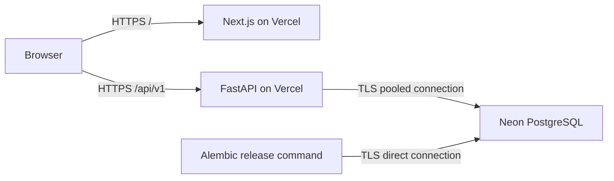

# Hosted fictional demonstration

Geevi deploys as one Vercel project from the repository root. `vercel.json` defines a Next.js web service and a
FastAPI service; `/api/v1/*` reaches FastAPI and all other paths reach Next.js. Both share one HTTPS origin.
Next.js uses its localhost API proxy only outside Vercel. Node.js is pinned to 24.x and Python to 3.13.

The hosted database is separate from local development and test databases. Only authored fictional fixtures are
loaded. Account passwords are generated privately; signatures and grants remain demonstration records.

## Environment variables

Set these in the Vercel project's production environment. Never put connection strings or account passwords in Git.

| Variable | Value / purpose |
|---|---|
| `GEEVI_DATABASE_URL` | Secret Neon pooled URL with TLS; the app normalizes it to the Psycopg driver |
| `GEEVI_SERVERLESS` | `true`; use short-lived connections without prepared statements |
| `GEEVI_COOKIE_SECURE` | `true`; HttpOnly, SameSite=Strict session cookies over HTTPS |
| `GEEVI_SAME_ORIGIN_WRITES` | `true`; accept the shared frontend/API host, including deployment URLs |
| `GEEVI_ALLOWED_ORIGINS` | `[]`; writes must pass the shared-origin check |
| `GEEVI_DEV_MODE` | `true` only for this explicitly fictional hosted demo |
| `GEEVI_MAX_UPLOAD_BYTES` | `2500000`; leaves room for base64 and JSON under the platform request limit |
| `GEEVI_MAX_ARCHIVE_BYTES` | `3000000`; small demo archives only |

The direct database URL is used locally for release migrations, never by the frontend and never as a build command.
Apply `uv run alembic upgrade head` in `apps/api` with `GEEVI_DATABASE_URL` set to the direct URL. Then explicitly
seed the hosted demo with `GEEVI_DEV_MODE=true`, `GEEVI_CREDENTIALS_FILE` pointing to a private ignored file, and
`uv run python scripts/seed_demo.py --load sources`. This loads unreviewed input documents and fictional accounts,
without fabricating research approvals, publications or clinical signatures. Keep the generated credentials file
with mode 0600 and share access deliberately. Do not reseed during builds; that would reset passwords.

## Release

Run API lint/tests, contract verification, frontend lint/typecheck/tests/build and browser journeys. Confirm the
deployment inputs with `vercel deploy --dry --json`: `.vercelignore` excludes local databases, environment files,
credentials, test gold and test output. Runtime demo inputs are packaged in `apps/api/app/demo_data/`.

Deploy with `vercel --prod` from the repository root. GitHub's default `main` branch is the production branch;
the Vercel Git integration deploys new main commits. Use separate databases for previews before enabling a preview
environment. Production credentials are intentionally not assigned to previews.

Verify the production alias, API health, anonymous access rejection, secure session cookie, authenticated patient
and document reads, same-origin writes and persistence after reload. Monitor Vercel deployment/runtime logs.
Real patient use, institutional identity, clinical validation and large-file storage are separate future work.

Platform references: [Vercel Services](https://vercel.com/docs/services),
[Services routing](https://vercel.com/docs/services/routing),
[FastAPI](https://vercel.com/docs/frameworks/backend/fastapi).
