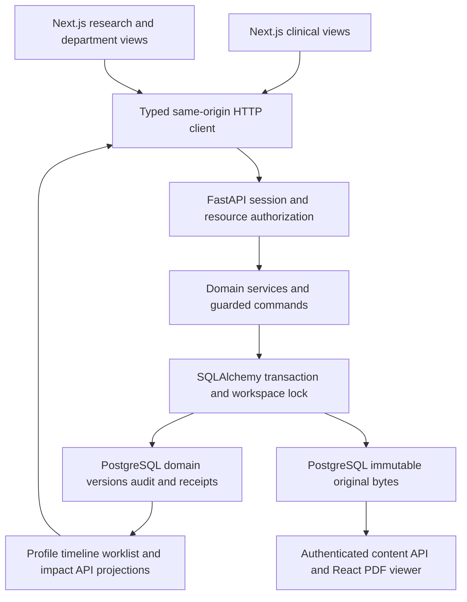
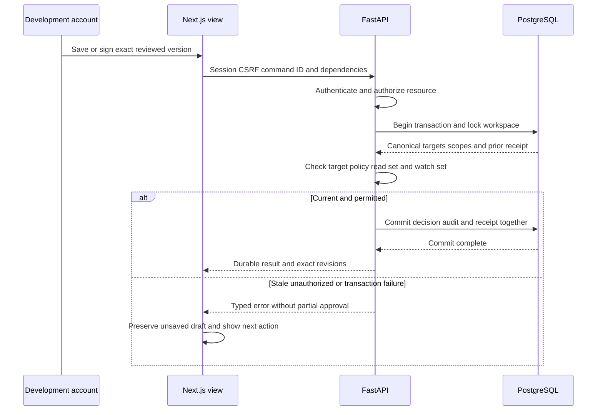
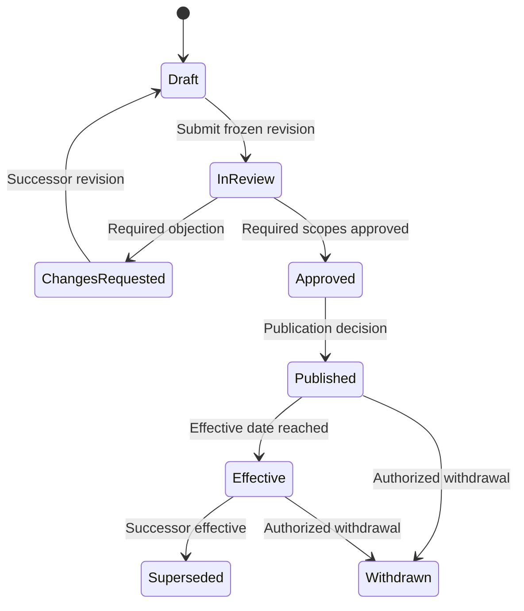
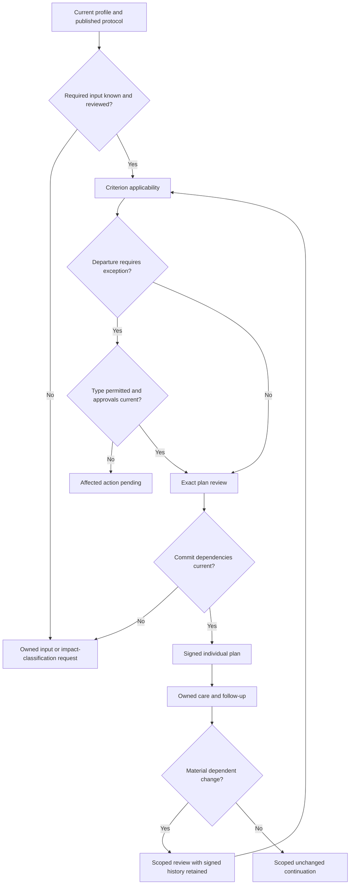
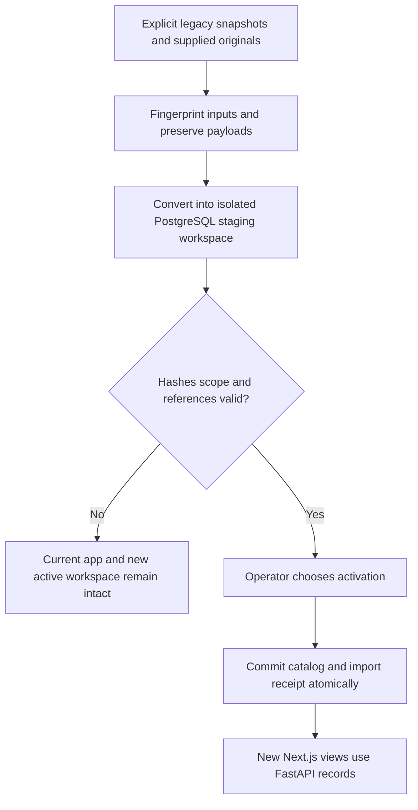

# Oncology Department Patient Journey - FastAPI and Next.js Plan

## Goal Capsule

- **Objective:** An oncology team can demonstrate a complete patient journey using shared, reviewed departmental knowledge, with accountable individual decisions, exceptions, care coordination and follow-up.
- **Means:** Build a new Next.js/TypeScript frontend and FastAPI backend, with PostgreSQL persistence, through KTD1–KTD10. The existing vanilla application supplies read-only behavior and data references.
- **Authority:** The Product Contract governs behavior. The Planning Contract governs its implementation. Unit approaches and examples must preserve both. Supporting research supplies evidence rather than additional scope.
- **Execution profile:** Implement U1–U14 as a complete fictional local full-stack demonstration. Institution-authorized clinical deployment is a separate follow-up milestone.
- **Completion owner:** The implementing agent supplies working changes, verification evidence and updated demo instructions. Clinical reviewers later assess clinical content and real-workflow suitability.
- **Stop conditions:** Do not invent medical criteria, silently lose original documents, fabricate historical approvals, or claim development accounts or workflow signatures provide institutional clinical authorization. A material contradiction with this contract requires an explicit explanation before scope changes.

---

## Product Contract

### Summary

Connect Meera's fictional AML episode from referral through independently sourced reports, review, shared protocol selection, a patient-specific exception, approved plan, accepted team work, actual care and follow-up. Arun independently uses the same departmental protocol. A later evidence review produces protocol v2 and separate impact decisions for both patients. One versioned departmental SOP governs case preparation and handoff.

The research workspace supports questions, structured evidence appraisal, named review and change proposals. Senior oncologists lead knowledge improvement; treating clinicians remain accountable for each patient. Reimplement the useful source-viewing, provenance and six-dimensional profile behavior in the new application; do not carry over the vanilla JavaScript runtime.

### Problem Frame

The current app links source review, patient applicability, prose plans and attributed session feedback, but its research and patient state live in separate browser stores. A patient plan is currently called a protocol, and no reusable departmental publication registry exists. Simplified fixtures mix reports, assessments and preferences, obscuring specimen, time and authorship. Broad case revisions create avoidable review work, while non-atomic persistence can lose changes across tabs or display success after a failed save.

The user explicitly requests a new application, prefers Next.js for the frontend and FastAPI for the backend, and rejects extending the vanilla stack. The requested improvement is shared expertise that remains traceable when applied to an individual, together with visible responsibility for unfinished work. Clinical effectiveness, staff adoption and protected research time remain hypotheses to validate with a partner department.

### Requirements

**Sources and patient context**

- R1. Keep patient, episode, encounter, specimen and report identities distinct, with namespaced external identifiers and explicit association review.
- R2. Preserve immutable source bytes, hash, author/issuer, source status, date precision and source regions for every extracted assertion.
- R3. Represent repeated specimen/assay-specific observations separately from the six-dimensional profile and clinician assessment.
- R4. Keep pending, untested, not detected, indeterminate, insufficient sample, unreported and unavailable distinct wherever they occur.
- R5. Record additive addenda, corrections, replacements and withdrawals through explicit version relationships; newest date alone never establishes supersession.
- R6. Historical profiles and decisions use the exact versions known at their knowledge cutoff, even when a later-arriving report describes an earlier event.
- R7. Track expected inputs before results exist, with an owner and next action; these records do not imply an order was issued or a test performed.

**Research and departmental knowledge**

- R8. Research questions and appraisals retain intended use, source passages, study context, limitations, reviewer assignments and disagreement history.
- R9. Accepting evidence for the library is a separate decision from approving or publishing a departmental protocol.
- R10. Protocol publication requires decisions against an immutable version under a named review-policy version, including the required independent actor.
- R11. Approved, published, effective, superseded, review-due and withdrawn states retain distinct meanings and dates.
- R12. A departmental SOP has its own versioned purpose, role-owned steps and review lifecycle, and tasks reference the exact applicable SOP version.
- R13. Shared protocol updates create separately owned patient impact reviews without automatically changing individual plans.
- R14. A research question may conclude insufficient evidence without publishing a protocol or issuing a patient recommendation.

**Individual decisions**

- R15. Patient applicability records criterion-level match, difference, unknown or not-applicable with rationale and exact supporting versions.
- R16. Patient-plan approval covers an exact plan, applicability, patient-discussion and exception decision set, with currency checked at durable commit.
- R17. Exceptions retain type, requested departure, exact patient/protocol/requirement scope, permitted approvers and expiry or review trigger; an exception never changes the shared protocol.
- R18. Missing required inputs and pending, rejected or expired required exceptions cannot satisfy the affected approval guard; explicitly independent preparation remains available.
- R19. Material changes create scoped review work while preserving signed history and current plan disposition until authorized clinical action.
- R20. Administrative task changes preserve unrelated approvals, whereas changes to an authored clinical obligation require the specified clinical review.

**Execution and follow-up**

- R21. Handoffs distinguish sent, received, accepted, returned, blocked and completed, with owner, due time and evidence of completion.
- R22. Planned events, actual care and transcribed external reports remain separate records with attribution and the historical plan/order reference used.
- R23. Concerns retain acknowledgement, response, escalation and review ownership; a notification does not constitute a response.
- R24. Routine follow-up is a separate obligation with scheduled, fulfilled, missed, rescheduled, cancelled and transferred dispositions.
- R25. A justified unchanged follow-up records a new encounter decision and next obligation while retaining the existing plan and unchanged accepted evidence.
- R26. Completing the demonstration or its tasks does not infer discharge, successful therapy, or completed transfer of clinical responsibility.

**Persistence, permissions and portability**

- R27. Successful writes are durable and atomic, duplicate commands are idempotent, and stale edits cannot silently overwrite newer state.
- R28. Fictional development actors authenticate to the backend and have server-enforced read/command capabilities; an administrator has no clinical authority by default and one actor cannot review their own work by changing roles.
- R29. Migration preserves current originals, provenance and legacy history, with retry/recovery that cannot activate a partially converted workspace.
- R30. A complete backup contains a versioned manifest, canonical records and original bytes; incomplete exports explicitly identify missing or corrupt originals.
- R31. Import validates schema, hashes, references and patient scope in a staging workspace before activation, preserving the current workspace on failure.
- R32. Keyboard navigation, focus, source links, error summaries and visible status updates work across the complete demonstration.
- R33. Synthetic workflow fixtures, public research references and authorized real evaluation records remain labelled and separate; unrelated real subjects are never combined.
- R34. All clinical policy and extraction-performance claims remain explicitly unvalidated until qualified review and an authorized real-data evaluation occur.

### Actors and fixed demonstration policy

| ID | Fictional actor | Demonstrated grants |
|---|---|---|
| A1 | Dr. Rao | Treating clinician, evidence author, protocol/SOP lead and publisher |
| A2 | Dr. Sen | Independent clinical reviewer and evidence reviewer |
| A3 | Mira | Coordinator and trained source reviewer within assigned transcription scope |
| A4 | Isha | Receiving care-team member, task acknowledgement and attributed care/concern entry |
| A5 | Patient/caregiver as an attributed source | Goals and concerns entered by an authorized demo actor; no patient portal |
| A6 | Development operator | Workspace import/export and recovery within granted scope; no clinical assessment, exception or publication authority |

The fixture policy requires Sen's approval and Rao's separate publication decision for protocol v1/v2. Mira cannot interpret findings or approve a clinical plan/exception. Isha records her own work or explicitly attributed external reports. Accounts represent fictional people; the backend authenticates sessions and enforces their development permissions. Clinical signatures remain demonstration records, not verified institutional signatures. Clinical exception review requires Rao and Sen where a fictional requirement explicitly permits that type of deviation. The main clinical-exception branch remains owned and pending. SOP review uses Sen as independent reviewer in the demonstration; no generic committee engine is required.

### Key flows

| ID | Trigger and sequence | Demonstrated outcome | Requirements |
|---|---|---|---|
| F1 | Rao opens question → cites sources → Sen reviews → disagreement resolved → protocol v1 and preparation/handoff SOP published | Reusable knowledge with exact versions and named approval | R8–R12, R14, R28 |
| F2 | Mira registers Meera → associates referral and separate reports → reviews source candidates → Rao assesses the case | Longitudinal profile with owned missing-input requests | R1–R7 |
| F3 | Rao applies v1 → documents goals → requests alternate operational arrangement → resolves that exception → approves exact plan | Individual decision linked to shared knowledge | R15–R20 |
| F4 | Mira assigns SOP-derived work → Isha accepts/returns → care recorded → concern acknowledged/responded → routine review completed unchanged | Actual follow-through and next obligation | R21–R26 |
| F5 | New research question → evidence review → protocol v2 → separate Meera/Arun impacts → one retains v1 and another adopts through a newly approved plan | Independent, reproducible adoption decisions | R8–R19 |
| F6 | Source correction or clinical obligation change → scoped impact → stale action blocked → authorized disposition | Historical signature retained with an explicit review-needed reason | R5, R16, R18–R20 |

Dates in fixtures are relative demonstration days, not recommended clinical timing. The alternate operational arrangement is an appointment-location preference, with documented patient discussion and clinician approval. It changes no medical treatment rule.

### Acceptance examples

- AE1. **Covers F1/F5, R10/R13/R16.** Given two plans refer to v1, publishing v2 creates two impacts. Resolving Meera's impact leaves Arun's open; recording adopt without a newly approved plan cannot close adoption.
- AE2. **Covers F2/F6, R5/R6/R19.** Given an approved plan used a report, a correction received later preserves the original and prior decision. The current profile reflects reviewed changes, while the earlier knowledge snapshot does not.
- AE3. **Covers F3, R17/R18/R28.** Given a required clinical deviation is pending, a coordinator/admin session or forged actor field cannot authorize it. Independent report preparation still works where its dependencies permit.
- AE4. **Covers F4, R22/R24/R25.** Given a scheduled session and unchanged follow-up, scheduling does not record delivery. After an attributed actual event and clinician review, the same plan remains and a new obligation appears.
- AE5. **Covers R16/R20/R27.** Given a plan form is open in one tab, an unrelated task update in another survives without staling clinical inputs. A relevant new result instead prevents the stale signature.
- AE6. **Covers R29–R31.** Given migration/import is interrupted or an original hash mismatches, the existing workspace remains usable and no completed migration or full-backup claim appears.

### Scope boundaries

U1–U14 build a new local full-stack application under `apps/web/` and `apps/api/`, with Next.js App Router, React, TypeScript, FastAPI and PostgreSQL. They include development-account sessions, backend access control, a minimal SOP, explicit draft save, report-specific/manual candidate entry, immutable approval packets, impact work and full demo backup/restore. All patient/research data remains fictional in this milestone.

**Deferred to follow-up work:** institutional identity/SSO and real-user qualification; real patient portal; EHR/FHIR integration and signed order/write-back; operational notifications outside the app; research cohort analysis; prospective study/consent administration; automated external literature retrieval; real model extraction/OCR and its evaluation; production security, deployment and operational backup/recovery. A shared transactional backend and development authentication are now in scope. Research questions/appraisals are implemented now; cohort export remains later.

**Outside this deliverable:** medical prescribing or dosing, clinical eligibility thresholds, automated diagnosis, image interpretation, autonomous triage, inferred treatment administration and research-study deviation approval. Do not fill clinical content with guesses.

**Considered and not built:** extending the vanilla application, Next.js-only business services, event-sourcing replay, microservices, configurable committee DSL, ZIP packaging, Redis/Celery and background safety monitoring. One FastAPI service and PostgreSQL meet the first journey's needs. Object storage and background jobs can be introduced when measured file/workload needs justify them.

### Supporting sources

The carried-forward product scope comes from `plans/oncology-department-journey/implementation-plan.md`, its data specification and acceptance matrix, and the user's request for a complete coding handoff. This plan supersedes the earlier document as the implementation authority; the earlier files remain audit/research inputs.

`research_oncologic_fit/findings_prototype.md` and `research_oncologic_fit/research_report.md` explain current behavior and the Oncologic comparison. `research_oncology_datasets/dataset-guide.md` and `research_oncology_datasets/samples/README.md` contain verified source access and sample provenance. Public [mCODE](https://hl7.org/fhir/us/mcode/) and [FHIR R4 report semantics](https://hl7.org/fhir/R4/diagnosticreport.html) shape the representation boundary; conformance is a later verified exchange task. The independently authored schema below does not copy restricted clinical reporting templates.

Architecture checks use official [Next.js server/client component guidance](https://nextjs.org/docs/app/getting-started/server-and-client-components), [FastAPI security documentation](https://fastapi.tiangolo.com/tutorial/security/), [SQLAlchemy transaction guidance](https://docs.sqlalchemy.org/en/20/orm/session_transaction.html) and [PostgreSQL row locking](https://www.postgresql.org/docs/current/explicit-locking.html), inspected on 11 October 2026. These support framework boundaries/transaction mechanics; the application architecture is the plan’s design choice.

---

## Planning Contract

### Existing prototype and new application boundary

The current `product/` application remains unchanged as a read-only reference. It is not the implementation base, a dependency of the new runtime, or evidence that the new stack already exists.

| Existing reference | Useful behavior/data | New application consequence |
|---|---|---|
| `product/aml-screen-walkthrough.html`, intake/dimension/protocol/session modules | Source links, six-dimensional profile, exact patient decisions and session feedback | Reimplement these behaviors in React and backend services |
| `product/evidence-review.html`, `research-lab.js` | Evidence passages and source review | Build connected research pages and API records |
| localStorage `casebook-intake-v1`, `casebook-research-lab-v1` | Existing fictional payloads and history | Import only explicit captured exports/snapshots; do not assume cross-origin browser access |
| IndexedDB PDF/image stores | Hash-addressed originals and geometry | Original files must be explicitly supplied and hash matched; leave old stores intact |
| `casebook-evidence-demo-v2`, earlier standalone route | Incompatible older demo | Preserve separately, exclude from automatic conversion |
| Existing PDF.js viewer and tests | Expected source navigation and past guard scenarios | Use as behavior references; do not import old IIFE modules or pretend old tests verify new code |

There are no existing FastAPI/Next.js manifests, migrations or tests in this baseline. All `apps/`, `contracts/`, `fixtures/`, Compose and CI files named below are planned additions. Verify supported framework/runtime versions from official documentation during bootstrap and commit lockfiles; the plan does not claim those dependencies are installed.

### Key technical decisions

- KTD1. **Build a new full-stack application.** Next.js App Router with React/TypeScript owns the frontend; FastAPI/Pydantic owns the API and domain behavior. Use `apps/web/` and `apps/api/` in this repository, preserving `product/` as a reference. (session-settled: user-directed — chosen over extending vanilla JavaScript: the user dislikes the existing stack and prefers Next.js and a FastAPI backend.) Governs R1–R34.
- KTD2. **PostgreSQL is the shared authority.** Use synchronous SQLAlchemy ORM sessions, Psycopg and Alembic with explicit domain/version tables, audit events, command receipts, dependency-scope revisions and import/recovery records. Keep blocking database work in synchronous FastAPI handlers/services. Store the small demo's immutable source bytes in a content-addressed `source_blobs` table using `bytea`; bytes and metadata can commit in one database transaction. Browser storage is not canonical. Implements R2/R27/R29.
- KTD3. **Transactional server commands.** Authenticate the caller; derive actor identity on the server. Each write has a command ID, workspace, action, target, expected entity revision and dependency packet. Acquire the workspace row lock before reading/checking dependencies; all material writes use this same lock, so a newly arriving relevant result cannot race a signature. Apply entity-level compare-and-set, domain guards, audit and the idempotency receipt in one transaction. Unrelated entity writes load current rows and survive; workspace sequence alone never makes a form stale. Hash/parse uploads before the short write transaction. Implements R16/R27/R28.
- KTD4. **Scoped currency with immutable review packets.** Freeze target versions, required assignments, policy and exact input read sets; watch-scope revisions catch new relevant material. Backend services compute/recheck these dependencies at commit. Ambiguous clinical changes create owned classification work. Frontend query freshness cannot authorize a signature. Implements R6/R16/R19/R20.
- KTD5. **Stable identity and immutable content.** Use UUID record/version identities plus issuer/system/value aliases. Published/reviewed content and decisions remain immutable; amendments create successors. Mutable assignments and inbox metadata stay outside signed content. Version packets use deterministic server serialization and a content digest, with clinical decimal/date precision preserved. Implements R1/R5/R10/R16.
- KTD6. **Development sessions and explicit policy.** Seed separate fictional accounts for A1–A4 and A6. Use server-side opaque sessions with hashed session tokens, HttpOnly/SameSite cookies, expiry/revocation and CSRF/Origin checks for writes; HTTPS uses Secure cookies. Credentials live in ignored local configuration, password hashes use a maintained Argon2 implementation, and demo seeding is disabled outside explicit development mode. Enforce resource scope on reads/downloads and capability/independence on commands. No client actor/role header grants authority. Default requirements are non-waivable; exception grants are requirement-specific. Implements R10/R17/R18/R28.
- KTD7. **Disposition and review currency remain separate.** Preserve signed plan history, active/held/completed/superseded disposition and current/review-needed status. Targeted impacts block dependent new signatures/handoffs, while historical care and unaffected logistics remain recordable. Implements R19–R22.
- KTD8. **Portable domain archive.** Retain the versioned JSON/base64 manifest for small fictional data; include all domain records, histories, receipts, recovery evidence and original bytes. Never export passwords, sessions or server secrets. Restore into a separate staging workspace container with scoped record IDs, preserving original logical IDs/content digests; references remain within that container. Imported signer identities/history do not grant current account permissions. Activate only after validation and an operator choice. Implements R30/R31.
- KTD9. **One typed HTTP boundary and explicit saves.** Generate TypeScript schema types from FastAPI OpenAPI; one typed frontend client handles requests and error mapping. Use TanStack Query for server state and React local state for unsaved drafts. Keys include workspace/patient/episode. Refetch on focus and after successful commands; other sessions can refresh before acting. All writes revalidate on the backend. Preserve draft text on conflict/network failure; clear sensitive query state on logout/account change. No optimistic approval, no localStorage record authority, no shared Next.js cache of patient data. Implements R16/R27/R32.
- KTD10. **Same-origin interface, single business-rule owner.** Next.js provides pages/layouts/client interactions and a documented `/api/v1` proxy to FastAPI. It implements no parallel workflow backend or direct database writes. FastAPI routes delegate to services/domain guards; OpenAPI, scripts and future agents call that same boundary. Keep imports/source text non-executable and authenticated source bytes behind the API. Implements R16/R27/R28/R32.

One service and a workspace write lock are sufficient for this small demonstration. The lock is a deliberate simple serialization point; retain per-entity revisions to avoid unrelated-data loss or blanket staleness. Fine-grained locking/object storage require measured need, not speculative infrastructure. KTD1 is user-directed; remaining choices implement that stack within the existing patient/governance contract.

### Repository layout and run boundary

```text
apps/
  web/                 Next.js App Router, TypeScript, UI and generated API types
  api/                 FastAPI app, domain/services, SQLAlchemy models, Alembic, pytest
contracts/             Generated OpenAPI artifact and API-contract checks
fixtures/
  department-journey/  Fictional input files, manifest, scenario and separate gold
scripts/               Contract generation/check and controlled demo setup
infra/                 Development Dockerfiles and environment examples
compose.yaml           Local database, migrations, API and frontend
product/               Existing vanilla prototype; preserved reference only
```

Use pnpm for frontend/workspace scripts and uv for Python dependencies; commit `pnpm-lock.yaml` and `apps/api/uv.lock`. Choose compatible stable versions during U1 and record them in runtime/toolchain files. Use local frontend port 3000, API port 8000 and PostgreSQL host port 5433 by default; the database container uses 5432. These do not replace the legacy demo on port 8765. Loopback-only development bindings avoid public exposure. Compose health checks and a one-shot Alembic service precede API startup. No hosted service or deployment is required.

### Data relationships and minimum record contracts

All records retain internal identity, workspace scope, content/version identity, creation/recording time and attribution where applicable. External unknown values remain unknown. The rows below define required information, not exact Python/TypeScript signatures.

| Record | Minimum contract and relationships |
|---|---|
| Patient / Episode / Encounter | Namespaced identifiers; patient association; service/team owner; actual/planned timing; episode ongoing/closed/transfer-pending/transferred status with explicit disposition |
| SourceBlob / SourceDocumentVersion | Immutable bytes/hash/length/type; issuer/author/external ID; received time; document family/version; extraction limits and original availability |
| ReportFamily / ReportVersion | Issued accession/issuer; type/status; specimen and source-file references; effective/issued/amendment times; relation kind and affected predecessor assertions |
| Specimen / AssayContext | Patient, collection event/material/site, aliases/parts/parent, collection/receipt times; test/panel/method/target scope and reported limitations |
| ObservationVersion | Report/specimen/assay; exact wording; typed reported value/units/range when present; test/result/missingness state; effective time; page/region/span; normalization provenance |
| ExpectedInput | Patient/episode, expected artifact, upstream request only if known, pending/received/failed/cancelled/unknown state, owner, next action and linked fulfilled report |
| ExtractionCandidate / SourceReview | Extractor/version, source support and candidate assertion; verified/corrected/rejected/unresolved disposition, reviewer and reason; local correction does not reissue the lab report |
| ClinicalAssessment / PatientDiscussion | Attributed encounter assessment, evidence, uncertainty/classification edition when stated; patient goals/preferences, participants and discussion version; consent reference only when documented |
| ProfileSnapshot | Exact fact/assessment versions, unresolved items, six-dimensional projection, clinical-time view and knowledge cutoff |
| ResearchQuestion / EvidenceSourceVersion | Question/scope/intended use and owner; citation/file/hash, passages, status and source amendments/withdrawal |
| EvidenceAppraisal / ReviewAssignment / ReviewDecision | Population/intervention/comparator/outcome/timepoint and study design as reported; findings/uncertainty/limitations; packet/policy/actor/scope, decision/rationale and superseding decisions |
| ChangeProposal | Target family/base version, proposed revision/diff, rationale, evidence references, assignments and disposition |
| ProtocolTemplateVersion | Department/owner/scope, evidence versions, stable requirements, watch scopes, applicability branch, waiver policy, review/publication/effective/review dates |
| SOPVersion | Purpose, operational steps, roles, expected completion evidence, escalation destination, review decisions and effective version; optional explicit protocol-version relation |
| ApplicabilityReview / ReviewPacket | Patient/episode/profile and protocol versions; criterion assessments; target digest/version; required assignments; read set and watched scope revisions |
| PatientPlanVersion / PlanDisposition | Individualized documented intent, alternatives/rationale, primary protocol, applicability, discussion and exception decisions; previous version and exact approval; disposition changed separately |
| ExceptionRequestVersion / ExceptionDecision | Departure/type/requirement, patient/episode/protocol/plan scope, evidence/rationale; required approvals; expiry or review trigger and non-waivable boundaries |
| Task / Handoff | SOP/plan references, action/owner/due/dependencies; sent/received/accepted/returned/blocked/completed/cancelled history, reason and completion evidence |
| PlannedEvent / CareEvent | Planned request/appointment separated from performed/partial/deferred/not-performed/unknown actual record; actual time, source, performer/transcriber and historical plan/order references |
| Concern / Response | Reported symptom or question as attributed narrative; acknowledged/responded/escalated/reviewed/closed history, responsible service and unresolved duties |
| FollowUpObligation / EncounterDecision | Purpose/owner/due/precision/dependencies; schedule and disposition; clinical review input packet, continue/revise/more-information/unresolved decision and next obligation |
| ImpactReview | Change-event identity, exact affected patient plan/scope, owner/review trigger; open/assigned/disposition/closed state; retained/adopted/not-applicable/more-information evidence |
| AuditEvent / CommandReceipt / RecoverySnapshot | Actor/action/target versions/reason/time; command identity/input digest/durable result; archive/migration source fingerprint, preserved legacy payload and validation state |

Store collection, receipt, clinical effective/event, report issue, local arrival, review and decision time separately. Relative dates carry value/unit/anchor/precision and deidentification basis; unrelated anchors cannot become a fabricated common calendar. Report version and source-file version are many-to-many. One specimen can have multiple assays; a panel can contain multiple observations. A patient summary is a projection over these records, not their schema.

### High-level technical design

**Component and data flow — KTD1–KTD4:**



**Approval protocol — R10/R16/R27:**



**Publication lifecycle — R10/R11:**



Effective/superseded are version-selection projections over recorded publication/effective dates; visiting a page never creates an unrecorded approval. Review due creates owned work and is not automatic expiry. Withdrawn versions cannot support a new plan selection; historical dependants receive review under R19.

**Patient decision gates and change handling — R15–R20:**



**Migration lifecycle — R29/R31:**



### Command and guard matrix

Command names are domain actions, not mandated function signatures. Typed failures include actor not permitted, stale target/dependency, required input/review absent, unresolved objection, expired/withdrawn scope, unavailable original, invalid association, duplicate-ID payload mismatch and storage failure. Each failure identifies the target and next resolvable action.

| Action family | Actor / input | Guard / resulting records |
|---|---|---|
| Associate/import report | Mira or Rao authenticated account; identity, parsed source, blob and report/specimen relation | R1/R2; commit original and metadata together; unresolved identity stays quarantined |
| Verify candidate | Assigned source reviewer; candidate/source versions | Original available and cited; append R2/R4 source review, never clinical interpretation |
| Submit/review evidence | Rao/Sen; appraisal packet and scope | Current source support; append scope decision; accept only when required objections resolved |
| Publish protocol/SOP | Rao; approved packet and effective date | R10–R12/R28; freeze content; protocol successor nominates R13 impacts atomically |
| Assess applicability | Rao; criterion facts, protocol and discussion | R15; required unknowns remain visible, not converted by exceptions |
| Resolve exception | Actor permitted for type; exact request and policy | R17/R18; append decision; no side effect approving plan |
| Approve plan / continue | Rao; exact packet or encounter review | R16/R18/R19/R25; validate read/watch sets; append plan or scoped continuation respectively |
| Assign/accept/complete work | Mira/Isha/Rao within grants; task dependencies | R20/R21; repeated commands deduplicate; dependent unresolved clinical scope blocks only its affected dispatch |
| Record actual care | Permitted team actor; event/source/historical reference | R22; reporting old care does not reactivate its plan |
| Respond/review concern | Assigned team and clinician; concern history | R23; unresolved escalations remain owned |
| Fulfil/miss/reschedule follow-up | Assigned service; obligation and decision | R24/R25; clinical schedule change follows authored obligation dependency, not a generic deadline edit |
| Resolve impact | Rao; change identity and disposition | Adoption closes only with linked approved successor plan; more information stays open; unaffected/not-applicable needs rationale |
| Export/import/migrate | A6 development operator or explicitly granted account; archive/legacy fingerprint | R29–R31; validate before activation, preserve failure state and prior workspace |

### API and trust-boundary contract

Expose versioned `/api/v1` resources for sessions, workspaces, patients/episodes, sources/results, research, protocols/SOPs, applicability/plans/exceptions, care/tasks/concerns/follow-up, impacts and archives. Use ordinary read endpoints and explicit POST domain-action endpoints for review, publication, approval and handoff. Do not allow generic PATCH to set approval/publication state.

FastAPI owns validated Pydantic request/response schemas and OpenAPI. Mutations carry a command UUID/idempotency key and exact expected versions; packet dependencies are checked against server records. Stored receipts are unique by workspace container and command ID. Payload identity includes the authenticated actor; duplicate IDs with changed payload/actor fail. Repeated successful commands return their receipt after current resource access is verified. Unrelated entity updates do not fail merely because workspace sequence advanced.

Return structured errors with code, safe message, target, permitted next action and authorized current-version/conflict details. Use 401/403 for authentication/capability failure, 409 for stale versions or conflicting command IDs, validation errors for unsupported input, and a non-success response on commit failure. A network timeout leaves the outcome unknown: retry the same command ID and then inspect its receipt. Never retry a signature under a fresh ID automatically.

Source upload/download, snapshots, archive validation and activation have the same workspace/resource access checks as clinical records. Reject active HTML/SVG and unsupported file types; bound input/archive size in configuration, check decoded byte length/hash and serve originals with safe content headers. Render narrative/source text as text, never unsanitized markup. Patient responses and authenticated source content use no-store/private behavior; patient query keys cannot omit workspace or patient identity. Logs carry operation IDs and error codes, not source bodies/passwords/tokens. Accounts, sessions and capability grants are not imported from archives.

### Scoped invalidation and defaults

The read set contains known input versions; the watch set contains revisions for relevant report families, observation selections, assessments, patient preferences, accepted evidence and protocol requirements. A new relevant result therefore cannot evade review merely because it was absent from the earlier read set. Unclassified incoming clinical material opens an owned classify-impact item before affected new approval. Reopening an evidence/applicability draft does not revoke the accepted version or earlier plan.

Addenda specify additive/corrective/replacement scope. An additive finding does not delete unaffected assertions. A local transcription correction changes app assertion history, not laboratory issuance. An ambiguous predecessor remains unresolved. No generic NLP materiality detector is introduced.

Impact identity is change-event + patient/episode + plan version + scope. Duplicate delivery returns the same impact; a new change retains its distinct reason. An authorized retain-v1 disposition carries reason/review trigger where policy permits. Seek-more-information remains open. Exception expiry blocks future actions in its required scope and nominates impacts; completed historical care remains intact. Withdrawal never issues an automatic treatment-stop instruction.

### Storage, legacy import and archive specifics

Model the 23 record groups as explicit SQLAlchemy identities/version relationships, with relational scope/foreign-key constraints and JSONB for versioned structured content where appropriate. Keep content revisions, decisions, audit events and command receipts append-only through normal application paths. `source_blobs` retains immutable SHA-256-addressed bytes, length and media type; all access resolves through an authorized source association. Scope revisions and an affected-record index support impact projection. A physical workspace container namespaces logical record IDs, so a restored archive can preserve signed logical IDs while the active container remains intact.

The old app remains usable and unchanged. The new origin cannot directly read its localStorage/IndexedDB. U2 accepts explicit exported packets or captured JSON snapshots of supported old stores plus user-supplied original files. Match originals by exact hash, not filename. Preserve raw payloads/fingerprint and unmapped legacy history. Existing exports may omit original bytes or full state: identify this limit, request the exact originals/snapshot where available, and never claim complete migration from an incomplete packet. No automatic merge or old-origin access workaround is part of the plan.

Imported legacy prose approvals remain legacy/unmapped; they cannot become reviewed shared publications or fresh clinical signatures. Missing/corrupt originals remain unavailable and dependent review/approval cannot treat them as verified. Interrupted staging retains the prior active workspace and old app. Conversion/activation receipts are idempotent by command and source fingerprint; recheck staged versions on activation. A later legacy export is a new explicit import choice, never a silent merge. The older `casebook-evidence-demo-v2` format is excluded.

Full archives include schema/archive versions, logical workspace identity, container provenance, snapshot revision/time, fictional/real labels, all domain/version/approval/audit records, receipts and recovery evidence, and original hash/length/type/base64 entries. Take a consistent database read snapshot; secrets, password hashes and sessions are excluded. A review-only packet remains explicitly incomplete as a backup. Import validates size/schema/hashes, scoped references and identity into a separate staging container; no archive can grant live permissions or rewrite active records. Activation is a distinct operator command after validation. Restored histories retain provenance; they are not evidence that an external signature was institutionally authenticated.

### Fixture and dataset contract

Create `fixtures/department-journey/` with independently authored fictional records and separate gold annotations. The API imports input files through a development fixture loader. Gold files are test-only, never served by the frontend or read by runtime extraction to manufacture successful results.

| Required source | Relationship exercised |
|---|---|
| Referral / first consult | Episode/history/source authorship |
| Repeated blood-result panels | Timed values, units and trend without overwrite |
| Marrow report with separate parts | Specimen-to-assertion source association |
| Flow, cytogenetic and molecular reports | Independent assays/status/limitations and delayed expected inputs |
| Additive addendum and correction variation | Explicit predecessor scope and targeted impacts |
| Clinical assessment and patient discussion | Interpretation/preferences outside laboratory observations |
| Plan/handoff and actual-care record | Intended versus performed and historical plan references |
| Follow-up results plus concern/response | Routine review versus reactive concern and next obligations |

Use Meera and Arun without joining real study subjects. Seed one fictional pathway and SOP for workflow validation only. Requirements cover reviewed identity/context and patient discussion, with an authored operational venue branch; clinical eligibility/therapy content remains absent and visibly unvalidated. Synthetic expected outputs cover unknowns, wrong identity, duplicate files, image-only/manual review and a pending permitted clinical-exception branch. Relative days and due triggers illustrate workflow only.

The saved BeatAML2 workbook informs patient/specimen/assay/missingness structure, not administered treatment chronology. Its cumulative regimen list is unordered. The saved GDC report informs report sections and multi-specimen handling; it is lung cancer. Neither is imported into Meera's chart. Public standards examples guide relationships, not medical plausibility. Preserve reference licences and do not embed CAP's restricted template dictionary. Detailed access evidence remains in `research_oncology_datasets/dataset-guide.md`.

### Sequencing and deferred implementation details

U1 establishes the new stack, database/migrations, API contracts, development sessions and transaction boundary. U3 creates the source/profile schema needed by U2's legacy conversion. Then U2 supports explicit import and U4 supplies coherent fixtures; U5/U6 implement evidence and departmental publication; U7/U8 implement individual decisions; U9/U10 implement execution/follow-up; U11 implements change impacts; U12 integrates the complete UI; U13 adds archive restore; U14 verifies the journey. Execute U3 before U2; identifiers stay stable.

Each domain unit owns its Python models/schemas/services/routes and its typed React feature components. U12 owns shared navigation/layout, query/session providers and route integration; it does not own other units' domain modules. Declare file ownership if delegating and accommodate others' edits. Backend domain services never import frontend code; frontend components never embed a competing approval engine.

Routine component layout, internal helper signatures and exact compatible package versions are implementation choices within these contracts. Record/pin toolchains in U1. Production identity, real-data use and institutional workflow qualification remain separate milestones. No new application source is written by this planning task.

---

## Implementation Units

Every file below is a planned new-app target unless explicitly identified as a reference. Do not modify the legacy `product/` application. Python paths abbreviated after `apps/api/app/` remain within that tree; TypeScript paths remain within `apps/web/src/`. Preserve U1–U14 identifiers.

| Unit | Outcome | Depends on |
|---|---|---|
| U1 | New application, database and guarded API | None |
| U3 | Source records and longitudinal profile | U1 |
| U2 | Explicit legacy import and original preservation | U1/U3 |
| U4 | Fictional source pack and scenario fixtures | U3 |
| U5 | Research questions and evidence appraisal | U1/U3 |
| U6 | Shared protocol and departmental SOP | U5 |
| U7 | Applicability and scoped review currency | U3/U6 |
| U8 | Exceptions and exact patient-plan approval | U7 |
| U9 | Handoff tasks and actual care | U8 |
| U10 | Concerns and routine follow-up | U9 |
| U11 | Knowledge change and independent patient impacts | U7/U10 |
| U12 | Connected Next.js screens and session-aware UI | U2/U4–U11 |
| U13 | Complete archive and staged restore | U2/U12 |
| U14 | Integrated verification, CI and implementation guide | U12/U13 |

### U1. New application, database and guarded API

**Goal:** Both applications run from clean setup and all writes cross an authenticated durable server boundary.

**Requirements:** R16/R27/R28; KTD1–KTD6/KTD9/KTD10.

**Dependencies:** None.

**Files:** `compose.yaml`, `package.json`, `pnpm-workspace.yaml`, `infra/`, `apps/web/package.json`, `apps/web/next.config.ts`, `apps/web/src/lib/api/`, `apps/api/pyproject.toml`, `apps/api/app/main.py`, `core/`, `db/`, `models/identity.py`, `schemas/commands.py`, `services/command_service.py`, `api/routes/sessions.py`, `apps/api/alembic/`, lockfiles; tests `apps/api/tests/test_commands.py`, `test_auth.py`, `test_transactions.py`.

**Approach:** Bootstrap the requested stack with pinned compatible dependencies. Configure one PostgreSQL authority, Alembic startup ordering, same-origin API proxy, OpenAPI generation, development-account sessions, CSRF/resource access and the KTD3 command transaction. Include a minimal health/session/safe example command to verify the full boundary before feature wiring.

**Patterns:** Split-store failures motivate the new transaction boundary; old IIFE/Node modules are behavior references only.

**Test scenarios:**
1. Identical command returns one receipt; changed payload/actor under the same ID fails.
2. Two clients update distinct tasks without loss; same-entity revisions conflict.
3. A relevant watched change committed before signature makes signing fail; an unrelated task change does not.
4. Commit/connection failure creates no partial approval; same-ID retry resolves unknown outcome.
5. Unauthenticated, unauthorized, cross-workspace and CSRF-invalid requests fail below the UI; client actor headers cannot grant authority.
6. Clean Compose startup runs migrations before the API and exposes only loopback development services.

**Verification:** pytest uses real isolated PostgreSQL for locking/concurrency; API contract and frontend type checks pass. Runtime versions and setup are recorded.

### U2. Explicit legacy import and original preservation

**Goal:** Existing fictional data can be imported without modifying the old app or fabricating governance.

**Requirements:** R2/R6/R29/R31; KTD1/KTD2/KTD5/KTD8.

**Dependencies:** U1/U3.

**Files:** `apps/api/app/services/legacy_import.py`, `schemas/imports.py`, `models/imports.py`, `api/routes/imports.py`, Alembic revisions; `apps/web/src/features/imports/LegacyImportWizard.tsx`; `apps/api/tests/test_legacy_import.py`, `apps/web/tests/e2e/legacy-import.spec.ts`.

**Approach:** Accept explicit supported snapshots/export packets and exact supplied originals. Preserve raw payload/fingerprint, convert into staging, show incomplete/unmapped state, validate and explicitly activate. Exclude the older independent demo format. Never read old-origin storage implicitly or alter the legacy app.

**Patterns:** Legacy source hash/geometry and approval history inform conversion; incomplete export does not imply a full backup.

**Test scenarios:**
1. Meera/Arun payloads and supplied original bytes retain identity/provenance/geometry.
2. Metadata-only export cannot claim complete migration; missing originals stay unavailable.
3. Legacy prose plan remains unmapped and cannot become a published shared protocol.
4. Interrupted/retried staging never replaces active records or duplicates activation.
5. Wrong original hash or unsupported older format fails; legacy app/state remains untouched.

**Verification:** An explicit imported workspace reloads from PostgreSQL, opens matching bytes and retains all unmapped/incomplete disclosures.

### U3. Source records and longitudinal profile

**Goal:** Independent sources produce reviewable timed patient context in the new application.

**Requirements:** R1–R7/R33; KTD1/KTD4/KTD5.

**Dependencies:** U1.

**Files:** `apps/api/app/models/sources.py`, `schemas/sources.py`, `services/sources.py`, `services/profile.py`, `api/routes/sources.py`, `api/routes/patients.py`, Alembic revisions; `apps/web/src/features/sources/SourceViewer.tsx`, `SourceReview.tsx`, `apps/web/src/features/patients/ProfileTimeline.tsx`; `apps/api/tests/test_sources.py`, `test_profiles.py`, `apps/web/tests/e2e/source-review.spec.ts`.

**Approach:** Model patient/episode/encounter/report/specimen/assay/observations/expected inputs and versioned source reviews. Add bounded report-specific candidate extraction and a manual unsupported path. Use a client-only PDF.js adapter with a pinned local worker and authenticated content endpoint; preserve exact coordinates and historical cutoff projections.

**Patterns:** Old viewer/source links and six-dimensional snapshots specify expected behavior, not reusable runtime modules.

**Test scenarios:**
1. Same accession from different issuers stays distinct; wrong-patient source is quarantined.
2. Multi-specimen finding opens the exact original region.
3. Negative/pending/untested/insufficient/unreported remain distinct.
4. Additive versus corrective reports preserve affected and unaffected assertions correctly.
5. Later specimen does not overwrite earlier data; late-arriving report cannot leak into a prior knowledge snapshot.
6. Expected input exists before a result and only its linked report fulfils it.
7. Unauthorized source download and active HTML/SVG upload fail.

**Verification:** Profile/version tests and rendered PDF/image source navigation pass without a clinical extraction-accuracy claim.

### U4. Fictional source pack and scenario fixtures

**Goal:** The complete journey has coherent separate inputs and independent expected outputs.

**Requirements:** R3–R7/R33/R34; F2–F6; KTD1.

**Dependencies:** U3.

**Files:** `fixtures/department-journey/manifest.json`, `inputs/`, `gold/`, `scenario.json`, `README.md`; `apps/api/scripts/make_fixtures.py`, `seed_demo.py`, `apps/api/app/services/fixture_loader.py`, fixture dependency group; `apps/api/tests/test_fixtures.py`.

**Approach:** Author the source pack/policy and native PDFs plus an image-only/manual variation. Declare ReportLab in the appropriate locked dependency group. Backend demo loader reads approved input paths only, never gold. Seeding creates fictional accounts/source context, not fabricated clinical approvals; UI actions complete the journey.

**Patterns:** Existing fixture examples inform source layouts; BeatAML/GDC remain separate references.

**Test scenarios:**
1. All manifest/source/time-anchor references resolve without runtime gold access.
2. Inputs are visibly fictional, never joined to real cohort subjects.
3. Duplicate/amended/later/unsupported variants have independent expected behavior.
4. Gold and arbitrary local paths cannot be fetched through the API; development seeding is unavailable outside explicit demo mode.

**Verification:** Fixture validation is reproducible. Clinical content remains explicitly unvalidated pending qualified review.

### U5. Research questions and evidence appraisal

**Goal:** Evidence is reviewed independently of patient approval and protocol publication.

**Requirements:** R8/R9/R14; F1/F5; KTD1.

**Dependencies:** U1/U3.

**Files:** `apps/api/app/models/research.py`, `schemas/research.py`, `services/research.py`, `api/routes/research.py`, Alembic revisions; `apps/web/src/features/research/`; `apps/api/tests/test_research.py`, `apps/web/tests/e2e/research-review.spec.ts`.

**Approach:** Implement questions, intended use, structured appraisal, passages, assignments, immutable review packets, disagreements and insufficient-evidence completion. Search remains local/imported evidence. Retain keyword extraction limits and exact cited versions.

**Patterns:** Current research passages/viewer and decision snapshots supply behavior references.

**Test scenarios:**
1. Sen accepts a cited appraisal without publishing a protocol or approving Meera.
2. Missing independent reviewer or unresolved required objection blocks acceptance.
3. Reopened draft retains the earlier accepted version.
4. Source amendment/withdrawal creates dependent review work.
5. Insufficient-evidence conclusion produces no patient recommendation.

**Verification:** Research records and source links reload through the same API/database as patient records.

### U6. Shared protocol and departmental SOP

**Goal:** One independently reviewed protocol serves both patients and a separate SOP governs operational work.

**Requirements:** R9–R13/R28; F1/AE1; KTD1/KTD5/KTD6.

**Dependencies:** U5.

**Files:** `apps/api/app/models/department.py`, `schemas/department.py`, `services/protocols.py`, `services/sops.py`, `api/routes/department.py`, Alembic revisions; `apps/web/src/features/department/`; `apps/api/tests/test_protocols.py`, `test_sops.py`.

**Approach:** Implement proposals, frozen revisions, required assignments, independent review, publication/effective dates, successors and withdrawal. Stable requirement IDs carry supporting scopes and waiver rules. SOP steps produce task specifications, not clinical orders. Reserve an atomic publication impact hook completed in U11.

**Patterns:** Exact existing approval behavior becomes server-owned review/publication logic.

**Test scenarios:**
1. Sen approval and Rao publication produce v1; absent/rejected review blocks it.
2. Same account cannot satisfy independence by changing roles or client fields.
3. Future-effective approved content cannot change under earlier signatures.
4. Review due does not imply expiry; withdrawn content cannot support new selection.
5. SOP revision leaves clinical protocol and old task version links intact.

**Verification:** Meera/Arun reference one immutable shared version through independent application records.

### U7. Applicability and scoped review currency

**Goal:** Relevant changes alone create accountable patient decision review.

**Requirements:** R6/R15/R16/R18–R20; F3/F6/AE2/AE5; KTD1/KTD3/KTD4.

**Dependencies:** U3/U6.

**Files:** `apps/api/app/models/reviews.py`, `schemas/reviews.py`, `services/applicability.py`, `services/review_dependencies.py`, `api/routes/applicability.py`, Alembic revisions; `apps/web/src/features/plans/ApplicabilityReview.tsx`; `apps/api/tests/test_applicability.py`, `test_review_dependencies.py`.

**Approach:** Freeze profile/protocol/applicability packets and dependency/watch scopes. Derive indexes server-side and recheck them under the shared command lock. Classify ambiguous incoming material explicitly. Preserve disposition, signed history and accepted versions while drafts reopen.

**Patterns:** Old profile capture and unchanged continuation demonstrate the intent; broad case-revision shortcuts are not retained.

**Test scenarios:**
1. Unknown stays unknown; not-applicable needs an attributed rationale.
2. New relevant result not in an old read set blocks stale signing through its watch scope.
3. Task-owner edit preserves clinical review; clinical-obligation edit opens targeted work.
4. Reopened applicability draft retains accepted version.
5. Fact correction affects only dependants and preserves historical care.

**Verification:** Currency explanations identify the exact change/owner; direct HTTP concurrency proves server guards.

### U8. Exceptions and exact patient-plan approval

**Goal:** Permitted exceptions and patient discussion support an exact individual decision.

**Requirements:** R16–R19/R28; F3/AE3; KTD1/KTD3/KTD6.

**Dependencies:** U7.

**Files:** `apps/api/app/models/plans.py`, `models/exceptions.py`, `schemas/plans.py`, `schemas/exceptions.py`, `services/plans.py`, `services/exceptions.py`, `api/routes/plans.py`, `api/routes/exceptions.py`, Alembic revisions; `apps/web/src/features/plans/`, `apps/web/src/features/exceptions/`; `apps/api/tests/test_plans.py`, `test_exceptions.py`.

**Approach:** Implement typed scoped requests and decisions; pin the plan to exact applicability/protocol/discussion/exception versions. Save, submit/review and sign are separate backend actions. Retain the previous signed plan during draft work; signatures are never optimistic frontend state.

**Patterns:** Existing exact draft/previous-plan constraints become immutable server records.

**Test scenarios:**
1. Permitted venue preference receives review and supports Meera’s exact plan.
2. Exception alone cannot approve a plan; edited request needs new decisions.
3. Pending/rejected/expired clinical exception blocks its affected action while independent preparation remains possible.
4. Identity/non-waivable scope cannot be bypassed by coordinator/operator or forged fields.
5. Expiry preserves historical care and creates future review.
6. Concurrent material change prevents a partial or stale signature.

**Verification:** Individual plan, rationale, discussion and exception scope are inspectable; shared v1 remains unchanged.

### U9. Handoff tasks and actual care

**Goal:** The care team accepts work and separately documents what happened.

**Requirements:** R20–R22/R26; F4/AE4; KTD1.

**Dependencies:** U8.

**Files:** `apps/api/app/models/care.py`, `schemas/care.py`, `services/care.py`, `api/routes/care.py`, Alembic revisions; `apps/web/src/features/care/`; `apps/api/tests/test_care.py`, `apps/web/tests/e2e/handoff.spec.ts`.

**Approach:** Instantiate SOP tasks with owner/dependencies and receipt history. Separate scheduled events, actual care and external transcription. Keep authorized historical plan/handoff references for past-care recording.

**Patterns:** Existing receipt/session attribution informs new API-owned history.

**Test scenarios:**
1. Sent handoff stays unaccepted until Isha acts; returned/blocked work retains owner/reason.
2. Scheduling creates no delivery assertion.
3. Performed/partial/deferred/unknown care preserves source/time.
4. External performer and transcribing account remain distinct.
5. Late event references older plan without reactivating it.
6. Pending transfer retains original responsibility until explicit receipt.

**Verification:** Worklist/timeline show planned, accepted and actual activity after server/browser restart.

### U10. Concerns and routine follow-up

**Goal:** Reactive concerns and scheduled reviews both produce accountable follow-through.

**Requirements:** R23–R26/R19; F4/AE4; KTD1.

**Dependencies:** U9.

**Files:** `apps/api/app/models/follow_up.py`, `schemas/follow_up.py`, `services/follow_up.py`, `api/routes/follow_up.py`, Alembic revisions; `apps/web/src/features/follow-up/`; `apps/api/tests/test_follow_up.py`, `apps/web/tests/e2e/follow-up.spec.ts`.

**Approach:** Keep concern/response and obligation/encounter decision separate. Escalation names a demo service without medical triage inference. Continue unchanged only after guarded review; changes use U8. Maintain missed/rescheduled/cancelled/transferred history and next duty.

**Patterns:** Old explicit continuation/reassessment preserves approved-plan identity when unchanged.

**Test scenarios:**
1. Acknowledged concern without response stays open and owned.
2. Routine review needs no concern, retains plan ID and creates next obligation.
3. Required unresolved input/expired exception blocks unsupported continuation.
4. Missed review retains unknown outcome and history through reschedule/transfer/cancellation.
5. Clinical schedule change uses scoped review; administrative deadline edit does not.
6. Demo completion leaves an ongoing episode and next duty visible.

**Verification:** Server records and UI demonstrate independent concern response and routine follow-up duties.

### U11. Knowledge change and independent patient impacts

**Goal:** Protocol v2 and source changes create reproducible per-patient decisions.

**Requirements:** R8/R13/R14/R19; F5/F6/AE1/AE2; KTD1.

**Dependencies:** U7/U10.

**Files:** `apps/api/app/models/impacts.py`, `schemas/impacts.py`, `services/impacts.py`, `api/routes/impacts.py`, publication/source service integration, Alembic revisions; `apps/web/src/features/impacts/`; `apps/api/tests/test_impacts.py`, `apps/web/tests/e2e/protocol-change.spec.ts`.

**Approach:** Create deduplicated impacts in the same transaction as publication/material change; index exact plan dependencies. Case-origin questions may lead to proposals, never immediate plan changes. Adoption closes only with a linked newly approved plan; retention needs permitted rationale/watch context.

**Patterns:** Independent case ownership and command/event identity preserve distinct consequences.

**Test scenarios:**
1. Publish v2 creates two impacts; Meera retains v1 and Arun separately approves adoption.
2. Duplicate event yields one impact per scope; a second change preserves a separate reason.
3. More-information stays open; adopt alone cannot close.
4. Withdrawal blocks new selection but preserves history and nominates review.
5. New research question changes no patient decision automatically.
6. Failed publication transaction persists neither version nor partial impact set.

**Verification:** Every closed impact reconstructs its change, patient basis and authorized disposition independently.

### U12. Connected Next.js screens and session-aware UI

**Goal:** Users complete F1–F6 through visible actions and linked records in the new app.

**Requirements:** R1–R28/R32; F1–F6; KTD1/KTD9/KTD10.

**Dependencies:** U2/U4–U11.

**Files:** `apps/web/src/app/layout.tsx`, `app/login/`, `app/(workspace)/`, `components/`, `lib/api/`, `lib/session/`, `providers/`, `styles/`; integrate existing new feature directories; `apps/web/tests/components/`, `apps/web/tests/e2e/department-journey.spec.ts`.

**Approach:** Build navigation and layout for Today, patient/episode, sources, decisions/exceptions, department protocols/SOPs, research, impact queue and imports. Use responsive React components, keyboard/dialog/focus/error/status behavior and a client-only source viewer. Authenticated accounts operate via sessions, not a role dropdown. Support local draft preservation and exact deep links; clear caches on logout.

**Patterns:** Old workflow screens are behavioral references only. Use shared typed client/components rather than copied global helpers.

**Test scenarios:**
1. Research→protocol→patient opens exact versions; wrong/cross-workspace link fails safely.
2. Separate Rao/Sen/Mira/Isha sessions expose permitted actions and backend access matches them.
3. Conflict/network/commit failure preserves draft and displays no approval success.
4. Keyboard dialogs/source focus/status work at narrow and desktop sizes.
5. Query keys isolate patients/workspaces; logout/account change cannot expose prior data.
6. One patient’s queue resolution does not change another.

**Verification:** Full journey works through UI and real HTTP API without console database/state injection.

### U13. Complete archive and staged restore

**Goal:** The new application and its originals can be recovered intact.

**Requirements:** R30/R31/R33; AE6; KTD1/KTD8.

**Dependencies:** U2/U12.

**Files:** `apps/api/app/schemas/archives.py`, `services/archives.py`, `api/routes/archives.py`, recovery model/migration updates; `apps/web/src/features/imports/ArchiveRestore.tsx`, `features/department/ExportPanel.tsx`; `apps/api/tests/test_archives.py`, `apps/web/tests/e2e/archive-restore.spec.ts`.

**Approach:** Export a consistent database snapshot including original bytes and all domain history, excluding credentials/sessions. Validate into a separate staging container with scoped stable logical IDs. Explicit activation switches the active catalog only after validation. Retain review-only packets with clear incomplete-backup labels; imported histories grant no current account authority.

**Patterns:** Legacy downloadable packets illustrate limitations; new archives explicitly include originals.

**Test scenarios:**
1. Clean isolated PostgreSQL restore reproduces facts, history, digests, geometry and exact bytes.
2. Missing/corrupt original prevents a complete-backup claim and lists reasons.
3. Unsupported schema, oversize/decode mismatch or cross-scope references fail before activation.
4. Interrupted import leaves the current container active.
5. Password/session/capability injection cannot grant authority.
6. Restoring beside existing records preserves logical IDs without rewriting signed content or colliding scopes.

**Verification:** Fresh API/database and browser recover the journey and originals; no old browser storage is required.

### U14. Integrated verification, CI and implementation guide

**Goal:** Supply a reproducible complete new application and current verification evidence.

**Requirements:** R1–R34; AE1–AE6; KTD1.

**Dependencies:** U12/U13.

**Files:** `apps/api/tests/`, `apps/web/tests/`, `apps/web/playwright.config.ts`, `contracts/openapi.json`, `scripts/check_contracts.*`, `.github/workflows/oncology-app-ci.yml`, `docs/development.md`, `docs/department-journey-guide.md`, environment examples and package scripts.

**Approach:** Run backend domain/HTTP/PostgreSQL integration tests, frontend component/type/lint/build checks and isolated browser journeys. Verify generated contracts, Alembic upgrade from empty/previous app schema, concurrent clients, faults and restoration. Document runtimes, setup, fictional credentials handling, passed checks and clinical limits. Do not rewrite/run old prototype tests as evidence for the new app.

**Patterns:** Existing scenario checks inform required outcomes; new tests verify the new service/UI boundary.

**Test scenarios:**
1. F1–F6 run from clean demo inputs through authenticated development accounts.
2. Negative exceptions, amendments, unchanged follow-up and independent impacts pass.
3. Concurrency, failure recovery and full restore satisfy AE5/AE6.
4. Fresh setup and CI use committed lockfiles/migrations/generated contracts.
5. Viewer/profile/history behavior is reimplemented; legacy directory/state is unchanged.
6. Guide reproduces new commands and separates software correctness from clinical validity.

**Verification:** The Definition of Done is supported by recorded fresh results, an ongoing episode and explicit remaining clinical/deployment limits.

---

## Verification Contract

This planning task does not install frameworks, scaffold application files or execute app tests. The implementer creates and runs the new checks. Existing vanilla tests are references, not a passing baseline for a different runtime.

| Planned verification | Entrypoint to create/document | Required evidence |
|---|---|---|
| Backend domain/HTTP/database | `uv run --project apps/api pytest apps/api/tests` | Guards, sessions, scopes, PostgreSQL transactions/concurrency, history/import/archive |
| Frontend quality | `pnpm --dir apps/web lint`, `typecheck`, `test`, `build` | Type safety, component behavior, compatible production compilation |
| Contract generation | Root `pnpm contracts:check` | FastAPI OpenAPI and generated TypeScript types are current; no hand-maintained duplicate API schema |
| Local full stack | `docker compose up --build` | PostgreSQL health → Alembic → FastAPI → Next.js startup from clean state |
| Browser journeys | `pnpm --dir apps/web exec playwright test` | Real API/session/database/source viewer, F1–F6, concurrency and restore |
| Accessibility/manual UX | gstack browse on the new Next.js route, keyboard, dialog focus, errors/status, narrow/desktop | R32 across the complete journey |
| Content review | Fictional manifest/story reviewed by a qualified clinician when available | Clinical plausibility separately from passing code |

The frontend command names are proposed package scripts, not existing commands. U1/U14 create and document them. Record compatible Node/Python/PostgreSQL and library versions; install only locked dependencies. Backend integration uses dedicated disposable PostgreSQL databases, never the user's existing databases. Do not substitute SQLite/in-memory mocks for the transaction/locking proof. Browser tests use isolated users/workspaces and actual HTTP endpoints. Keep legacy state untouched. Manual browser work follows the user's gstack instructions. No deployment or real patient-data transfer is part of these checks.

### Original acceptance matrix applicability

The outcomes in `plans/oncology-department-journey/acceptance-matrix.md` remain supporting acceptance evidence with these explicit delivery assignments:

| Original IDs | First deliverable assignment |
|---|---|
| A01–A11 | U2/U3/U7/U13: identity, source versions, missingness, historical context and originals |
| B01–B06 | U5/U6/U11: evidence, reviewer requirements, publication/effective dates and change impacts |
| C01–C10 | U7/U8/U10: independent applicability, exact decisions, exceptions and continuation |
| D01–D08 | U9/U10: accepted work, actual care, concerns, missed follow-up and historical references |
| E01–E03 | U5/U11: independent impact resolution and case-origin research questions |
| E04 | Deferred cohort-export capability; U13 demo backup does not satisfy it |
| F01/F02/F04/F06/F07 | U1/U2/U12/U13/U14: persistence, migration, duplicate local commands, accessibility and restore |
| F03 | Direct HTTP/session/resource authorization now; institutional identity and real-user authorization remain pilot work |
| F05 | Upstream write-back is deferred; no delivery claim or integration implementation now |
| F08 | Separate human content/workflow review; if unavailable, retain unvalidated status |

Additional required proof closes the earlier plan's gaps: same actor cannot satisfy independent review; approved future-effective content cannot mutate; additive versus corrective addenda preserve the right assertions; newly arriving relevant material is caught by watch scopes; simultaneous independent task edits survive; aborted storage produces no approval; clinical scheduling change differs from administrative editing; routine follow-up has no concern/new-plan requirement; pending transfer stays owned; adoption needs an approved successor; second change preserves its distinct impact; missing-original archive is incomplete; post-cutover legacy changes cannot merge silently.

### System-wide impact and review boundaries

The new frontend routes, API schemas/client types, database migrations, domain services, source viewer and tests evolve together. The old application remains untouched. Server-derived session identity, read/resource authorization and transactional commands are the policy boundary; disabling a button is not enforcement. Rendered source/import text cannot execute as markup. Development accounts and recorded signatures remain clearly identified as fictional, without institutional qualification claims.

No external messages, real patient-data upload, hospital-system write, controlled dataset acquisition or deployment is part of U1–U14. Real-data permissions and external-model processing require the later institutional pilot milestone; existing public samples remain reference assets outside the synthetic patient chart.

---

## Definition of Done

The coding deliverable is complete only when:

1. Meera completes F1–F6 through connected views and Arun independently uses the same protocol.
2. The separate preparation/handoff SOP is published, instantiated and inspectable from a task.
3. Every requirement R1–R33 has new backend/frontend evidence or its stated delivery boundary; R34 retains truthful clinical-review status.
4. U1–U14 test scenarios and applicable original acceptance outcomes pass, with test/runtime/source details recorded.
5. Browser/server restart, two authenticated clients, source amendments, partial care, no-change follow-up and full PostgreSQL export/restore preserve exact history and source bytes.
6. All remaining obligations, pending clinical exceptions and impact work retain owner/next action; the episode may remain ongoing.
7. Fresh setup, lockfiles, API contracts, Alembic migrations, new routes, sessions and CI checks are documented and reproducible.
8. The new app runs independently of vanilla modules; legacy source/data is preserved, no client database authority or duplicate Next.js business backend exists, and no unrequested service is introduced.

### Later institution-authorized pilot milestone

The completed fictional full-stack app provides a foundation for the next phase, not a clinical deployment claim. Development sessions, PostgreSQL and API guards exist in U1–U14; this later milestone qualifies and hardens them for real institutional use. That milestone requires a named service/pathway owner and clinical content; institutional accounts/SSO and verified clinical grants; operational hardening of the new relational persistence and controlled original storage; backup/recovery/retention policy; authoritative patient/order/administration integration contracts; verified FHIR/profile mappings where adopted; approved real-data use and external-processing boundaries; independent extraction annotations and measured workflow baseline; and service-owned exception/urgent-response rules.

Prospective study management, cohort analytics and medical decision support each need their own scoped requirements and validation. None is silently supplied by the public research workbook, an SOP, or a successful browser demonstration.
