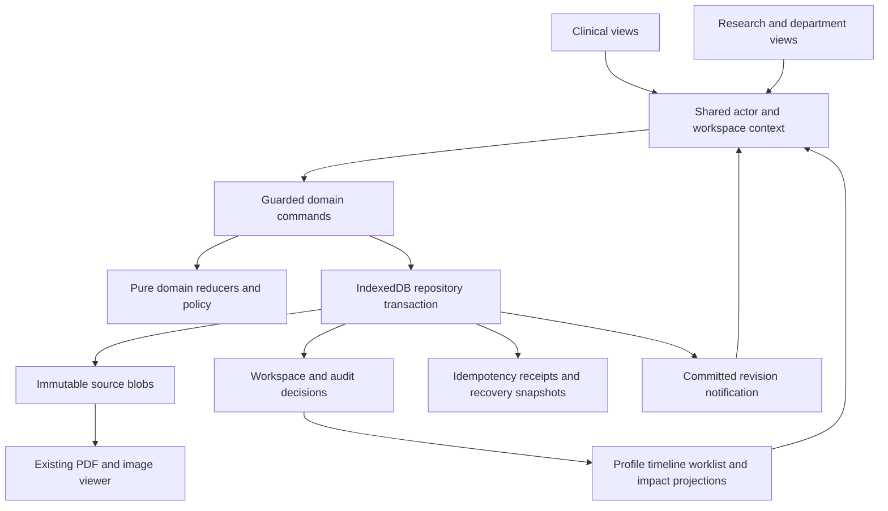
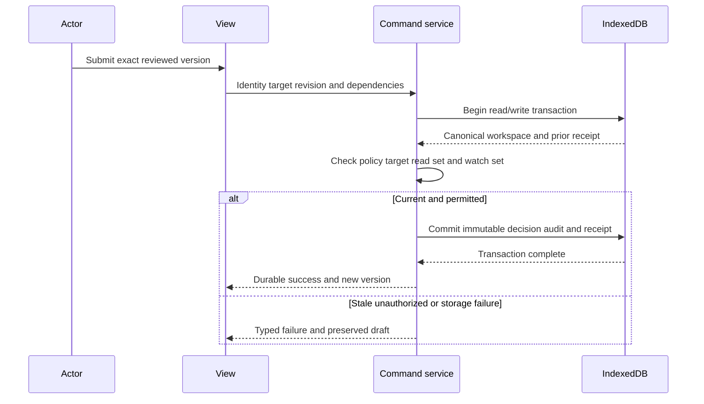
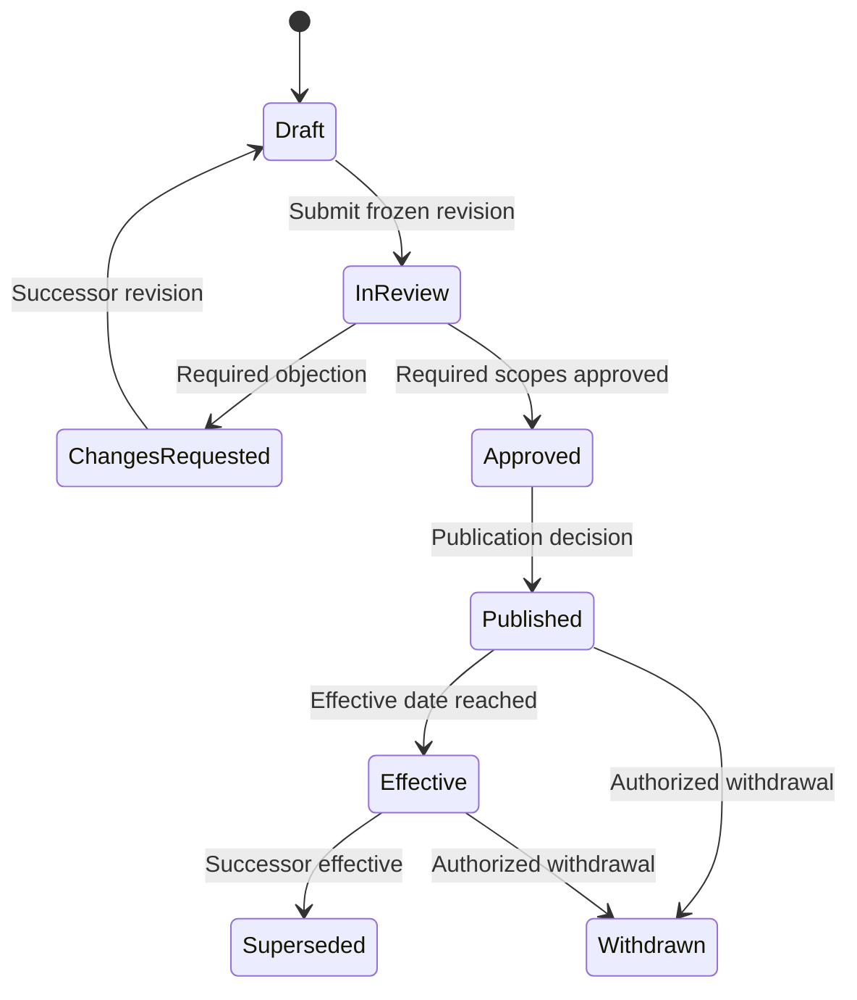
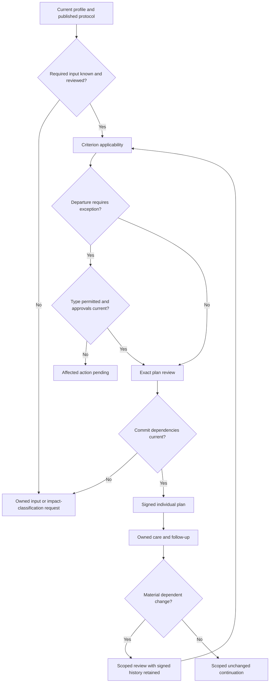
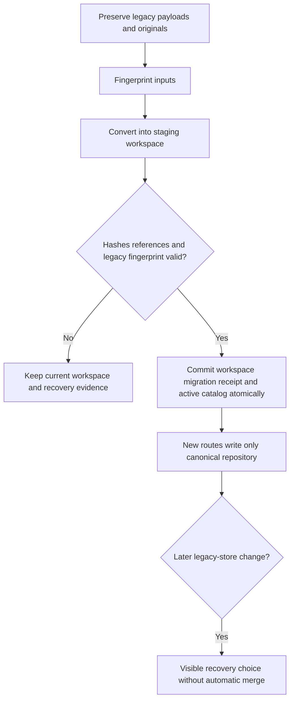

# Oncology Department Patient Journey - Plan

Archived revision 1. Superseded by [the FastAPI and Next.js plan](../2026-10-11-1137-feat-oncology-department-journey-plan.md). This file is reference history, not execution authority.

## Goal Capsule

- **Objective:** An oncology team can demonstrate a complete patient journey using shared, reviewed departmental knowledge, with accountable individual decisions, exceptions, care coordination and follow-up.
- **Means:** Extend the existing Casebook browser application through the domain and persistence boundaries in KTD1–KTD10.
- **Authority:** The Product Contract governs behavior. The Planning Contract governs its implementation. Unit approaches and examples must preserve both. Supporting research supplies evidence rather than additional scope.
- **Execution profile:** Implement U1–U14 as a complete fictional local demonstration. Institution-authorized clinical deployment is a separate follow-up milestone.
- **Completion owner:** The implementing agent supplies working changes, verification evidence and updated demo instructions. Clinical reviewers later assess clinical content and real-workflow suitability.
- **Stop conditions:** Do not invent medical criteria, silently lose original documents, fabricate historical approvals, or claim simulated browser permissions provide real clinical authorization. A material contradiction with this contract requires an explicit explanation before scope changes.

---

## Product Contract

### Summary

Connect Meera's fictional AML episode from referral through independently sourced reports, review, shared protocol selection, a patient-specific exception, approved plan, accepted team work, actual care and follow-up. Arun independently uses the same departmental protocol. A later evidence review produces protocol v2 and separate impact decisions for both patients. One versioned departmental SOP governs case preparation and handoff.

The research workspace supports questions, structured evidence appraisal, named review and change proposals. Senior oncologists lead knowledge improvement; treating clinicians remain accountable for each patient. This deliverable preserves the current source viewer and six-dimensional profile while adding the missing shared workflow.

### Problem Frame

The current app links source review, patient applicability, prose plans and attributed session feedback, but its research and patient state live in separate browser stores. A patient plan is currently called a protocol, and no reusable departmental publication registry exists. Simplified fixtures mix reports, assessments and preferences, obscuring specimen, time and authorship. Broad case revisions create avoidable review work, while non-atomic persistence can lose changes across tabs or display success after a failed save.

The requested improvement is shared expertise that remains traceable when applied to an individual, together with visible responsibility for unfinished work. Clinical effectiveness, staff adoption and protected research time remain hypotheses to validate with a partner department.

### Requirements

**Sources and patient context**

- R1. Keep patient, episode, encounter, specimen and report identities distinct, with namespaced external identifiers and explicit association review.
- R2. Preserve immutable source bytes, hash, author/issuer, source status, date precision and source regions for every extracted assertion.
- R3. Represent repeated specimen/assay-specific observations separately from the six-dimensional profile and clinician assessment.
- R4. Keep pending, untested, not detected, indeterminate, insufficient sample, unreported and unavailable distinct wherever they occur.
- R5. Record additive addenda, corrections, replacements and withdrawals through explicit version relationships; newest date alone never establishes supersession.
- R6. Historical profiles and decisions use the exact versions known at their knowledge cutoff, even when a later-arriving report describes an earlier event.
- R7. Track expected inputs before results exist, with an owner and next action; these records do not imply an order was issued or a test performed.

**Research and departmental knowledge**

- R8. Research questions and appraisals retain intended use, source passages, study context, limitations, reviewer assignments and disagreement history.
- R9. Accepting evidence for the library is a separate decision from approving or publishing a departmental protocol.
- R10. Protocol publication requires decisions against an immutable version under a named review-policy version, including the required independent actor.
- R11. Approved, published, effective, superseded, review-due and withdrawn states retain distinct meanings and dates.
- R12. A departmental SOP has its own versioned purpose, role-owned steps and review lifecycle, and tasks reference the exact applicable SOP version.
- R13. Shared protocol updates create separately owned patient impact reviews without automatically changing individual plans.
- R14. A research question may conclude insufficient evidence without publishing a protocol or issuing a patient recommendation.

**Individual decisions**

- R15. Patient applicability records criterion-level match, difference, unknown or not-applicable with rationale and exact supporting versions.
- R16. Patient-plan approval covers an exact plan, applicability, patient-discussion and exception decision set, with currency checked at durable commit.
- R17. Exceptions retain type, requested departure, exact patient/protocol/requirement scope, permitted approvers and expiry or review trigger; an exception never changes the shared protocol.
- R18. Missing required inputs and pending, rejected or expired required exceptions cannot satisfy the affected approval guard; explicitly independent preparation remains available.
- R19. Material changes create scoped review work while preserving signed history and current plan disposition until authorized clinical action.
- R20. Administrative task changes preserve unrelated approvals, whereas changes to an authored clinical obligation require the specified clinical review.

**Execution and follow-up**

- R21. Handoffs distinguish sent, received, accepted, returned, blocked and completed, with owner, due time and evidence of completion.
- R22. Planned events, actual care and transcribed external reports remain separate records with attribution and the historical plan/order reference used.
- R23. Concerns retain acknowledgement, response, escalation and review ownership; a notification does not constitute a response.
- R24. Routine follow-up is a separate obligation with scheduled, fulfilled, missed, rescheduled, cancelled and transferred dispositions.
- R25. A justified unchanged follow-up records a new encounter decision and next obligation while retaining the existing plan and unchanged accepted evidence.
- R26. Completing the demonstration or its tasks does not infer discharge, successful therapy, or completed transfer of clinical responsibility.

**Persistence, permissions and portability**

- R27. Successful writes are durable and atomic, duplicate commands are idempotent, and stale edits cannot silently overwrite newer state.
- R28. Simulated actors have explicit command-level capabilities; an administrator has no clinical authority by default and one actor cannot review their own work by changing roles.
- R29. Migration preserves current originals, provenance and legacy history, with retry/recovery that cannot activate a partially converted workspace.
- R30. A complete backup contains a versioned manifest, canonical records and original bytes; incomplete exports explicitly identify missing or corrupt originals.
- R31. Import validates schema, hashes, references and patient scope in a staging workspace before activation, preserving the current workspace on failure.
- R32. Keyboard navigation, focus, source links, error summaries and visible status updates work across the complete demonstration.
- R33. Synthetic workflow fixtures, public research references and authorized real evaluation records remain labelled and separate; unrelated real subjects are never combined.
- R34. All clinical policy and extraction-performance claims remain explicitly unvalidated until qualified review and an authorized real-data evaluation occur.

### Actors and fixed demonstration policy

| ID | Fictional actor | Demonstrated grants |
|---|---|---|
| A1 | Dr. Rao | Treating clinician, evidence author, protocol/SOP lead and publisher |
| A2 | Dr. Sen | Independent clinical reviewer and evidence reviewer |
| A3 | Mira | Coordinator and trained source reviewer within assigned transcription scope |
| A4 | Isha | Receiving care-team member, task acknowledgement and attributed care/concern entry |
| A5 | Patient/caregiver as an attributed source | Goals and concerns entered by an authorized demo actor; no patient portal |

The fixture policy requires Sen's approval and Rao's separate publication decision for protocol v1/v2. Mira cannot interpret findings or approve a clinical plan/exception. Isha records her own work or explicitly attributed external reports. All identities, signatures and permissions are visibly simulated. Clinical exception review requires Rao and Sen where a fictional requirement explicitly permits that type of deviation. The main clinical-exception branch remains owned and pending. SOP review uses Sen as independent reviewer in the demonstration; no generic committee engine is required.

### Key flows

| ID | Trigger and sequence | Demonstrated outcome | Requirements |
|---|---|---|---|
| F1 | Rao opens question → cites sources → Sen reviews → disagreement resolved → protocol v1 and preparation/handoff SOP published | Reusable knowledge with exact versions and named approval | R8–R12, R14, R28 |
| F2 | Mira registers Meera → associates referral and separate reports → reviews source candidates → Rao assesses the case | Longitudinal profile with owned missing-input requests | R1–R7 |
| F3 | Rao applies v1 → documents goals → requests alternate operational arrangement → resolves that exception → approves exact plan | Individual decision linked to shared knowledge | R15–R20 |
| F4 | Mira assigns SOP-derived work → Isha accepts/returns → care recorded → concern acknowledged/responded → routine review completed unchanged | Actual follow-through and next obligation | R21–R26 |
| F5 | New research question → evidence review → protocol v2 → separate Meera/Arun impacts → one retains v1 and another adopts through a newly approved plan | Independent, reproducible adoption decisions | R8–R19 |
| F6 | Source correction or clinical obligation change → scoped impact → stale action blocked → authorized disposition | Historical signature retained with an explicit review-needed reason | R5, R16, R18–R20 |

Dates in fixtures are relative demonstration days, not recommended clinical timing. The alternate operational arrangement is an appointment-location preference, with documented patient discussion and clinician approval. It changes no medical treatment rule.

### Acceptance examples

- AE1. **Covers F1/F5, R10/R13/R16.** Given two plans refer to v1, publishing v2 creates two impacts. Resolving Meera's impact leaves Arun's open; recording adopt without a newly approved plan cannot close adoption.
- AE2. **Covers F2/F6, R5/R6/R19.** Given an approved plan used a report, a correction received later preserves the original and prior decision. The current profile reflects reviewed changes, while the earlier knowledge snapshot does not.
- AE3. **Covers F3, R17/R18/R28.** Given a required clinical deviation is pending, changing to coordinator or admin cannot authorize it. Independent report preparation still works where its dependencies permit.
- AE4. **Covers F4, R22/R24/R25.** Given a scheduled session and unchanged follow-up, scheduling does not record delivery. After an attributed actual event and clinician review, the same plan remains and a new obligation appears.
- AE5. **Covers R16/R20/R27.** Given a plan form is open in one tab, an unrelated task update in another survives without staling clinical inputs. A relevant new result instead prevents the stale signature.
- AE6. **Covers R29–R31.** Given migration/import is interrupted or an original hash mismatches, the existing workspace remains usable and no completed migration or full-backup claim appears.

### Scope boundaries

U1–U14 cover a local fictional workflow shared across the clinical and research pages of one browser origin. They include a minimal SOP, explicit draft save, report-specific/manual candidate entry, immutable approval packets, impact work and full demo backup/restore.

**Deferred to follow-up work:** authenticated multi-user backend; real patient portal; EHR/FHIR integration and signed order/write-back; operational notifications outside the app; research cohort analysis; prospective study/consent administration; automated external literature retrieval; real model extraction/OCR and its evaluation; production security/backup/recovery deployment. Research questions/appraisals are implemented now; the original matrix's cohort-export item remains a later capability.

**Outside this deliverable:** medical prescribing or dosing, clinical eligibility thresholds, automated diagnosis, image interpretation, autonomous triage, inferred treatment administration and research-study deviation approval. The software must not populate omitted clinical content with guesses.

**Considered and not built:** a framework rewrite, event-sourcing replay engine, microservices, configurable committee DSL, ZIP packaging and background safety monitoring. The local deliverable has adequate simpler mechanisms. Reconsider only when a real deployment or measured corpus size requires them.

### Supporting sources

The carried-forward product scope comes from `plans/oncology-department-journey/implementation-plan.md`, its data specification and acceptance matrix, and the user's request for a complete coding handoff. This plan supersedes the earlier document as the implementation authority; the earlier files remain audit/research inputs.

`research_oncologic_fit/findings_prototype.md` and `research_oncologic_fit/research_report.md` explain current behavior and the Oncologic comparison. `research_oncology_datasets/dataset-guide.md` and `research_oncology_datasets/samples/README.md` contain verified source access and sample provenance. Public [mCODE](https://hl7.org/fhir/us/mcode/) and [FHIR R4 report semantics](https://hl7.org/fhir/R4/diagnosticreport.html) shape the representation boundary; conformance is a later verified exchange task. The independently authored schema below does not copy restricted clinical reporting templates.

---

## Planning Contract

### Current implementation baseline

| Area | Verified existing implementation | Consequence |
|---|---|---|
| Clinical route | `product/aml-screen-walkthrough.html`, `intake-app.js`, dimension/protocol/session views | Keep entry route and viewer behavior |
| Research route | `product/evidence-review.html`, `research-lab.js` | Separate pure review logic from UI and storage |
| Model convention | IIFE namespaces with CommonJS exports; plain JSON state and Node native tests | Retain compatible exports and pure domain transitions |
| Patient store | localStorage `casebook-intake-v1` | Convert once; stop whole-object writes after cutover |
| Research store | localStorage `casebook-research-lab-v1` | Convert jointly with patient state |
| Originals | IndexedDB `casebook-pdf-library/documents` and `casebook-intake-images/files`, keyed by hash | Preserve and migrate bytes; current JSON packets omit them |
| Earlier demo | `patient-evidence-review.html`, key `casebook-evidence-demo-v2` | Preserve separately; do not merge incompatible fixed comparisons |
| PDF runtime | Vendored `product/vendor/pdfjs/`, version 5.6.205 | Retain worker paths and licence; no PDF library upgrade needed |
| Roles and tests | Clinical role hard-coded to oncologist; three browser checks reference absent `#role` | Reconcile tests and actual simulated actor UI together |
| Server | `product/serve-demo.py`, origin `127.0.0.1:8765`, serves `product/` and `research/` | New runtime fixtures belong under `product/`; planning/research folders need no server exposure |

There is no current package/build manifest. Do not assume npm scripts, a React/TypeScript application, or pinned Node/Python versions. The prior protocol-model test setup uses a now-forbidden direct plan mutation; update its setup without removing the approval gate. No test outcome from an earlier audit is a current passing baseline.

### Key technical decisions

- KTD1. **Retain the application stack.** Use the existing vanilla JavaScript, CSS, dual model exports and PDF viewer. New modules isolate domain responsibility; replacing the stack would add migration work without proving the requested journey. Governs implementation of R1–R34.
- KTD2. **One authoritative transactional demo repository.** Use IndexedDB database `casebook-department-v1` with stores `workspaces`, `blobs`, `commandReceipts` and `recoverySnapshots`. Clinical and research pages use the same repository. A workspace contains normalized JSON-compatible entity maps and append-only audit decisions; full event replay is unnecessary. Implements R27/R29.
- KTD3. **Durable command boundary.** Every mutation carries a command ID, workspace, actor, action, target, expected entity revision, dependency read/watch sets and input digest. Load current state and validate/reduce/commit workspace plus receipt within one transaction. Include originals in that transaction when importing. Identical retries return the stored receipt; changed payload under an old ID fails. Parsing/hashing happens before the transaction. Implements R16/R27/R28.
- KTD4. **Scoped currency with immutable packets.** Review packets freeze target versions, required assignments, policy and exact input read sets. Watch scopes detect newly arriving relevant material. Workspace revision is only a notification sequence. Domain reducers classify declared changes; ambiguous clinical material creates an owned impact-classification request. Implements R6/R16/R19/R20.
- KTD5. **Stable identity and immutable content versions.** Use internal IDs distinct from issuer/system/value aliases. Content revisions and submitted packets never mutate after approval. Mutable assignment/inbox metadata stays outside signed content. Draft edits create successor revisions. Implements R1/R5/R10/R16.
- KTD6. **Explicit demonstration policy.** Store the A1–A4 capability matrix and reviewer rules as a versioned fixture policy, checked inside commands. Default requirements are non-waivable; exception permissions are authored per requirement. This avoids an open-ended policy engine and implements R10/R17/R18/R28.
- KTD7. **Separate current disposition from review currency.** Signed plan history, active/held/completed/superseded disposition and current/review-needed status are separate. Targeted unresolved impacts block dependent new signatures or handoffs, while attributed historical care and unaffected logistics remain recordable. Implements R19–R22.
- KTD8. **Portable archive without a new package dependency.** Use a single versioned JSON envelope with binary originals encoded as base64, their lengths/hashes and explicit missing entries. Internal blobs remain binary. Small demo files fit this approach; reconsider packaging for a measured larger corpus. Implements R30/R31.
- KTD9. **Explicit save and cross-tab refresh.** Show unsaved draft state and save feedback only after commit. BroadcastChannel announces revisions; focus and mutation reload canonical state. Stale forms retain entered text and show a relevant diff rather than auto-rebasing a signature. Implements R16/R27.
- KTD10. **Shared actions below views.** UI handlers call domain commands, including for role changes and scripted demo actions. No model may set approval from generated text. The app has no agent runtime to extend now; future tools must call these same guarded actions. Implements R16/R27/R28.

The persistence choice is resolved from verified split-store failure paths. A bake-off is unnecessary: atomic IndexedDB transactions satisfy the browser-only scope, whereas a production server changes the accepted deployment milestone. No unresolved provider/framework selection blocks the demonstration.

### Data relationships and minimum record contracts

All records retain internal identity, workspace scope, content/version identity, creation/recording time and attribution where applicable. External unknown values remain unknown. The rows below define required information, not exact JavaScript signatures.

| Record | Minimum contract and relationships |
|---|---|
| Patient / Episode / Encounter | Namespaced identifiers; patient association; service/team owner; actual/planned timing; episode ongoing/closed/transfer-pending/transferred status with explicit disposition |
| SourceBlob / SourceDocumentVersion | Immutable bytes/hash/length/type; issuer/author/external ID; received time; document family/version; extraction limits and original availability |
| ReportFamily / ReportVersion | Issued accession/issuer; type/status; specimen and source-file references; effective/issued/amendment times; relation kind and affected predecessor assertions |
| Specimen / AssayContext | Patient, collection event/material/site, aliases/parts/parent, collection/receipt times; test/panel/method/target scope and reported limitations |
| ObservationVersion | Report/specimen/assay; exact wording; typed reported value/units/range when present; test/result/missingness state; effective time; page/region/span; normalization provenance |
| ExpectedInput | Patient/episode, expected artifact, upstream request only if known, pending/received/failed/cancelled/unknown state, owner, next action and linked fulfilled report |
| ExtractionCandidate / SourceReview | Extractor/version, source support and candidate assertion; verified/corrected/rejected/unresolved disposition, reviewer and reason; local correction does not reissue the lab report |
| ClinicalAssessment / PatientDiscussion | Attributed encounter assessment, evidence, uncertainty/classification edition when stated; patient goals/preferences, participants and discussion version; consent reference only when documented |
| ProfileSnapshot | Exact fact/assessment versions, unresolved items, six-dimensional projection, clinical-time view and knowledge cutoff |
| ResearchQuestion / EvidenceSourceVersion | Question/scope/intended use and owner; citation/file/hash, passages, status and source amendments/withdrawal |
| EvidenceAppraisal / ReviewAssignment / ReviewDecision | Population/intervention/comparator/outcome/timepoint and study design as reported; findings/uncertainty/limitations; packet/policy/actor/scope, decision/rationale and superseding decisions |
| ChangeProposal | Target family/base version, proposed revision/diff, rationale, evidence references, assignments and disposition |
| ProtocolTemplateVersion | Department/owner/scope, evidence versions, stable requirements, watch scopes, applicability branch, waiver policy, review/publication/effective/review dates |
| SOPVersion | Purpose, operational steps, roles, expected completion evidence, escalation destination, review decisions and effective version; optional explicit protocol-version relation |
| ApplicabilityReview / ReviewPacket | Patient/episode/profile and protocol versions; criterion assessments; target digest/version; required assignments; read set and watched scope revisions |
| PatientPlanVersion / PlanDisposition | Individualized documented intent, alternatives/rationale, primary protocol, applicability, discussion and exception decisions; previous version and exact approval; disposition changed separately |
| ExceptionRequestVersion / ExceptionDecision | Departure/type/requirement, patient/episode/protocol/plan scope, evidence/rationale; required approvals; expiry or review trigger and non-waivable boundaries |
| Task / Handoff | SOP/plan references, action/owner/due/dependencies; sent/received/accepted/returned/blocked/completed/cancelled history, reason and completion evidence |
| PlannedEvent / CareEvent | Planned request/appointment separated from performed/partial/deferred/not-performed/unknown actual record; actual time, source, performer/transcriber and historical plan/order references |
| Concern / Response | Reported symptom or question as attributed narrative; acknowledged/responded/escalated/reviewed/closed history, responsible service and unresolved duties |
| FollowUpObligation / EncounterDecision | Purpose/owner/due/precision/dependencies; schedule and disposition; clinical review input packet, continue/revise/more-information/unresolved decision and next obligation |
| ImpactReview | Change-event identity, exact affected patient plan/scope, owner/review trigger; open/assigned/disposition/closed state; retained/adopted/not-applicable/more-information evidence |
| AuditEvent / CommandReceipt / RecoverySnapshot | Actor/action/target versions/reason/time; command identity/input digest/durable result; archive/migration source fingerprint, preserved legacy payload and validation state |

Store collection, receipt, clinical effective/event, report issue, local arrival, review and decision time separately. Relative dates carry value/unit/anchor/precision and deidentification basis; unrelated anchors cannot become a fabricated common calendar. Report version and source-file version are many-to-many. One specimen can have multiple assays; a panel can contain multiple observations. A patient summary is a projection over these records, not their schema.

### High-level technical design

**Component and data flow — KTD1–KTD4:**

**Approval protocol — R10/R16/R27:**

**Publication lifecycle — R10/R11:**

Effective/superseded are version-selection projections over recorded publication/effective dates; visiting a page never creates an unrecorded approval. Review due creates owned work and is not automatic expiry. Withdrawn versions cannot support a new plan selection; historical dependants receive review under R19.

**Patient decision gates and change handling — R15–R20:**

**Migration lifecycle — R29/R31:**

### Command and guard matrix

Command names are domain actions, not mandated function signatures. Typed failures include actor not permitted, stale target/dependency, required input/review absent, unresolved objection, expired/withdrawn scope, unavailable original, invalid association, duplicate-ID payload mismatch and storage failure. Each failure identifies the target and next resolvable action.

| Action family | Actor / input | Guard / resulting records |
|---|---|---|
| Associate/import report | Mira or Rao; identity, parsed source, blob and report/specimen relation | R1/R2; commit original and metadata together; unresolved identity stays quarantined |
| Verify candidate | Assigned source reviewer; candidate/source versions | Original available and cited; append R2/R4 source review, never clinical interpretation |
| Submit/review evidence | Rao/Sen; appraisal packet and scope | Current source support; append scope decision; accept only when required objections resolved |
| Publish protocol/SOP | Rao; approved packet and effective date | R10–R12/R28; freeze content; protocol successor nominates R13 impacts atomically |
| Assess applicability | Rao; criterion facts, protocol and discussion | R15; required unknowns remain visible, not converted by exceptions |
| Resolve exception | Actor permitted for type; exact request and policy | R17/R18; append decision; no side effect approving plan |
| Approve plan / continue | Rao; exact packet or encounter review | R16/R18/R19/R25; validate read/watch sets; append plan or scoped continuation respectively |
| Assign/accept/complete work | Mira/Isha/Rao within grants; task dependencies | R20/R21; repeated commands deduplicate; dependent unresolved clinical scope blocks only its affected dispatch |
| Record actual care | Permitted team actor; event/source/historical reference | R22; reporting old care does not reactivate its plan |
| Respond/review concern | Assigned team and clinician; concern history | R23; unresolved escalations remain owned |
| Fulfil/miss/reschedule follow-up | Assigned service; obligation and decision | R24/R25; clinical schedule change follows authored obligation dependency, not a generic deadline edit |
| Resolve impact | Rao; change identity and disposition | Adoption closes only with linked approved successor plan; more information stays open; unaffected/not-applicable needs rationale |
| Export/import/migrate | Demo operator; archive/legacy fingerprint | R29–R31; validate before activation, preserve failure state and prior workspace |

### Scoped invalidation and defaults

The read set contains known input versions; the watch set contains revisions for relevant report families, observation selections, assessments, patient preferences, accepted evidence and protocol requirements. A new relevant result therefore cannot evade review merely because it was absent from the earlier read set. Unclassified incoming clinical material opens an owned classify-impact item before affected new approval. Reopening an evidence/applicability draft does not revoke the accepted version or earlier plan.

Addenda specify additive/corrective/replacement scope. An additive finding does not delete unaffected assertions. A local transcription correction changes app assertion history, not laboratory issuance. An ambiguous predecessor remains unresolved. No generic NLP materiality detector is introduced.

Impact identity is change-event + patient/episode + plan version + scope. Duplicate delivery returns the same impact; a new change retains its distinct reason. An authorized retain-v1 disposition carries reason/review trigger where policy permits. Seek-more-information remains open. Exception expiry blocks future actions in its required scope and nominates impacts; completed historical care remains intact. Withdrawal never issues an automatic treatment-stop instruction.

### Storage, migration and archive specifics

`workspaces` holds normalized workspaces and a catalog record naming the active workspace. `blobs` stores immutable content-addressed bytes with media metadata. `commandReceipts` stores command digest and committed result. `recoverySnapshots` preserves source fingerprints, legacy payloads and migration/import validation evidence. Approval/audit arrays are append-only records in the workspace.

U2 reads `casebook-intake-v1`, `casebook-research-lab-v1`, PDF and image stores. It explicitly excludes `casebook-evidence-demo-v2`. Legacy prose plans and approvals remain labelled legacy/unmapped; they are not inferred departmental publications. Current source geometry/hash relations survive conversion. Missing bytes remain unavailable and cannot be replaced by a similarly named file.

After a preserved recovery snapshot, conversion stages a workspace and rechecks legacy fingerprints before cutover. Other legacy tabs must reload. New routes cease legacy writes, and later legacy-store changes cause a visible recovery choice. Atomic activation changes the catalog only after reference/blob validation. Retrying a completed source fingerprint returns its migration receipt. Interrupted staging never changes the active workspace.

The archive envelope includes archive/schema versions, workspace identity/revision, export time, synthetic/real labels, normalized records, immutable approvals/audit, command receipts, and original hash/length/type/encoding entries. Review-only packets remain available with a clear incomplete-backup label. Full export checks original availability/integrity; an explicitly incomplete archive contains missing-file reasons. Import validates into a new staging workspace and provides an explicit activate-or-retain-current choice. Import is not a merge engine or a production research export.

### Fixture and dataset contract

Create `product/fixtures/department-journey/` with independently authored fictional records and separate gold annotations. Runtime input never reads gold files to manufacture successful extraction.

| Required source | Relationship exercised |
|---|---|
| Referral / first consult | Episode/history/source authorship |
| Repeated blood-result panels | Timed values, units and trend without overwrite |
| Marrow report with separate parts | Specimen-to-assertion source association |
| Flow, cytogenetic and molecular reports | Independent assays/status/limitations and delayed expected inputs |
| Additive addendum and correction variation | Explicit predecessor scope and targeted impacts |
| Clinical assessment and patient discussion | Interpretation/preferences outside laboratory observations |
| Plan/handoff and actual-care record | Intended versus performed and historical plan references |
| Follow-up results plus concern/response | Routine review versus reactive concern and next obligations |

Use Meera and Arun without joining real study subjects. Seed one fictional pathway and SOP for workflow validation only. Requirements cover reviewed identity/context and patient discussion, with an authored operational venue branch; clinical eligibility/therapy content remains absent and visibly unvalidated. Synthetic expected outputs cover unknowns, wrong identity, duplicate files, image-only/manual review and a pending permitted clinical-exception branch. Relative days and due triggers illustrate workflow only.

The saved BeatAML2 workbook informs patient/specimen/assay/missingness structure, not administered treatment chronology. Its cumulative regimen list is unordered. The saved GDC report informs report sections and multi-specimen handling; it is lung cancer. Neither is imported into Meera's chart. Public standards examples guide relationships, not medical plausibility. Preserve reference licences and do not embed CAP's restricted template dictionary. Detailed access evidence remains in `research_oncology_datasets/dataset-guide.md`.

### Sequencing and deferred implementation details

Deliver the repository and migration boundary first, then sources/fixtures, shared reviews/publication, individual decisions, execution/follow-up, impacts and final route integration. U4 fixture work and U5 pure evidence review can proceed after their dependencies with separate file ownership. U12 is the UI integration owner; model units do not independently rewrite shared boot/navigation code. No worker may revert another's edits.

Runtime-specific IndexedDB test harness details, final helper names and exact DOM layout are execution-time choices within these contracts. Measured quota/performance behavior must be verified during implementation. No browser-only choice establishes real authentication or clinical data authorization.

---

## Implementation Units

Existing files are modified only where listed. Names marked new are proposed files. Test paths are explicit targets, not claims that those tests already exist.

| Unit | Outcome | Primary files | Depends on |
|---|---|---|---|
| U1 | Durable shared repository and command boundary | `product/department-store.js`, `department-commands.js` | None |
| U2 | Preserved legacy conversion and recovery | `product/department-migration.js`, `pdf-reader.js` | U1 |
| U3 | Report/specimen/results and historical projections | `product/source-model.js`, `intake-model.js`, `profile-dimensions.js` | U1/U2 |
| U4 | Coherent fictional journey source pack | `product/fixtures/department-journey/`, fixture script | U3 |
| U5 | Questions and independent evidence review | `product/research-model.js`, `research-lab.js` | U1/U3 |
| U6 | Shared protocol and separate SOP publication | `product/department-protocol-model.js`, `department-sop-model.js` | U5 |
| U7 | Scoped applicability and review dependencies | `product/review-dependencies.js`, `protocol-model.js` | U3/U6 |
| U8 | Exceptions and exact individual plan decisions | `product/exception-model.js`, `protocol-model.js` | U7 |
| U9 | Accepted tasks and attributed actual care | `product/care-model.js`, `session-model.js` | U8 |
| U10 | Concerns and routine follow-up obligations | `product/follow-up-model.js`, `session-model.js` | U9 |
| U11 | Research change and patient impact resolution | `product/impact-model.js`, shared publication model | U7/U10 |
| U12 | Connected actor/worklist/department/patient UI | Current HTML, views and new department/worklist views | U4–U11 |
| U13 | Originals-inclusive export and staged restore | `product/department-archive.js`, archive view | U2/U12 |
| U14 | Complete journey verification and instructions | Tests, review guide and demo notes | U12/U13 |

### U1. Transactional workspace and command boundary

**Goal:** Both routes commit changes through one durable authority.

**Requirements:** R16/R27/R28; KTD2–KTD5/KTD9.

**Dependencies:** None.

**Files:** New `product/department-store.js`, `product/department-commands.js`, `product/demo-policy.js`; new `product/tests/department-commands.test.cjs` and `product/tests/browser-department-store-check.js`.

**Approach:** Define the repository port and pure reducer/guard boundary. Implement the four stores, catalog and typed receipts. Commit against latest state using expected entity revisions and dependency versions. Notify after completion and preserve failed drafts. Keep UI integration in U12.

**Patterns:** Existing dual exports and JSON-compatible models; original hash storage in `pdf-reader.js`.

**Execution note:** Verify current mutation/export boundaries before replacing persistence; add contract coverage before wiring views.

**Test scenarios:**
1. Identical command retried returns one decision/receipt; same ID with different payload fails.
2. Two tabs edit different tasks and both survive; same entity revision conflicts.
3. An unrelated task commit during signature does not stale its clinical dependencies.
4. Abort/quota failure produces no durable signature or success receipt.
5. Direct unauthorized command fails even when invoked without the UI.

**Verification:** Real-browser IndexedDB transaction and reload checks prove durability; model tests prove guard/idempotency semantics. Simulation boundary remains visible.

### U2. Legacy conversion and original preservation

**Goal:** Existing fictional data moves to the new repository without losing sources or fabricating governance.

**Requirements:** R2/R6/R29/R31; KTD2/KTD5/KTD8.

**Dependencies:** U1.

**Files:** New `product/department-migration.js`; adapt original-storage seam in `product/pdf-reader.js`; new `product/tests/department-migration.test.cjs`, `product/tests/browser-department-migration-check.js`; preserve `pdf-workspace.js` for the legacy route.

**Approach:** Snapshot/fingerprint supported legacy stores, convert to staged normalized records, copy PDF/image bytes, validate references, then atomically activate. Preserve old stores and mark legacy decisions. Expose unavailable originals and post-cutover legacy changes.

**Patterns:** Current identical-file recovery and exact source hashes; existing patient/history IDs.

**Test scenarios:**
1. Meera/Arun and research references migrate with original bytes and geometry intact.
2. Legacy plan cannot become a published shared protocol or gain a new signature.
3. Interrupted conversion retries once per fingerprint and never activates partial data.
4. Legacy payload changes during staging cause retry; later change is not silently merged.
5. Missing/corrupt original stays explicit; legacy separate demo remains unchanged.

**Verification:** Reload and recover the migrated workspace and preserved prior payloads; open identical original bytes after cutover.

### U3. Source records and longitudinal profile

**Goal:** Realistic independent sources produce reviewable, timed patient context.

**Requirements:** R1–R7/R33; KTD4/KTD5.

**Dependencies:** U1/U2.

**Files:** New `product/source-model.js`; adapt `product/intake-model.js`, `profile-dimensions.js`, `pdf-evidence.js`; extend `product/tests/intake-model.test.cjs`, `profile-dimensions.test.cjs`, `pdf-evidence.test.cjs`; new `product/tests/source-model.test.cjs`.

**Approach:** Introduce source/report/specimen/assay/observation/expected-input records behind an intake compatibility seam. Keep candidate extraction and source review distinct. Derive current and historical six-dimensional views from explicit versions. Implement supported report-specific extraction with a manual candidate path for unsupported content.

**Patterns:** Existing source coordinates, unknown preservation and snapshots. Do not generalize the old fixed-label parser into unsupported clinical interpretation.

**Test scenarios:**
1. Same accession from two issuers remains distinct; wrong-patient source stays quarantined.
2. Multi-specimen finding opens the correct original part/region.
3. Negative/pending/untested/insufficient/unreported survive projection/export.
4. Additive addendum preserves unaffected findings; targeted correction retains prior versions.
5. Later specimen differs without overwriting; ambiguous predecessor remains unresolved.
6. Late report appears by clinical time in current view but cannot leak into a prior knowledge cutoff.
7. Expected input exists before a result and only the linked report fulfils it.

**Verification:** Source associations and snapshots are deterministic; actual original view remains usable. No extraction-accuracy claim follows from synthetic tests.

### U4. Fictional source pack and scenario fixtures

**Goal:** The full journey uses coherent separate inputs and independent expected outputs.

**Requirements:** R3–R7/R33/R34; F2–F6.

**Dependencies:** U3.

**Files:** New `product/fixtures/department-journey/manifest.json`, `inputs/`, `gold/`, `scenario.json`, `README.md`; new `product/scripts/make-department-fixtures.py`, `product/scripts/requirements-fixtures.txt`; new `product/tests/department-fixtures.test.cjs`. Retain old fixture generator/files as legacy inputs.

**Approach:** Author the source pack and policy specified above; generate native PDFs where useful, plus an image-only/manual variant. Declare the ReportLab fixture dependency rather than assuming a global installation. Manifest contains identities, relationships, time anchors, source types, hashes and expected limitations. Gold is evaluation-only.

**Patterns:** Existing fixture generation and source layouts, with separate report authors and specimen namespaces.

**Test scenarios:**
1. Manifest/source references resolve without runtime dependence on gold.
2. All inputs are visibly fictional and no real cohort subject is linked into them.
3. Duplicate/amended/later-specimen/unsupported variants have distinct expected behavior.
4. Relative chronology is coherent within its declared anchor; artificial due dates are labelled.

**Verification:** Scenario packet demonstrates F2–F6. Clinical-content review remains recorded as unvalidated until a qualified reviewer signs off.

### U5. Research questions and evidence appraisal

**Goal:** Evidence can be appraised and reviewed independently of patient and publication decisions.

**Requirements:** R8/R9/R14; F1/F5.

**Dependencies:** U1/U3.

**Files:** New `product/research-model.js`; refactor `product/research-lab.js`, `pdf-evidence.js`; new `product/tests/research-model.test.cjs`; adapt `product/tests/browser-research-lab-check.js`, `browser-research-stale-check.js`.

**Approach:** Move research transitions into the pure model and repository commands. Add question scope, structured appraisal, review assignments, version-bound decisions and changes-requested resolution. Preserve cited passages and disclose keyword extraction limits. Search remains local/imported evidence in this deliverable.

**Patterns:** Current source viewer/citation checks; exact snapshot history from patient plan models.

**Test scenarios:**
1. Sen accepts a cited appraisal without publishing a protocol or approving Meera.
2. Required reviewer absent or objection unresolved blocks acceptance.
3. Edited/reopened draft leaves the earlier accepted version intact.
4. Source amendment/withdrawal creates explicit dependent review work.
5. Question closes insufficient evidence without clinical advice.

**Verification:** Research state reloads from the shared repository and source links open originals. Review decisions identify exact actor/scope/version.

### U6. Shared protocol and departmental SOP

**Goal:** One reviewed protocol serves multiple patients, while one separate SOP governs their operational work.

**Requirements:** R9–R13/R28; F1/AE1.

**Dependencies:** U5.

**Files:** New `product/department-protocol-model.js`, `product/department-sop-model.js`; new `product/tests/department-protocol-model.test.cjs`, `department-sop-model.test.cjs`.

**Approach:** Implement proposals, required assignments, frozen review versions, approval/publication/effective states and successor relationships under KTD5/KTD6. Stable requirement IDs hold supporting scopes and waiver policy. SOP steps produce task specifications and exact version links, not clinical orders.

**Patterns:** Patient draft/approval version checks; reuse shared review packet infrastructure from U5.

**Test scenarios:**
1. Sen review plus Rao publication produces v1; absent/rejected review blocks it.
2. Rao switching roles cannot satisfy independent review.
3. Approved future-effective content cannot mutate or activate changed content under old signatures.
4. Review due is not automatic withdrawal/expiry; withdrawn version is unavailable for new selection.
5. SOP revision cannot edit its associated clinical protocol; task links retain prior SOP version.

**Verification:** Meera and Arun can reference one immutable shared version through separate application records. Library/history dates and distinctions are reconstructable.

### U7. Applicability and scoped review currency

**Goal:** Patient decisions become stale only for relevant, accountable changes.

**Requirements:** R6/R15/R16/R18–R20; F3/F6/AE2/AE5.

**Dependencies:** U3/U6.

**Files:** New `product/review-dependencies.js`; adapt `product/protocol-model.js`, `profile-dimensions.js`; new `product/tests/review-dependencies.test.cjs`; extend `product/tests/protocol-model.test.cjs`.

**Approach:** Replace broad case-revision/latest-application shortcuts with frozen applicability packets, read/watch sets and scope revisions. Separate review currency from signed plan/disposition. Rebuild derived dependency index from packets; classify incoming unreviewed material explicitly.

**Patterns:** Existing captured applicability/profile snapshots and narrow unchanged-session continuation, preserving their constraints with more precise dependencies.

**Test scenarios:**
1. Unknown required criterion stays unknown; not-applicable needs attributed rationale.
2. New result in watched scope blocks stale signing even when not in the old read set.
3. Task owner change leaves unrelated approval current; clinical-obligation change opens scoped review.
4. Reopened applicability draft does not revoke accepted version.
5. Corrected fact affects its dependants only; historical plan and care remain available.

**Verification:** Currency explanations identify exact change and next owner. Signature checks operate against persisted dependencies in U1, not view state.

### U8. Exceptions and exact patient-plan approval

**Goal:** An authorized exception and patient discussion can support an exact individualized decision.

**Requirements:** R16–R19/R28; F3/AE3.

**Dependencies:** U7.

**Files:** New `product/exception-model.js`; adapt `product/protocol-model.js`; new `product/tests/exception-model.test.cjs`; extend `product/tests/protocol-model.test.cjs`.

**Approach:** Implement typed versioned requests/decisions and approved scopes under KTD6. Pin plan to applicability, protocol, patient discussion and valid exception decisions. Explicit save/review/sign remain separate commands. Preserve previous approved plan during draft work.

**Patterns:** Exact draft ID and stored previous-plan checks in current `protocol-model.js`.

**Test scenarios:**
1. Venue preference exception receives the permitted review and supports Meera's exact plan.
2. Exception alone does not approve a plan; request edited after review needs new decisions.
3. Required pending/rejected/expired clinical exception blocks the affected action while independent preparation works.
4. Non-waivable identity/required scope cannot be bypassed by coordinator/admin.
5. Expiry after actual care preserves history and creates future scoped review.
6. Material change during signature fails without partial approval.

**Verification:** Shared v1 remains unchanged; approved plan, rationale, discussion and exception scope are separately inspectable.

### U9. Handoff tasks and actual care

**Goal:** The care team can accept work and document what actually happened.

**Requirements:** R20–R22/R26; F4/AE4.

**Dependencies:** U8.

**Files:** New `product/care-model.js`; adapt `product/session-model.js`; new `product/tests/care-model.test.cjs`, `session-model.test.cjs`.

**Approach:** Instantiate SOP tasks with owner/dependencies and receipt history. Separate planned events from actual records and external transcription. Keep historical approved/handoff references selectable for recording completed past work under R22.

**Patterns:** Current transcribed receipt and session provenance; audit each actor's own action.

**Test scenarios:**
1. Sent handoff remains unaccepted until Isha acts; returned/blocked task retains owner/reason.
2. Scheduled session creates no delivery/response assertion.
3. Performed/partial/deferred/unknown care preserves actual source/time.
4. External performer and recording actor stay distinct.
5. Late actual event references older plan without reactivating it.
6. Pending transfer retains originating ownership until receipt is recorded.

**Verification:** Team worklist and patient timeline tell planned, accepted and actual activity apart after reload.

### U10. Concerns and routine follow-up

**Goal:** Reactive concerns and scheduled reviews both produce visible accountable follow-through.

**Requirements:** R23–R26/R19; F4/AE4.

**Dependencies:** U9.

**Files:** New `product/follow-up-model.js`; adapt `product/session-model.js`; new `product/tests/follow-up-model.test.cjs`; extend `product/tests/session-model.test.cjs`.

**Approach:** Implement distinct concern/response and obligation/encounter-decision records. Route escalation to a named demo service, without clinical triage inference. Continuation reviews current relevant issues and schedules the next obligation; changed content uses U8.

**Patterns:** Existing pending session review, explicit continue/reassess/change disposition and original-plan preservation.

**Test scenarios:**
1. Concern without response remains acknowledged/open, with owner and next action.
2. Routine review starts without a concern, continues unchanged and retains plan ID.
3. Unresolved required input/expired exception prevents unsupported continuation.
4. Missed review retains unknown outcome; reschedule/transfer/cancel keeps reasons/history.
5. Clinical scheduling change uses scoped review; routine task due-date edit does not.
6. Demonstration checkpoint leaves ongoing episode and next obligation visible.

**Verification:** Reload preserves concern response, clinical review and follow-up duties as separate evidence.

### U11. Knowledge change and independent patient impacts

**Goal:** Protocol v2 and source changes lead to reproducible per-patient decisions.

**Requirements:** R8/R13/R14/R19; F5/F6/AE1/AE2.

**Dependencies:** U7/U10.

**Files:** New `product/impact-model.js`; integrate `product/department-protocol-model.js`, `research-model.js`, `review-dependencies.js`; new `product/tests/impact-model.test.cjs`.

**Approach:** Create deduplicated impacts inside publication/material-change commands and project queues from exact references. Link optional case-origin questions to evidence changes. Close adopt only through approved successor plan; retain/not-applicable decisions keep rationale and watch context.

**Patterns:** Exact patient ownership and historical plan linkage; U1 command identity rather than status-only side effects.

**Test scenarios:**
1. Covers AE1. Publish v2 → two impacts; Meera retains v1 and Arun separately approves adoption.
2. Duplicate event creates one impact per scope; second genuine change keeps its own reason.
3. More-information stays open; adopt click without approved plan cannot close.
4. Withdrawal preserves active history but blocks new selection and nominates review.
5. Creating a new research question does not immediately change a patient decision.

**Verification:** Each closed impact reconstructs its change, patient basis and authorized disposition independently.

### U12. Connected clinical, department and research screens

**Goal:** A user can complete F1–F6 through visible actions and linked records.

**Requirements:** R1–R28/R32; F1–F6.

**Dependencies:** U4–U11.

**Files:** Adapt `product/aml-screen-walkthrough.html`, `evidence-review.html`, `intake-app.js`, `research-lab.js`, `dimension-view.js`, `protocol-view.js`, `session-view.js`, `intake.css`; new `product/department-view.js`, `worklist-view.js`; adapt clinical/research browser checks; new `product/tests/browser-department-journey-check.js`.

**Approach:** Introduce one boot/context contract for actor, active workspace, selected patient/episode, command service and projections. Preserve current URLs with validated new record deep links. Add Today worklist, patient decision summary, source/result timeline, applicability/exception review, department protocol/SOP library, research review and impact queue. Scope CSS changes to current routes; preserve the separate legacy demo.

**Patterns:** Existing escaped HTML fragments and delegated events. Avoid duplicate global helpers and cached whole-state saves. Declare dependency load order in both HTML routes.

**Test scenarios:**
1. Research→protocol→Meera link opens exact versions; invalid/cross-patient link shows a resolvable error.
2. Actor switch uses simulated identities and correct capabilities, never inherited signatures.
3. Storage failure or stale form retains entered text with explicit error, not success.
4. Keyboard/source-dialog/focus/status behavior works on narrow and desktop views.
5. Worklist rows open exact owned tasks/impacts; one patient's resolution cannot affect another.

**Verification:** Both routes use the same durable workspace; full journey works through UI actions with no console state injection.

### U13. Complete backup, review packet and staging restore

**Goal:** The demonstration and its source evidence can be moved and recovered intact.

**Requirements:** R30/R31/R33; AE6.

**Dependencies:** U2/U12.

**Files:** New `product/department-archive.js`; integrate export/import actions in `product/department-view.js`, `intake-app.js`, `protocol-view.js`; new `product/tests/department-archive.test.cjs`, `product/tests/browser-department-archive-check.js`.

**Approach:** Implement KTD8 envelope, validate hashes/references, stage a separate workspace and explicitly activate after validation. Retain lightweight patient review packets with clear scope labels. No cross-workspace automatic merge.

**Patterns:** Existing downloadable JSON and identical-file recovery, extended to actual originals.

**Test scenarios:**
1. Export/reimport yields same facts, approvals, source geometry and exact bytes.
2. Missing original makes complete-backup claim unavailable; incomplete archive lists the reason.
3. Altered bytes, unsupported schema or cross-patient reference fails before activation.
4. Import interrupted leaves current workspace active.
5. Recovery with matching original preserves existing document identity.

**Verification:** Clean isolated storage restores the journey and opens original files without fake replacement sources.

### U14. Integrated verification and review instructions

**Goal:** Supply a reproducible complete demonstration and honest evidence of what passed.

**Requirements:** R1–R34; AE1–AE6.

**Dependencies:** U12/U13.

**Files:** Adapt `product/intake-review-guide.md`, `workflow-demo-notes.md`; new `product/department-journey-guide.md`; reconcile `product/tests/browser-intake-check.js`, `browser-intake-source-check.js`, `browser-protocol-check.js`, related stale checks and protocol-model test setup; finish browser-department-journey/store/migration/archive checks from earlier units.

**Approach:** Map assertions to units and the verification contract. Correct outdated role/route assumptions. Execute isolated synthetic browser journeys, reload/recovery, exact negative branches and legacy smoke coverage. Describe input data, tested runtime, known limits and clinical-review state.

**Patterns:** Existing Node test runner and page-context browser scripts; use actual route wiring rather than stale guide counts.

**Test scenarios:**
1. F1–F6 run from clean synthetic state through actor UI and source imports.
2. Independent cases, expired/pending exceptions, addendum/correction and no-change continuation are demonstrated.
3. Cross-tab concurrency, failure recovery and full restore satisfy AE5/AE6.
4. Existing viewer/profile/history and separate legacy route remain usable.
5. Guide reproduces current checks and does not equate passing code with clinical validity.

**Verification:** Definition of Done below is supported by recorded current results, remaining limits and a demonstrable ongoing episode.

---

## Verification Contract

The planning run does not execute tests. The implementer establishes a fresh baseline and verifies the final implementation. Preserve meaningful approval guards while correcting obsolete test setup.

| Verification | Concrete entrypoint | What it proves |
|---|---|---|
| Pure domain tests | `node --test product/tests/*.test.cjs` | Guards, history, scope/version logic, conversion and archive validation |
| Served demo | `python3 product/serve-demo.py` at `http://127.0.0.1:8765/product/aml-screen-walkthrough.html` | Correct same-origin PDF worker, route and persistence behavior |
| Browser model/store integration | `product/tests/browser-department-store-check.js`, migration/archive checks | Real IndexedDB, transactions, cross-tab conflicts, reload and recovery |
| Full role journey | `product/tests/browser-department-journey-check.js` plus current clinical/research checks | F1–F6 through visible actions and actual source files |
| Source and legacy regression | Existing source/PDF/dimension checks at their correct routes | Original byte/geometry and legacy behavior preservation |
| Accessibility/manual review | Keyboard, dialog focus, status/error narration, desktop/narrow viewport | R32 behavior; automated coverage alone is insufficient |
| Content review | Fictional manifest and story reviewed by qualified clinician when available | Clinical plausibility separately from software correctness |

Browser scripts are page-context checks, not standalone Node programs. Evaluate them on the correct served route using the user's gstack browse workflow. Isolate storage: checks may reset fictional state. Keep host/port constant for persistence verification. Confirm Node/Python prerequisites at implementation time; no runtime version is pinned by the present repo. Fixture generation has its own declared dependency file. There is no existing build or `release:validate` command to invoke; do not invent one.

### Original acceptance matrix applicability

The outcomes in `plans/oncology-department-journey/acceptance-matrix.md` remain supporting acceptance evidence with these explicit delivery assignments:

| Original IDs | First deliverable assignment |
|---|---|
| A01–A11 | U2/U3/U7/U13: identity, source versions, missingness, historical context and originals |
| B01–B06 | U5/U6/U11: evidence, reviewer requirements, publication/effective dates and change impacts |
| C01–C10 | U7/U8/U10: independent applicability, exact decisions, exceptions and continuation |
| D01–D08 | U9/U10: accepted work, actual care, concerns, missed follow-up and historical references |
| E01–E03 | U5/U11: independent impact resolution and case-origin research questions |
| E04 | Deferred cohort-export capability; U13 demo backup does not satisfy it |
| F01/F02/F04/F06/F07 | U1/U2/U12/U13/U14: persistence, migration, duplicate local commands, accessibility and restore |
| F03 | Local direct-command capability check now; server authorization proof deferred to pilot |
| F05 | Upstream write-back is deferred; no delivery claim or integration implementation now |
| F08 | Separate human content/workflow review; if unavailable, retain unvalidated status |

Additional required proof closes the earlier plan's gaps: same actor cannot satisfy independent review; approved future-effective content cannot mutate; additive versus corrective addenda preserve the right assertions; newly arriving relevant material is caught by watch scopes; simultaneous independent task edits survive; aborted storage produces no approval; clinical scheduling change differs from administrative editing; routine follow-up has no concern/new-plan requirement; pending transfer stays owned; adoption needs an approved successor; second change preserves its distinct impact; missing-original archive is incomplete; post-cutover legacy changes cannot merge silently.

### System-wide impact and review boundaries

Both current routes, model exports, storage APIs, original viewer seams, global script load order, deep links and browser checks change together. Model functions used by the legacy demo need compatibility or an explicit separate adapter. Source text rendered into HTML retains existing escaping; imported archive/source text cannot execute as markup. Command policy is checked below the UI, while the visible simulation label prevents a browser role switch from being represented as institution authorization.

No external messages, patient-data upload, real hospital-system write, controlled dataset acquisition or deployment is part of U1–U14. Real-data permissions and external-model processing require the later service milestone; existing public samples remain reference assets outside the synthetic patient chart.

---

## Definition of Done

The coding deliverable is complete only when:

1. Meera completes F1–F6 through connected views and Arun independently uses the same protocol.
2. The separate preparation/handoff SOP is published, instantiated and inspectable from a task.
3. Every requirement R1–R33 has current software/UI evidence or its stated delivery boundary; R34 retains truthful clinical-review status.
4. U1–U14 test scenarios and applicable original acceptance outcomes pass, with test/runtime/source details recorded.
5. Reload, cross-tab edits, source amendments, partial care, no-change follow-up and full export/restore preserve exact history and source bytes.
6. All remaining obligations, pending clinical exceptions and impact work retain owner/next action; the episode may remain ongoing.
7. Current guides and browser checks match actual actor controls, routes and storage behavior.
8. Experimental/abandoned code and obsolete duplicate write paths are removed; no unrequested framework/backend is introduced.

### Later institution-authorized pilot milestone

The completed fictional app provides a specification for the next phase, not a clinical deployment claim. That milestone requires a named service/pathway owner and clinical content; real accounts and server-enforced authorization; transactional relational persistence and controlled original storage; backup/recovery/retention policy; authoritative patient/order/administration integration contracts; verified FHIR/profile mappings where adopted; approved real-data use and external-processing boundaries; independent extraction annotations and measured workflow baseline; and service-owned exception/urgent-response rules.

Prospective study management, cohort analytics and medical decision support each need their own scoped requirements and validation. None is silently supplied by the public research workbook, an SOP, or a successful browser demonstration.
