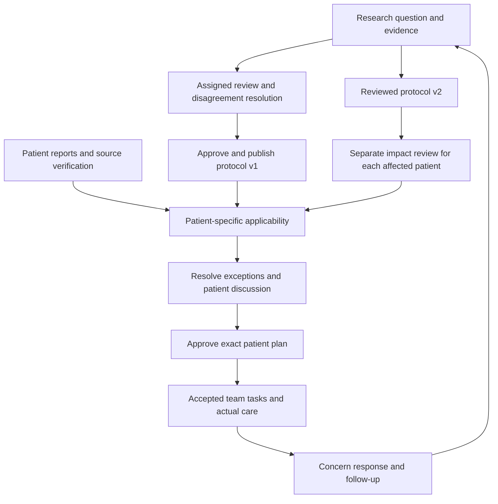

# Oncology department journey plan

11 October 2026 · Planning complete; implementation not started.

The proposed product connects reusable departmental knowledge to accountable patient care. Senior oncologists lead evidence review and protocol improvement; treating clinicians remain responsible for applying it to each patient, resolving exceptions and reviewing follow-up. Protected research time is a staffing goal to validate with the department, not a reason to remove clinical responsibility.

Read these in order:

1. **[Consolidated implementation plan](../../docs/plans/2026-10-11-1137-feat-oncology-department-journey-plan.md)** — revision 2 builds a new Next.js/TypeScript application with FastAPI and PostgreSQL. It specifies 34 requirements, 14 implementation units, new file/test targets, API/session/transaction contracts, source preservation and restore. Use the [paste-ready coding-agent handoff](../../docs/plans/oncology-coding-agent-handoff.md) to begin implementation in this workspace. The old vanilla app remains a reference.
2. **[Report and data specification](report-and-data-specification.md)** — 23 domain entities, source/specimen/assay relationships, dates and result states, realistic fictional document pack and research-data separation.
3. **[Acceptance matrix](acceptance-matrix.md)** — 47 planned checks covering provenance, review, exceptions, handoff, follow-up, protocol revisions and recovery. These have not been executed against a new implementation.
4. **[Dataset guide](../../research_oncology_datasets/dataset-guide.md)** — recommended datasets, what was actually inspected, access/rights, limitations and a sequence for improving data structure.

The [earlier implementation plan](implementation-plan.md) preserves the original 14-step journey and P0–P7 delivery framing. The [workflow review memo](workflow-review.md) supplies deeper audit evidence and additional scenario variations. Where these differ, use the consolidated plan: Meera is the main journey and Arun tests independent application of the same protocol. The consolidated plan also specifies which original acceptance outcomes are deferred.

U1–U14 deliver the complete fictional full-stack demonstration, including development-account authentication, server authorization and shared PostgreSQL persistence. The later institutional pilot qualifies identities, data use, clinical content, integrations and operational security for real use. The archived P0–P7 framing predates the new-stack instruction and is not the implementation authority. The plan does not supply medical treatment rules or thresholds.

No application code, fixtures, tests or configuration were changed. Small public reference samples and research/planning documents were saved only.
