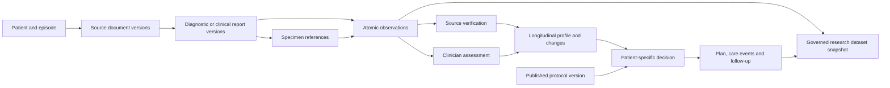

# Report and data specification

11 October 2026 · Planning only. These are proposed software contracts and fixture requirements, not implemented schema or clinical advice.

## What needs to change

The current intake fixtures combine marrow/molecular findings, clinical history, performance/fitness and other assessments in a two-page document. The supplemental context document mixes extent, fitness, preferences and logistics. Those simplifications helped demonstrate the interface, but they conceal who produced each fact, which specimen/assay it concerns, when it was known and whether a later document supersedes it.

Keep the six-dimensional patient profile as a presentation layer. Underneath it, store independently sourced documents, reports, specimens, observations and clinician assessments. Do not force a real report into one fictional all-purpose form or train extraction only against the labels the parser already recognizes.

This direction follows the distinction in the official ABDM laboratory profile between a report and referenced observations. The published example also includes document, patient, organization, practitioner, specimen and request records. It is a structural example, not a coherent oncology case or clinical gold standard. [ABDM profile](https://www.nrces.in/ndhm/fhir/r4/StructureDefinition-DiagnosticReportLab.html), [example bundle](https://www.nrces.in/ndhm/fhir/r4/Bundle-DiagnosticReport-Lab-example-03.html)

The inspected real GDC lung report contains five specimen parts, while Beat AML includes repeated specimens from the same research subject. These independently support explicit specimen and timing relationships; they are not linked patients and the lung report is not an AML clinical reference. The published mCODE genomics example also separates multiple specimens, observations and interpretation types. [Inspected samples and provenance](../../research_oncology_datasets/samples/README.md), [mCODE genomics examples](https://hl7.org/fhir/us/mcode/examples_genomics.html)

## Five layers that must stay separate

| Layer | Purpose | Example of a distinction |
|---|---|---|
| Original source | Preserve the issued file/message and provenance | A scanned lab report and an electronic result message can refer to the same report |
| Structured source content | Represent what the source actually reports | A result belongs to a particular specimen, method and time |
| Verification and clinical interpretation | Record who checked wording and who interpreted it | Confirming a quoted marker result does not independently diagnose the patient |
| Decisions and care | Record approved plans, tasks, actual events and exceptions | A plan is not an administration record |
| Research and derived views | Build summaries/cohorts from versioned records | A cohort result is not a new treatment recommendation |

The diagram is conceptual, not a claim that the internal database must exactly duplicate a FHIR resource graph.

## Minimum data dictionary

| Entity | Minimum information | Identity/version rule |
|---|---|---|
| Patient | Internal ID, source identifiers with issuer/system, verified identity links, demographic facts with provenance | Never identify a patient by name alone; merged/split identities retain audit |
| Episode | Patient, service, referral/reason, responsible team, relevant period and status | Distinct service episodes may share the patient but not assumptions |
| Encounter | Episode, actual/planned timing, type, participants and assessment references | A visit/encounter is not automatically a treatment delivery |
| SourceDocumentVersion | Original bytes or source message, hash, media type, source organization/author, received time, source identifier/version, page count, access/provenance | Hash deduplicates bytes, not clinical meaning; retain a document family and relationships |
| ReportVersion | Report type, status as issued, accession/issuer, author/verifier, report/effective/issued times, source documents, conclusion, specimen and observation links | Report status and local review status are independent |
| Specimen | Internal ID, external aliases with issuer, subject, type/site as reported, collection/received times, container/part labels and parent relationships where relevant | Internal ID unique; external accession numbers can repeat across issuers |
| Test/AssayContext | Name and code when supported, performing lab, method/platform, panel, target/analyte coverage, sensitivity/limitations as reported | Do not invent missing assay details or infer comparability |
| Observation | Subject/episode, report/specimen/assay links, analyte or finding, exact source wording, typed value/units/reference range when present, observation time, result status, interpretation and source region | Versioned fact plus provenance; derived normalizations are distinguishable from source text |
| ExtractionCandidate | Proposed value, source passage/coordinates, extractor/version, confidence if evaluated, omissions/ambiguity | Machine output remains a candidate, not a verified fact |
| SourceReview | Actor/scope, candidate version, verified/corrected/rejected disposition, reason and time | Preserve original text, correction and review independently |
| ClinicalAssessment | Clinician, encounter/time, findings used, interpretation, uncertainty and relevant disease-specific classification | Separate from the lab's interpretation and from extraction review |
| ProfileSnapshot | Included fact/assessment versions, unresolved/conflicting items, six-dimensional projection and review scope | Historical views cannot be recomputed with later facts silently added |
| EvidenceSourceVersion | Citation/identifier, source file/retrieval, publication/amendment/retraction status when established | Changes create a new version and dependency review |
| EvidenceAppraisal | Question/population/intervention/comparator/outcome/timepoint, study design, finding/effect and uncertainty, limitations, applicability, reviewer decisions | Narrative conclusions link to actual passages; article acceptance is not protocol approval |
| ProtocolTemplateVersion | Department, owner, scope, evidence versions, requirements/branches, roles, monitoring/escalation policy, effective/review dates, required reviews and publication decision | Frozen on publication; edit by creating a successor |
| ApplicabilityReview | Patient/profile dependency versions, protocol version, criterion-level match/difference/unknown/not applicable, rationale and reviewer | Unknown is not a match; no opaque overall score substitutes for the criteria |
| PatientPlanVersion | Approved individualized plan, goals/intent as documented, alternatives/rationale, protocol references, exceptions, patient discussion and signer | Links to previous version; separate from executable order records |
| Exception | Type/scope, requested departure, reason, affected criterion/plan, owner, required approvers, decision, expiry/review trigger | Cannot edit the shared protocol through a patient exception |
| Task | Target record, requested action, assigned role/person, due time, dependencies, acceptance, disposition and evidence | Idempotent command/event identity; completion is explicit |
| CareEvent | Plan/order reference, planned and actual times, performed/partial/deferred/unknown state, source and author, relevant observations | Preserve whether it is reported, imported or source-verified |
| Concern/FollowUp | Reporter, timing, narrative/structured observations, responsible service, response/escalation, patient communication and review | Patient report and clinical assessment remain distinct |
| Audit/DecisionEvent | Actor/role, action, exact target/version, reason, timestamp, prior/new references and command identity | Prior signed decisions retained; migration does not backfill fictitious signatures |
| ResearchDatasetSnapshot | Study/question, authorization scope, inclusion rules, variables/definitions, source lineage, missingness, dates and extract version | Analysis is reproducible; no joining people across unrelated datasets |

## Result semantics and dates

Use separate fields for these different questions:

- **Was the test performed?** Ordered, pending, performed, not performed, failed/insufficient sample, or unknown, only when supported.
- **What did it report?** Detected, not detected, quantitative/category/text result, indeterminate, or no reported result. Preserve exact wording.
- **Is the source complete?** Preliminary, final, addendum/amended/corrected, withdrawn/entered in error, or unknown, as issued.
- **What did our team verify?** Candidate, source-verified, corrected, rejected, unresolved/conflicting; record reviewer and scope.
- **What does the clinician conclude?** Attributed assessment with supporting evidence and uncertainty.

Do not equate not detected, not tested, not reported, not available and pending. An unavailable file is an access state, not a negative biological result. A finding that differs from a previous specimen/timepoint may represent a real change; it is not automatically a conflict or transcription error.

Store collection time, specimen receipt, observation/effective time, report issue/amendment time, local receipt, review time and clinical decision time separately. Preserve timezone and date-only/partial/relative precision. For deidentified datasets, retain date-shift/relative-day semantics. Do not convert a relative day into a fabricated real date. If source chronology is inconsistent, flag it and retain it; do not silently repair the evidence.

For molecular findings, retain reported marker/variant, reference naming system/build when present, assay method, specimen, reported value and units, interpretation, sensitivity/limitations and report version. A gene name alone is not a complete variant result. For disease extent, use disease-appropriate recorded classifications; do not impose a solid-tumour stage schema on AML.

## A realistic fictional episode pack

The exact contents are a proposed demonstration pack, not a universal required AML diagnostic checklist. A clinician must review clinical plausibility before it is used to evaluate a clinical task. Each document has a distinct issuer/author, ID, date, status and defined specimen or encounter relation where applicable.

| Pack item | What it contributes | Why it is a separate source |
|---|---|---|
| Referral / first-consult note | Presenting reason, prior history, referring team, open questions | Clinical narrative is not a laboratory result |
| Blood count/result panel at more than one timepoint | Atomic results, units, reference ranges, specimen/date/status | Trend requires multiple dated observations |
| Marrow morphology/pathology report | Specimen parts, gross/microscopic findings as relevant, reported interpretation and author | Multiple specimens/parts cannot be reduced to one unlabeled text value |
| Flow cytometry report | Specimen, method, findings and lab interpretation | Distinct assay and limitations |
| Cytogenetics report | Specimen, report status, result and interpretation | Can be pending or issued at another time |
| Molecular panel report | Variant/marker results, assay/context and limitations | Results need analyte-to-specimen/method linkage |
| One amendment/addendum | Clearly identifies the earlier report and changed material | Exercises provenance and targeted impact review |
| Clinical assessment note | Clinician's fitness/current condition assessment and basis | Assessment is not inferred from an isolated source value |
| Patient goals/access discussion | Preferences, practical constraints, who participated and pending discussion | Patient priorities are not properties of a marrow specimen |
| Approved plan and handoff record | Exact pathway/plan version, decisions and role-owned actions | Planning is not delivery |
| Care-event record | What actually happened, what did not happen, source/author/time | Delivery can be partial, deferred or unconfirmed |
| Follow-up results and review | Change/no change, response/toxicity assessment as documented, next steps | Outcomes require definitions and timed assessment |
| Patient concern plus response | Reported concern, receipt, assigned response and closure | An alert alone does not show care was provided |

Create a small base case plus controlled variations: same report received twice; pending result; amended result; another timepoint with a different result; wrong patient; ambiguous specimen reference; image-only report; incomplete original; conflicting source interpretation; partial delivery; unacknowledged task; late follow-up. Variations are explicitly synthetic and do not invent clinical treatment guidance.

## Research dataset and fixture separation

Maintain three physically/logically labelled groups:

1. **Reference documents and schemas:** public examples used to understand report structure. They are not automatically redistributable templates or training data.
2. **Synthetic workflow fixtures:** authored to exercise the full journey, with known expected results and visible fictional labels. They are not copied/linked fragments of real individuals.
3. **Authorized evaluation data:** real deidentified or appropriately governed documents held for extraction/workflow evaluation, with permission and independently adjudicated annotations.

A cancer cohort record, a pathology PDF from a different cohort and a synthetic encounter cannot be joined as if they belonged to one real patient. Store provenance and use purpose on every imported research asset. Controlled data are not downloaded or exposed to an external model merely because their metadata are public.

## Annotation and evaluation contract

For every curated evaluation document, reference annotations identify document family/version, patient/specimen/report relationships, source regions, raw wording, normalized value only when justified, result status/negation, dates/units, and uncertainty. Record annotator, independent review and adjudication for disagreements. A study/report author interpretation and our reviewer assessment are separate labels.

Evaluate detection/association separately from value extraction; evaluate transcription separately from clinical interpretation; measure errors after human review, not only before review. Hold out patients and document layouts as appropriate. Track clinically significant omissions, false certainty, incorrect source attribution, amendments and unsupported inferred facts. Gold annotations for synthetic fixtures can be exact; real clinical annotations require qualified review.

## Standards mapping approach

Use verified current published standards to guide exchange shape rather than inventing a universal oncology JSON schema. The internal model can map documents to DocumentReference, report groupings to DiagnosticReport, atomic findings to Observation, specimen context to Specimen, and encounters/plans/tasks to relevant exchange resources where the chosen implementation guide supports them. Oncology-specific profiles can guide additional fields and terminology. The detailed [dataset guide](../../research_oncology_datasets/dataset-guide.md) records which standards/examples were verified and their limitations.

The departmental evidence-review and publication workflow requires app-specific domain objects and policy. Standards conformance, local clinical requirements and data-use rights are separate concerns; meeting one does not establish the others.
