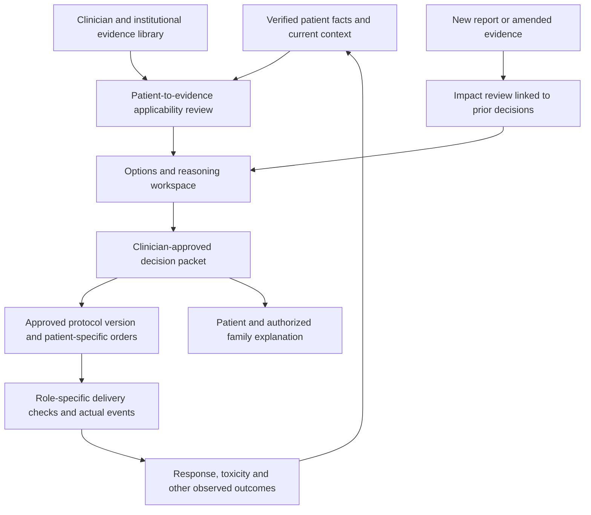

# Evidence-to-protocol oncology workspace

**Current product direction:** [Oncologist workspace: patient care and reviewed knowledge](oncologist-workspace-blueprint.md) supersedes the evidence-first navigation and initial build order below. The revised entry point is a caseload worklist, evolving patient profile and encounter feedback loop, connected to a shared reviewed knowledge library. The main clickable app now demonstrates the initial patient-intake and encounter-review slice; see [the review guide](intake-review-guide.md). The earlier evidence demo remains in `evidence-review.html`.

Product proposal · 11 October 2026

This extends the earlier [AML app blueprint](aml-app-blueprint.md). The ambition now includes clinician-owned evidence, patient-to-evidence applicability review, documented recommendations and versioned protocol execution across specialties. The earlier coordination workflow is a useful foundation, but does not by itself implement this expanded product. This document is a design proposal; no production clinical engine or validated protocol library exists in this workspace.

The user clarified that caregivers include **both clinical professionals and family caregivers**. Their responsibilities and permissions must be distinct.

## 1. Product concept

For each important treatment decision, preserve an inspectable chain:

**Patient facts → clinical question → evidence and applicability → options considered → clinician-selected recommendation → approved protocol version → patient-specific orders → actual delivery → observed outcome.**

This is a graph of explicit links, not a folder of PDFs. An evidence item can support several decisions; one decision may require multiple evidence items. Supporting, conflicting and contextual evidence should have distinguishable relationships. Uploaded research is not automatically applicable, authoritative or approved for use.

## 2. Evidence library: what oncologists attach

Accept citations/DOIs/URLs, permitted full-text documents, guideline sections, institutional protocols, MDT decisions and authorized case-series or institutional outcome summaries. Store documents only where access and licensing permit; a citation and source link may be appropriate when full-text storage is not. Treat source text as data, never instructions for the software.

Every evidence card should contain:

| Area | Required information |
|---|---|
| Identity and provenance | Title, authors, publisher/source, DOI or identifier, publication date, captured version/date, document/page/section reference |
| Evidence type | Guideline, randomized trial, observational study, subgroup analysis, case report, institutional protocol or expert decision |
| Clinical question | Disease/subtype, treatment setting/line, intervention and comparator, outcome being studied |
| Population | Inclusion/exclusion criteria, relevant biology, prior treatment, fitness/organ criteria, assessed versus unreported variables |
| Results | Endpoint definition, treatment arms, analysis population, sample sizes, follow-up, estimates and uncertainty as actually reported |
| Limitations | Subgroup size, selection bias, missing data, external validity, conflicts/funding, exploratory versus prespecified findings |
| Governance | Uploader, reviewer, review scope, institution approval status, version, superseded/retracted status when known, review due date |

Distinguish **source authenticity**, **extraction correctness**, **evidence quality**, **patient applicability**, and **institutional adoption**. A physician's upload or signature does not establish all five.

## 3. Parameter matching means inspecting applicability

The user should be able to inspect a matrix rather than receive a single “94% match” score. Example columns:

| Evidence criterion | Source passage | Patient value | Patient source/date | Assessment | Responsible reviewer |
|---|---|---|---|---|---|
| Disease subtype/setting | Exact criterion | Verified diagnosis and current setting | Diagnostic assessment | Matches / differs / unknown / not applicable | Clinician |
| Molecular requirement | Exact assay/variant definition | Actual result or pending status | Specimen-linked authorized report | Matches / differs / unknown / not applicable | Clinician |
| Functional or organ criterion | Original definition/threshold | Current assessment using appropriate units/method | Dated assessment | Matches / differs / unknown / not applicable | Clinician |
| Prior treatment | Specified exposure/exclusion | Verified treatment history | Medication/procedure records | Matches / differs / unknown / not applicable | Clinician |
| Endpoint relevance | Endpoint/population | Patient goal and decision being considered | Shared-decision note | Applicability explanation | Clinician |

Supported rules can compare verified structured values using versioned definitions; an LLM can draft candidate criteria with source passages. Clinical relevance and ambiguous interpretation require clinician review. Freshness, unit conversions, negation and specimen context need explicit handling. Missing data stays unknown.

**Three separate questions:** Does this patient resemble the studied population? Is an option clinically appropriate and locally available? Does the patient meet the criteria of a currently recruiting trial? Answers are not interchangeable. Trial exclusion is not by itself a clinical contraindication; similarity is not proof of benefit; a biomarker match is not a prescription.

### Meera and Arun example

Using the existing fictional AML cases, the app could compare a clinician-selected intensive-treatment study and a clinician-selected less-intensive-treatment study. It must use the actual criteria of those studies; this blueprint does not invent a paper or numerical benefit.

- Meera's diagnosis, full molecular/cytogenetic profile, prior treatment, fitness and goals are compared field by field. An unknown criterion generates an information or review task.
- Arun's biology, functional limitations and cardiac assessment may differ from the population of the first study. Show each difference and let the clinician state why it matters.
- The clinician may select an option despite a population difference with an explicit rationale, or reject an apparently similar option because another factor matters.
- Display conflicting studies and considered alternatives alongside the selected evidence. Keep supporting evidence from being merely a post-hoc justification of a preselected treatment.

## 4. “Past results” has two distinct meanings

**Published results:** retain population, intervention, comparator, endpoint, absolute results when reported, effect estimate and confidence interval, follow-up and study limitations. Do not compare an overall-survival result with a response-rate result as though they were the same measure. Cross-trial comparisons are not randomized comparisons. Do not turn a study-arm response percentage into a personal probability for Meera or Arun.

**Institutional outcomes:** separately show cohort definition, time window, eligible denominator, outcome availability, losses to follow-up and the extent of adjustment. These are descriptive unless a suitable analysis supports stronger inference. Treatment selection, case mix and incomplete follow-up can distort simple comparisons. Use appropriately governed aggregate access and small-cohort disclosure controls; family caregivers cannot browse identifiable similar patients.

Outcome capture should distinguish response, toxicity, complications, treatment completion, patient-reported function and survival where appropriately measured. A continuous-learning feature must not silently revise protocols from observational outcomes. Proposed updates return to clinical governance.

## 5. The signed decision packet

For each material treatment decision, bind an immutable packet to:

1. Patient/episode and the clinical question at a specific time.
2. Patient facts and report versions used, including uncertainties.
3. Evidence item versions, applicability review and conflicting evidence.
4. Options considered, selected recommendation and clinical rationale.
5. Applicable institutional protocol/version and any exception rationale.
6. Required reviewers, their review scopes, identity, time and disposition.
7. Patient discussion/consent reference, subsequent orders and delivery handoff.

Keep authorship, acknowledgement, verification, approval, consent and administration attestation as different events. Patient consent does not substitute for clinician authorization. A family caregiver's acknowledgement does not establish consent authority.

Use separate approval layers: **library review** establishes a source's reviewed status; **case-specific applicability review** records the clinician's assessment of every evidence item used in this decision; **decision approval** binds the selected recommendation and evidence packet; **delivery attestations** record each professional's execution responsibility. Library approval cannot stand in for patient-specific review. A scoped batch signature may cover an explicitly enumerated set of reviewed items, but it cannot silently approve unseen attachments or future versions. Each evidence item retains a disposition such as supporting, conflicting, contextual or not applicable, with reviewer and rationale.

### Role-based sign-off matrix

These are proposed defaults for institutional configuration, not universal clinical or legal requirements.

| Item | Accountable reviewer / signer | What the event means |
|---|---|---|
| External report receipt and identity linkage | Authorized coordinator/records role | Received and correctly associated, not clinically interpreted |
| Laboratory report | Issuing diagnostic professional/system | Authorized diagnostic finding; importing it does not require recreating that signature |
| Patient facts extracted into a summary | Appropriately trained authorized reviewer | Extraction checked against source, not approval of treatment |
| Evidence-to-patient applicability | Treating oncologist and requested specialist reviewer | Relevance, uncertainty and conflicts assessed |
| Treatment recommendation | Responsible oncologist; MDT reviewers where indicated by policy | Decision and rationale approved for this patient/context |
| Institutional protocol template | Specialty governance owners, including pharmacy/nursing/other disciplines where relevant | A version is approved for a defined institutional use, not for every patient |
| Patient-specific medication order | Authorized prescriber | Exact order authorized; pharmacy verification and nursing checks remain separate |
| Medical-treatment delivery | Professionals assigned to prescription verification, preparation, pre-administration checks and administration | Each attests to their own responsibility and actual events |
| Surgery and perioperative checks | Surgeon, anaesthesia and theatre professionals for their respective responsibilities | Procedure plan, fitness, consent verification, time-out and actual procedure records are distinct |
| Changed plan / material amended evidence | Relevant clinical reviewers | Impact assessed and appropriate new version approved |
| Patient or family task | Patient/authorized caregiver | Instruction received or practical task completed, not clinical approval |

Do not make oncologists re-sign every unchanged field at each visit. Every important event needs attribution; clinical approvals attach to a defined version and scope. Material changes create an impact-review task. Preserve the earlier signed snapshot; do not silently copy its approval to a new plan. A pending review does not autonomously stop existing treatment: escalation, change classification and urgent exceptions follow the service's clinically approved policy. Actual legal signature requirements need intended-use and institution-specific assessment; an ordinary checkbox is not automatically a legally adequate signature.

## 6. Protocol support by specialty

“Complete protocol” should mean an institution-approved, versioned workflow with required inputs, roles, checks, branches, exception handling and documentation. It should not mean one generic AI-generated treatment pathway for all cancers.

| Medical oncology / haematology | Surgical oncology |
|---|---|
| Approved strategy and regimen reference | Operative indication, alternatives and procedure plan |
| Current assessment and patient-specific signed orders | Required staging/resectability and patient-fitness assessments |
| Relevant laboratory and toxicity review | Anaesthesia assessment and preparation |
| Pharmacy verification and preparation records | Procedure consent and theatre/resource booking |
| Nursing checks and actual administration | Site/procedure confirmation and surgical safety checks |
| Holds, modifications and their authors/reasons | Operative findings, actual procedure and deviations |
| Supportive therapy and complication documentation | Specimen identification, pathology and postoperative complications |
| Response assessment and next-cycle/phase decision | Postoperative review, rehabilitation and further oncology decision |

Radiation oncology needs its own planning, review, quality-assurance and fraction-delivery workflow. Integrate with the relevant specialist systems rather than treating it as a variant of a medication calendar.

The AML examples exercise haematology; they are not suitable examples of routine tumour-removal surgery. Validate the surgical branch using a separate solid-tumour pathway selected with a surgical service. NCG already publishes distinct [medical](https://www.kcdo.in/src/docx/ner-medical-oncology-module-2.0.pdf), [surgical](https://www.kcdo.in/src/docx/ner-surgical-oncology-module-2.0.pdf) and [radiation](https://www.kcdo.in/src/docx/ner-radiation-oncology-module-2.0.pdf) requirements, inspected in the earlier research.

## 7. Revised screens

| User | Screen | Purpose |
|---|---|---|
| Oncologist | Evidence library | Attach, organize, review and version research or institutional guidance |
| Oncologist | Patient–evidence matrix | Inspect exact criteria, patient sources, mismatches and unknowns |
| Oncologist / MDT | Options and decision packet | Compare evidence and outcomes, document alternatives/rationale, obtain scoped review |
| Specialty governance | Protocol library | Maintain approved specialty templates, effective dates, owners and revision history |
| Clinicians / pharmacy / nursing / theatre | Execution workspace | See current authorized work, role-specific checks, deviations and actual events |
| Coordinator | Review and handoff queue | Track missing data, pending reviews, accepted handoffs and practical arrangements |
| Patient / authorized family | Care and support view | See approved explanations, confirmed visits, preparation, practical tasks and staffed contacts |
| Quality/governance | Outcomes and audit | Review execution, revisions and governed aggregate outcomes without silently changing recommendations |

Family caregivers can help with transport, documents, home support and approved medication instructions, including prescribed oral-treatment instructions where applicable. They cannot prescribe, alter doses, approve evidence, clear treatment or attest that a clinical professional delivered a procedure. Patient authorization, capacity/representative arrangements and permitted access must be recorded as appropriate.

## 8. Build sequence and acceptance checks

**First: evidence-backed decision preparation.** Add clinician evidence upload, source-linked manual criteria, the applicability matrix and a versioned decision packet to the existing case/evidence/task foundation. Use manually curated synthetic examples and then an authorized shadow evaluation. Do not begin with autonomous regimen ranking or an unvalidated benefit prediction.

**Second: one institution's medical workflow.** Integrate approved plan/order references and implement the service's role-specific review and handoff requirements. Measure whether the app reduces duplicated entry and review effort. Actual prescribing and drug delivery stay in established authoritative systems until any deeper integration is validated.

**Third: a distinct surgical pilot and radiation integration.** Reuse evidence/provenance/review foundations, but co-design specialty execution templates with the relevant service. Add the family support view alongside these internal workflows, with clear staffing for submitted concerns.

**Later: governed outcome analysis.** Add institutional cohort analysis only when longitudinal completeness, permissions, endpoints and analysis methods support useful interpretation.

Acceptance checks for the first release:

- An uploaded paper cannot become approved evidence without a recorded review scope and source version.
- Every extracted study criterion and patient value opens its exact source; missing data remains unknown.
- A conflicting result or report amendment is visible and reaches an assigned reviewer.
- An approved packet can be reconstructed exactly, including the evidence and patient facts known at sign-off.
- A change to a material input opens impact review; it neither silently inherits approval nor autonomously cancels treatment.
- The current delivery view identifies the authorized plan/order version and distinguishes proposed from actual work.
- A family user cannot access another patient's case or execute clinical authorization actions through UI or API.
- Outcome displays disclose denominators, endpoint and follow-up, and never present observational matching as a causal personal prediction.

The recommendation/evidence-matching and protocol-execution functions expand intended use beyond clerical summarization. They require their own clinical validation, governance and intended-use-specific regulatory assessment before real treatment decisions depend on them.

## 9. Vendor comparison and discovery

See [Lunit and Fuse research](../research/lunit-fuse-evidence-workflows.md) for directly sourced product capabilities and limitations. Public descriptions can establish documented scope, not prove an undocumented capability is absent or that hospitals will pay for another tool.

The research materially narrows the differentiation claim. [FuseRx](https://www.fuseonc.com/rx) already describes radiation pathways, patient/disease-based recommendations, guidelines/studies in the workflow and comparison of options. [FuseDocs](https://www.fuseonc.com/docs) describes document review/approval and transfer of approved documents. Generic guideline support or approval alone is therefore not a defensible novel feature claim. Investigate the depth of case-specific evidence provenance, applicability review, version-bound signatures and medical/surgical coverage in a demonstration.

[Lunit's precision-oncology page](https://www.lunit.io/en/precision-oncology/) presents SCOPE products for digital-pathology research and explicitly labels the described SCOPE IO, IHC suite and GP products research-use-only. Treat these as potential research/biomarker ecosystem components; do not assume they are authorized clinical treatment-selection inputs in India.

Candidate differentiation to validate: patient facts, clinician-selected evidence, explicit applicability, scoped approval and actual execution connected in one inspectable record across specialties. Test this through vendor demonstrations and hospital observation before calling it an unmet market need.
