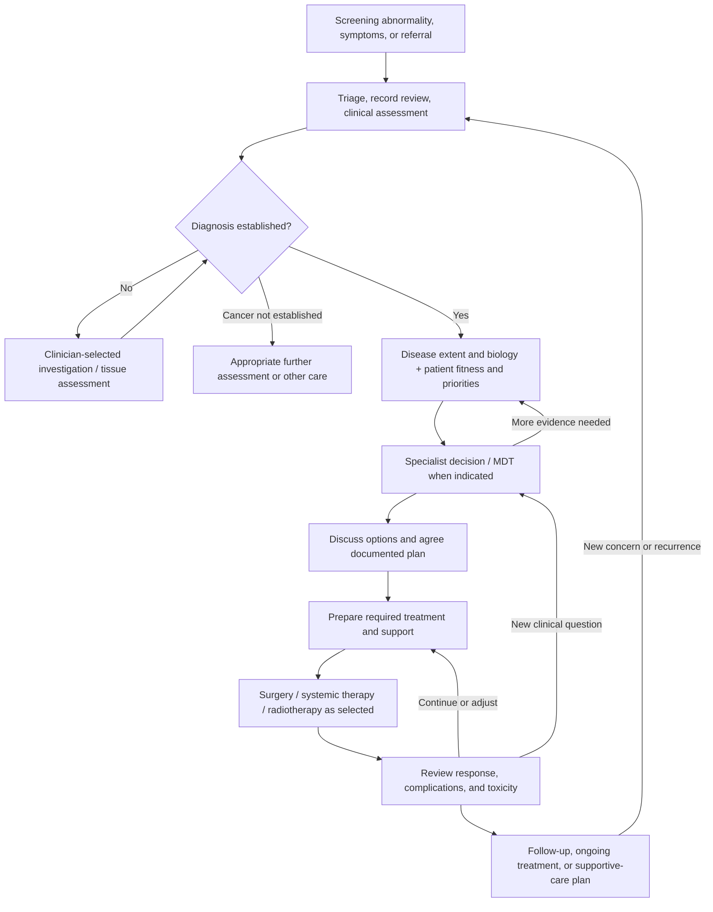

# Oncology workflow in India: from referral to an executed care plan

Research date: **11 October 2026**. Prepared from the supplied research and the primary sources below. This is a workflow and product-research document, not a treatment protocol. Clinical details explain information dependencies; they do not prescribe care for an individual.

## 1. The problem to investigate

**Oncology systems already exist. The research opportunity is to find where a hospital still struggles to assemble trustworthy evidence, make the next decision, and carry it through across departments.**

A useful working problem statement is:

> For a defined cancer pathway, the care team needs to move each patient from one clinical decision to the next with the necessary evidence verified, uncertainty visible, and every resulting action assigned and acknowledged. We need to discover which information gaps and handoffs currently delay that process or create avoidable rework.

This is a **hypothesis for field research**, not a measured claim about all Indian hospitals. The useful unit of analysis is:

**Report → verified fact → clinical question → documented decision → assigned action → evidence of completion.**

The oncologist is central, but the work is distributed. The NCG multidisciplinary tumour board (MDT) specification includes medical, surgical, and radiation oncology, radiology and pathology input; it separates case presentation, discussion, decision, and follow-up review. Its medical oncology specification separately records physician and nursing work. These are concrete reasons to design around team handoffs rather than one doctor's notes. [NCG MDT, pp. 5–10](https://www.kcdo.in/src/docx/ner-multi-disciplinary-tumor-board-module-2.0.pdf) · [NCG medical oncology, pp. 8–14](https://www.kcdo.in/src/docx/ner-medical-oncology-module-2.0.pdf)

## 2. What exists today?

NCG–KCDO publishes oncology-specific electronic medical record (EMR) requirements and runs its Leading EMR Adopter Program (LEAP). Its current page lists **six vendors under the 2024 empanelment**: Amrita, Oakland, Plus91, Ohum, Manorama, and TrioTree. It describes new 2026 vendors as coming soon and its interoperability blueprint as being pilot-tested. This supports the existence of an oncology EMR ecosystem; it does **not** prove nationwide deployment, universal connectivity, or complete implementation by every vendor. [NCG–KCDO oncology EMR](https://www.kcdo.in/oncologyemr)

| Layer | Verified evidence | What still requires hospital/vendor verification |
|---|---|---|
| Oncology EMR | NCG requirements and empanelment programme exist | Installed product/version, modules enabled, actual usage |
| Medical oncology | Specification covers protocols, physician notes, nursing delivery, toxicity, discharge and completion summaries | Which functions are implemented and integrated locally |
| Surgical oncology | Specification covers theatre booking, checklists, surgery, anaesthesia, specimens and complications | Whether scheduling, specimen tracking and postoperative records connect |
| Radiation oncology | Specification covers external-beam and brachytherapy workflows, approvals, delivery, interruptions and summaries | Interfaces to treatment-planning and delivery systems |
| MDT | Specification records evidence, questions, department comments, decision and subsequent review | Which cases are discussed, meeting frequency, decision follow-through |
| Cross-hospital exchange | NCG describes ABDM-based interoperability work and pilot testing | What information can actually be exchanged between the target facilities |

Sources for module rows: [medical](https://www.kcdo.in/src/docx/ner-medical-oncology-module-2.0.pdf), [surgical](https://www.kcdo.in/src/docx/ner-surgical-oncology-module-2.0.pdf), [radiation](https://www.kcdo.in/src/docx/ner-radiation-oncology-module-2.0.pdf), [MDT](https://www.kcdo.in/src/docx/ner-multi-disciplinary-tumor-board-module-2.0.pdf). These documents are **requirements**, not independent product audits or clinical-outcome evaluations.

Where no integrated oncology platform exists, treatment decisions can still be documented and acted on through consultations, reports, prescriptions, and departmental records. For the target hospital, discover whether those records live in paper files, general hospital software, separate laboratory/radiology systems, or a mixture. This research does not establish the national prevalence of any arrangement.

**Product implication:** first inventory what is already installed and where staff work around it. A feature listed in an EMR specification may still be unusable locally; equally, a proposed new product may duplicate an existing, well-used module.

## 3. How care starts and progresses

An abnormal screening result means **further assessment is needed**, not automatically that cancer is confirmed. Symptoms or a suspicious result prompt history, examination and appropriate tests; in most cases tissue examination is required for diagnostic certainty. Confirmed cancer may then require additional investigation of extent, grade, or biomarkers. [NCI diagnosis](https://www.cancer.gov/about-cancer/diagnosis-staging/diagnosis)

The diagram is a **research synthesis for a common solid-tumour pathway**, not a mandatory sequence. Blood cancers, recurrence, emergencies, and site-specific pathways differ. A referred patient may enter with several steps already completed.

| Transition | Main clinical question | Evidence/output | Proposed accountable handoff to validate locally |
|---|---|---|---|
| Entry → assessment | What is the referral reason and urgency? | Referral, prior records, symptoms, examination | Referring service → accepting service; acceptance and appointment recorded |
| Assessment → diagnosis | What disease is present? Is evidence adequate? | Imaging, tissue/cell examination and relevant additional tests | Ordering clinician → diagnostic department → reviewing clinician |
| Diagnosis → planning | What is the extent and biology? What can the patient tolerate? | Relevant staging workup, biomarkers, history, functional assessment, organ-function information | Diagnostic teams → treating specialist; missing evidence assigned |
| Planning → agreed plan | What is the intent and sequence? What does the patient prefer? | Specialist/MDT recommendation, discussion and approved plan | Decision-maker → patient and delivery team |
| Plan → preparation | What must be arranged for this selected treatment? | Required assessments, consent, orders, scheduling | Treating service → receiving treatment service |
| Preparation → delivery | What is authorized and can proceed now? | Current assessment and approved orders | Prescriber/reviewing team → authorized delivery staff |
| Delivery → reassessment | What was delivered, how tolerated, and what happened to the disease? | Procedure/administration record, complications, response information | Delivery team → reviewing team |
| Review → continuity | Continue, change, complete, or investigate again? | Revised plan, follow-up instructions, responsible service | Reviewing team → patient, coordinator and next provider |

Clinical foundations: [NCI diagnosis](https://www.cancer.gov/about-cancer/diagnosis-staging/diagnosis), [biomarkers](https://www.cancer.gov/about-cancer/treatment/types/biomarker-testing-cancer-treatment), and [NCG medical](https://www.kcdo.in/src/docx/ner-medical-oncology-module-2.0.pdf)/[MDT](https://www.kcdo.in/src/docx/ner-multi-disciplinary-tumor-board-module-2.0.pdf) modules. The ownership and completion rules in the last column are **proposed operational design**.

Do not require every listed test for every patient. The module offers fields for different situations; a field is not a universal clinical indication. Likewise, the medical module asks whether to assign a patient to a tumour board, rather than assuming every encounter must wait for one. [NCG medical, pp. 8–10](https://www.kcdo.in/src/docx/ner-medical-oncology-module-2.0.pdf)

Supportive and palliative care can run alongside cancer-directed treatment, including from diagnosis; they are not only an end-of-pathway destination. Symptom, psychological and practical needs therefore need their own tasks and care owners throughout the journey. [NCI palliative care](https://www.cancer.gov/about-cancer/advanced-cancer/care-choices/palliative-care-fact-sheet)

## 4. Reports: who produces them, and what do they answer?

| Record | Production process and responsible role | Information it contributes | Proposed tracking requirements |
|---|---|---|---|
| Referral / consultation | Clinician documents reason for referral, history and examination | Why the patient is here; existing care and outstanding questions | Origin, author, date, accepting team |
| Imaging | Images are acquired; radiologist interprets the study | Location, extent and comparison with earlier studies | Examination date, body region, report version, image access and comparator |
| Histopathology | Tissue is obtained; laboratory processes and stains sections; pathologist examines and reports | Tissue diagnosis, subtype, grade and relevant specimen findings | Specimen site, procedure/date, accession identifier, adequacy, pending work |
| Immunohistochemistry / molecular testing | Laboratory tests selected proteins or genetic features on an appropriate sample | Classification and potentially treatment-relevant biomarkers | Test method, result, specimen linkage, limitations and status |
| Blood / biochemical tests | Sample collection, analysis and laboratory validation | Blood counts, organ function and other selected measurements | Collection time, units, reference intervals and source |
| Stage assessment | Clinician integrates relevant examination, imaging, pathology and other findings | Extent of disease in an applicable staging framework | Type of assessment, staging system/edition, date, evidence and author |
| MDT note | Team reviews case and question; documents discussion and decision | Recommended plan, further tests, rationale and follow-up need | Attendees, decision version, tasks and subsequent review |
| Treatment record | Procedure or administration team documents what occurred | Actual surgery, medication delivery, radiation delivery, interruptions | Planned versus actual event, author, time and exceptions |
| Response / follow-up summary | Clinician reviews symptoms, examination and appropriate tests | Response, toxicity, next steps | Comparison basis, unresolved findings, follow-up owner/date |

Foundations: [NCI diagnosis](https://www.cancer.gov/about-cancer/diagnosis-staging/diagnosis), [pathology](https://www.cancer.gov/about-cancer/diagnosis-staging/diagnosis/pathology-reports-fact-sheet), [biomarkers](https://www.cancer.gov/about-cancer/treatment/types/biomarker-testing-cancer-treatment), [NCG MDT, pp. 5–10](https://www.kcdo.in/src/docx/ner-multi-disciplinary-tumor-board-module-2.0.pdf), and the treatment modules linked below. The tracking column is a **design proposal**, not a claim that all laboratories expose these fields electronically.

### A pathology report is an output of a process

NCI describes tissue fixation, processing into paraffin blocks, cutting thin sections, staining and microscopic examination. Additional tests can appear in linked reports, and comments can identify tests still pending. A second pathology opinion may require the actual slides or tissue block, not merely the report PDF. [NCI pathology](https://www.cancer.gov/about-cancer/diagnosis-staging/diagnosis/pathology-reports-fact-sheet)

A proposed operational lifecycle is:

**Requested → specimen collected → received/accessioned by laboratory → adequacy assessed → processing/testing → report authorized → report received → clinician acknowledgement → resulting action closed.**

“Accessioned” means the laboratory has registered the specimen under its identifier. Validate exact statuses and responsibilities against the local laboratory process. Allow branches for rejection, insufficient material, repeat sampling, external review, further testing, corrected reports and addenda. Insufficient tumour tissue can prevent biomarker testing; it must never become a negative result. [NCI biomarkers](https://www.cancer.gov/about-cancer/treatment/types/biomarker-testing-cancer-treatment)

An uploaded report should close the **document retrieval** task, but not automatically close the **clinical review** task. A clinician must be able to acknowledge it, record its consequence, and create any follow-up action. This closed-loop distinction is a proposed product requirement.

### Stage requires context

Stage describes disease extent, not simply tissue grade. Clinical staging is based on the pretreatment workup; pathological staging uses relevant surgical/pathological information, with separate post-treatment classifications where applicable. Rules depend on site and histology. [NCI staging](https://www.cancer.gov/about-cancer/diagnosis-staging/staging) · [NCI SEER staging training](https://training.seer.cancer.gov/staging/systems/ajcc.html)

**Design proposal:** preserve dated clinical, pathological and post-treatment assessments separately, together with their source and applicable system/edition. Later progression is a new disease-status event; do not overwrite the historical diagnosis-stage record. NCI explicitly distinguishes the original stage from subsequent changes in the cancer. [NCI staging](https://www.cancer.gov/about-cancer/diagnosis-staging/staging)

## 5. Why apparently similar patients may receive different care

**Similar patients do not always require different treatments.** A shared, clinically appropriate standard regimen may be right for both. The question is whether the relevant decision variables match.

| Decision dimension | Possible difference between Patient A and Patient B | Why it can matter |
|---|---|---|
| Disease identity/biology | Same organ, different subtype or treatment-relevant biomarker | Different treatment sensitivity/options |
| Extent and clinical situation | Different nodal or distant involvement; new versus recurrent disease | Different intent, options or sequence |
| Fitness and organ function | Different functional status, comorbidities or organ function | Treatment feasibility and modifications |
| Prior treatment | Different previous drugs, toxicity or response | Different remaining options |
| Current condition | Same original plan, different current toxicity or investigations | Continue, modify, postpone or reassess |
| Priorities and practical access | Different preferences or barriers | Choice among appropriate options and ability to execute the plan |

Sources: [NCI biomarkers](https://www.cancer.gov/about-cancer/treatment/types/biomarker-testing-cancer-treatment), [NCI chemotherapy](https://www.cancer.gov/about-cancer/treatment/types/chemotherapy), and [NCG medical, pp. 8–11](https://www.kcdo.in/src/docx/ner-medical-oncology-module-2.0.pdf). This table is a conceptual model, not a treatment-selection algorithm.

A biomarker match does not guarantee benefit. Sample limitations, tumour heterogeneity and changes over time can affect interpretation. Tumour biomarker testing is also different from testing for an inherited cancer predisposition. [NCI biomarkers](https://www.cancer.gov/about-cancer/treatment/types/biomarker-testing-cancer-treatment)

For system design, separate three linked records:

1. **Pathway/strategy:** intent and sequence of care agreed by the responsible team and patient.
2. **Prescription/order:** the exact treatment authorized by the clinician.
3. **Treatment-visit assessment and delivery:** whether to proceed now and what actually happened.

This separation is a **design synthesis** grounded in the NCG module's distinct protocol, physician, nursing and toxicity sections. It records ongoing toxicity, dose/regimen changes, investigations, signatures, administration times and reasons a treatment was not delivered. Approval of the overall plan must therefore not be interpreted by software as proof that every future treatment has been reviewed or given. [NCG medical, pp. 6–14](https://www.kcdo.in/src/docx/ner-medical-oncology-module-2.0.pdf)

## 6. Delivery has three different operational branches

**Systemic therapy** includes medicines such as chemotherapy, targeted therapy and immunotherapy. NCG's module connects a configured protocol to patient-specific physician orders, nursing administration, toxicity monitoring and summaries. It also allows treatment at another hospital and records interruption information relevant to concurrent radiotherapy. [NCG medical, pp. 6–17](https://www.kcdo.in/src/docx/ner-medical-oncology-module-2.0.pdf)

**Surgery** requires its own scheduling and resource workflow. NCG separates theatre booking, worklists, safety checklists, surgery and anaesthesia documentation, specimen information, and postoperative complications. Surgical pathology can subsequently add information relevant to further decisions. [NCG surgical, pp. 4–6 and 13–16](https://www.kcdo.in/src/docx/ner-surgical-oncology-module-2.0.pdf) · [NCI pathology](https://www.cancer.gov/about-cancer/diagnosis-staging/diagnosis/pathology-reports-fact-sheet)

**Radiotherapy** has planning and delivery stages, with separate external-beam and brachytherapy sections. NCG includes simulation, treatment planning, approvals, fractions (individual treatment sessions), toxicity, interruptions and completion information. It should not be reduced to a generic appointment calendar. [NCG radiation, pp. 5 and 10–19](https://www.kcdo.in/src/docx/ner-radiation-oncology-module-2.0.pdf)

**Proposed shared requirement:** every branch returns actual treatment events and exceptions to the longitudinal record. A booking is not delivery; a prepared drug is not administration; a planned radiation fraction is not a delivered fraction. Maintain clinical readiness separately from financial approval, resource availability and patient availability. Administrative blockers should route to a named owner; urgent clinical care needs a clinician-controlled escalation path rather than a blanket software lock.

## 7. A concrete synthetic patient journey

The following illustrates coordination only. The pending result and clinician decisions are fictional; no regimen or dose is proposed.

| Event | Evidence → question → decision | Proposed system action and completion evidence |
|---|---|---|
| Referral arrives | Outside breast biopsy report establishes a diagnosis; a linked HER2 result is still pending | Register source documents and dates; preserve “pending”; assign retrieval to coordinator |
| First specialist review | Clinician considers the outside report and decides whether local pathology review and further evidence are required | Record the requested review, receiving department and clinical question |
| Laboratory contact | Coordinator confirms the pending test's status and specimen identifier | Log actual status and expected update; do not invent a result or assume all care must wait |
| Result arrives | New authorized report becomes available | Link it to the specimen and prior report; flag for designated clinician review |
| Clinical review | Clinician interprets it alongside extent, fitness and preferences | Record acknowledgement and whether the result changes the plan; create MDT task if requested |
| Plan agreed | Team and patient agree the next care step | Save signed/versioned plan and owner; release only clinician-approved operational tasks |
| Treatment preparation | Required current assessments and appointments are completed | Keep clinical review, financial status and scheduling separate |
| Delivery and review | Team records actual treatment and subsequent assessment | Update timeline; track exceptions and next review; revise plan only under authorized ownership |

Breast pathology commonly includes ER, PR and HER2 information; this supports the example's information dependency, not a universal waiting rule or treatment choice. [NCI pathology](https://www.cancer.gov/about-cancer/diagnosis-staging/diagnosis/pathology-reports-fact-sheet)

## 8. What to build first: a decision-preparation and follow-through layer

**Recommendation to validate:** start with one hospital, one cancer pathway and referral-to-approved-plan coordination. Extend to first-treatment handoff only after that initial workflow works. The first release should answer:

- What is verified, and where is its evidence?
- What is unknown, conflicting or pending?
- Which upcoming decision needs this information?
- Who must do what next, by when, and how will completion be confirmed?

### Proposed patient workspace

Provide three views over the same record: **clinician** (summary, timeline, evidence and uncertainty), **coordinator** (owned tasks, dependencies and overdue work), and **patient/caregiver** (approved explanation, preparation instructions, next appointment and contact route).

Avoid a universal percentage-complete score. Use **ready for a named decision**, with requirements selected and maintained by the clinical service. A patient can be ready for consultation while further investigation remains necessary before a treatment choice.

### Proposed linked entities

| Entity | Minimum distinction to preserve |
|---|---|
| Patient / cancer episode | Patient identity versus separate disease episodes or primary cancers |
| Order / specimen / report | Requested work versus actual material versus reported findings |
| Clinical fact | Value, units, specimen/exam date, source location, report version, verification status |
| Stage / disease-status assessment | Classification, timing, author, evidence and historical context |
| Decision / care plan | Question, rationale, approver, version, patient discussion, superseded plan |
| Treatment order / event | Intended treatment versus actual delivery and exceptions |
| Task / acknowledgement | Owner, dependency, due date, status, completion evidence and review |

Keep “not ordered,” “pending,” “not performed,” “insufficient sample,” “equivocal,” “negative” and “positive” distinct. An amended report should trigger review of linked facts and decisions, not silently replace history.

AI can assist draft extraction and summaries with source links. Human reviewers verify clinical facts and interpretation. Use ordinary software for permissions, task transitions, audit trails and approved workflow rules. Autonomous regimen selection, dosing and patient-facing clinical conclusions are outside this proposed first product.

## 9. Hospital observation worksheet and pilot measurements

With institutional permission and appropriate data handling, trace consecutive cases rather than only memorable success or failure stories. Include new referrals, external reports, pending biomarkers, a changed plan and a missed appointment. The sample size and evaluation period should be agreed with the hospital.

For each transition, fill one row:

| Case/step | Trigger and time | Input/source | Question/decision | Owner | Required next action | Due/actual time | Completion evidence | Delay reason/rework |
|---|---|---|---|---|---|---|---|---|
| De-identified case ID | Event timestamp | System or document | What was unresolved? | Named role | Observable action | Both timestamps | Record proving closure | Clinical, diagnostic, administrative, capacity, patient choice or other |

Interview prompts:

1. **Oncologist:** Which missing facts actually prevent your next decision? Which do not? What changes a previously approved plan?
2. **Pathology/radiology:** How are orders received, samples/studies identified, inadequate work handled, addenda issued and important results acknowledged?
3. **Coordinator:** Which calls/messages are needed to chase a result? How do you know the clinician acted on it?
4. **Nursing/pharmacy/delivery team:** Which approved order do you use? How is a hold or modification communicated and actual delivery returned?
5. **Patient/caregiver:** What is unclear about the next step, location, preparation, timing or whom to contact?
6. **IT/operations:** Which fields/interfaces exist? Where is duplicate entry? Who owns procurement, implementation and ongoing response queues?

Proposed baseline and pilot definitions:

| Metric | Definition to agree before measuring |
|---|---|
| Preparation effort | Active staff minutes assembling/verifying evidence per case; separate from elapsed waiting time |
| Decision readiness at first review | Cases meeting clinician-approved requirements for that decision / all eligible first reviews |
| Time to approved plan | Time from receiving-facility referral acceptance to documented approval; separately capture diagnosis-to-approval when reliable |
| Result turnaround | Order→collection, collection→authorized report, report→clinical acknowledgement; measure separately |
| Follow-through | Actions completed with evidence by agreed due time / all actions due; disclose unresolved/lost cases |
| Manual chasing | Number of calls/messages needed per case, with reason |
| Error burden | Incorrect patient linkage, omitted/incorrect facts, stale versions and unresolved critical items; report severity and denominator |
| First-treatment handoff | Approved plan→first actual treatment; attribute delay reasons rather than assuming every delay is preventable |

Begin in shadow mode: compare outputs against staff-reviewed records before allowing workflow actions. Report medians and distributions, not only averages; stratify by pathway, referral completeness and clinical urgency. Predetermine success criteria with the hospital. Faster summaries alone do not demonstrate safer care, better clinical outcomes, or willingness to pay.

## 10. Source register and evidence limits

All sources accessed **11 October 2026** using gstack browse. NCG PDFs were downloaded through that browser and their text inspected. No patient records or hospital interviews were used. The supplied research was context, not independently validated evidence. The current draft deliberately does not reuse its epidemiology, regulatory, vendor-impact or conference-effect estimates.

| ID | Primary source | Material inspected and use |
|---|---|---|
| S1 | [NCG–KCDO oncology EMR](https://www.kcdo.in/oncologyemr) | Current empanelment listing, LEAP, modules and interoperability status |
| S2 | [NCG resource library](https://www.kcdo.in/oncologyemr/ncgemrresourcelibrary) | Requirements/adoption resource catalogue; useful starting point for local implementation review |
| S3 | [NCG Medical Oncology Module v2.0](https://www.kcdo.in/src/docx/ner-medical-oncology-module-2.0.pdf) | 24 July 2024; pp. 4–6 overview; 6–8 protocol; 8–11 physician notes; 12–13 nursing; 14 toxicity; 15–17 summaries |
| S4 | [NCG Surgical Oncology Module v2.0](https://www.kcdo.in/src/docx/ner-surgical-oncology-module-2.0.pdf) | pp. 4–6 workflow overview; contents identify booking, checklist, surgery, anaesthesia and complications |
| S5 | [NCG Radiation Oncology Module v2.0](https://www.kcdo.in/src/docx/ner-radiation-oncology-module-2.0.pdf) | pp. 4–6 overview; external-beam, planning/approval and delivery fields; brachytherapy and discharge sections |
| S6 | [NCG MDT Module v2.0](https://www.kcdo.in/src/docx/ner-multi-disciplinary-tumor-board-module-2.0.pdf) | 11 October 2024; pp. 5–9 presentation; 9–10 discussion, decision, further tests and follow-up |
| S7 | [NCI: How Cancer Is Diagnosed](https://www.cancer.gov/about-cancer/diagnosis-staging/diagnosis) | Screening suspicion versus diagnosis, tests, biopsy and subsequent workup |
| S8 | [NCI: Pathology Reports](https://www.cancer.gov/about-cancer/diagnosis-staging/diagnosis/pathology-reports-fact-sheet) | Tissue processing, report contents, pending/linked tests, external second opinion |
| S9 | [NCI: Biomarker Testing](https://www.cancer.gov/about-cancer/treatment/types/biomarker-testing-cancer-treatment) | Treatment relevance, sample limitations, changing biology and inherited-test distinction |
| S10 | [NCI: Cancer Staging](https://www.cancer.gov/about-cancer/diagnosis-staging/staging) | Extent, different systems, original stage versus later disease change |
| S11 | [NCI SEER: AJCC staging training](https://training.seer.cancer.gov/staging/systems/ajcc.html) | Clinical/pathological/post-therapy timing distinction; not used as a site-specific staging rulebook |
| S12 | [NCI: Chemotherapy](https://www.cancer.gov/about-cancer/treatment/types/chemotherapy) | Selection factors, schedules, monitoring and treatment adjustment |
| S13 | [NCI: Palliative Care in Cancer](https://www.cancer.gov/about-cancer/advanced-cancer/care-choices/palliative-care-fact-sheet) | Support alongside cancer treatment and throughout care |

NCG materials are particularly useful because they document what Indian oncology stakeholders ask systems to support. NCI explains underlying clinical concepts, but its US-specific insurance or regulatory statements are not transferred to India. Neither source set establishes the target hospital's actual workflow, deployment quality, clinician workload, integration cost or product demand. Those are the next questions for direct observation.
