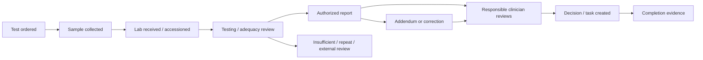

# Two patients with AML: reports, decisions, and the system's role

Researched **11 October 2026**. These are two **fictional adults with newly diagnosed non-APL acute myeloid leukemia (AML)**, chosen to show how the same broad diagnosis leads to different care. They are not actual patients or treatment recommendations. Exact drugs, doses, timing, thresholds and treatment eligibility require the treating team and its current protocols.

The core distinction is **disease biology + patient fitness + preferences + response over time**. Age is one factor, not an automatic intensity rule. AML does not use the usual solid-tumour “stage 1–4” framework: subtype, disease status, genetics, clinical condition and response matter. [NCI patient AML](https://www.cancer.gov/types/leukemia/patient/adult-aml-treatment-pdq) · [NCI professional AML](https://www.cancer.gov/types/leukemia/hp/adult-aml-treatment-pdq)

## The two patients

The following information is revealed gradually by the workflow, not known on arrival.

| | Patient A: Meera | Patient B: Arun |
|---|---|---|
| Starting situation | Age 42; fatigue and bruising; previously independent | Age 74; fatigue and fever; frailty and significant existing heart disease |
| Eventual diagnosis | Non-APL AML | Non-APL AML |
| Fictional genetic findings | NPM1 mutation; FLT3-ITD not detected; no adverse cytogenetic finding identified | Complex karyotype and TP53 mutation |
| Specialist fitness assessment | Able to undertake intensive treatment | Intensive treatment judged disproportionately risky after functional, organ and comorbidity review |
| Illustrative chosen path | Intensive remission induction, then response-guided post-remission treatment | Lower-intensity disease-directed therapy with close monitoring and repeated assessment |
| Fictional subsequent course | Remission achieved; appropriate MRD assay detects no residual disease at specified assessments; consolidation and follow-up | Clinician-confirmed remission after serial assessment; ongoing treatment while beneficial; cardiac/frailty limitations persist |

These outcomes are illustrative, not predictions. NCI describes improved prognosis with NPM1 mutation in the absence of FLT3-ITD and lists complex karyotype and TP53 among adverse factors. We do **not** assign a formal ELN risk category from two isolated results: the hematologist must review the complete profile and applicable classification. [NCI professional AML: classification and remission treatment](https://www.cancer.gov/types/leukemia/hp/adult-aml-treatment-pdq)

## 1. Symptoms lead to blood tests and urgent referral

**Reports:** complete blood count (CBC), including differential; peripheral blood smear report; referral/initial assessment note. The laboratory authorizes the CBC; a qualified laboratory physician/hematopathologist reviews the smear. The clinician evaluates the results in context. The CBC measures blood-cell populations; the smear examines cell appearance. These can raise suspicion but do not, alone, fully classify the leukemia. [NCI patient AML: diagnostic tests](https://www.cancer.gov/types/leukemia/patient/adult-aml-treatment-pdq)

**A:** blood findings and abnormal immature cells prompt urgent hematology assessment. **B:** similar concern plus fever triggers simultaneous assessment for infection and clinical instability.

**Decision owner:** referring clinician/emergency team and accepting hematologist decide urgency, immediate evaluation and admission. The system does not infer that a high or low count by itself equals confirmed AML.

**Our system:** match patient identity, preserve sample time and source, route the abnormal report to the responsible team, and track referral acceptance and acknowledgement. A notification is not proof someone has acted.

## 2. Stabilization and diagnostic work proceed in parallel

**Reports/records:** hematology admission note, serial CBC, clinician-selected coagulation and biochemical tests, infection investigations when indicated, and supportive-treatment orders. Orders, results and administered treatment are different records.

**A:** assessed for infection, bleeding, metabolic and other immediate risks. **B:** the same assessment, with particular attention to fever, cardiac status and tolerance of supportive interventions. The team can order blood-product support or infection treatment as clinically required. AML and its therapy both suppress normal blood production; NCI explicitly describes close monitoring, transfusions and infectious-complication support. [NCI professional AML: supportive care](https://www.cancer.gov/types/leukemia/hp/adult-aml-treatment-pdq)

**Decision owner:** hematologist/acute-care team, with other specialists and the blood bank as needed.

**Our system:** run diagnostic and urgent-care tasks simultaneously. Do not lock care behind “all molecular tests complete,” MDT scheduling or financial paperwork. Capture the clinician's decision about what must be known before a particular treatment versus what can remain pending.

**Important exception:** suspected acute promyelocytic leukemia (APL) is an emergency with its own pathway. ELN recommends immediate specialist management before genetic confirmation because of early bleeding risk. Our two patients are ultimately confirmed non-APL; software must not put an APL-suspected patient into an ordinary waiting queue. [ELN APL recommendations, Table 1](https://pmc.ncbi.nlm.nih.gov/articles/PMC6509567/)

## 3. Bone marrow and cell tests establish what disease this is

The hematology team obtains appropriate marrow samples; the diagnostic teams generate several complementary reports. The exact specimen plan depends on the case, and peripheral blood may also provide diagnostic material. Morphology alone is insufficient to establish lineage. [NCI professional AML: diagnostic evaluation](https://www.cancer.gov/types/leukemia/hp/adult-aml-treatment-pdq)

| Report | Who generates/interprets it | Question it answers |
|---|---|---|
| Marrow aspirate morphology | Hematopathology team examines cells | What cells/blasts are present and in what pattern? |
| Trephine/core-biopsy histology | Pathologist examines tissue architecture | What does the marrow tissue show; is the sample adequate? |
| Flow-cytometry immunophenotyping | Specialist laboratory and reporting hematopathologist | Which cell markers are expressed; does the population fit myeloid or another lineage? |
| Integrated diagnostic assessment | Hematopathologist integrates available evidence; treating hematologist reviews | What diagnosis is supported, what remains provisional, and which results are pending? |

**A and B:** both are diagnosed with AML using integrated evidence. The marrow and flow reports may look broadly similar while their genetic profiles differ. Not every centre emits a single document titled “integrated report”; the system should support either a consolidated interpretation or linked authorized reports.

**Decision owner:** diagnostic specialists establish and report the laboratory interpretation; the treating hematologist integrates it with clinical findings and directs care.

**Our system:** track specimen identifiers, adequacy, diagnostic status and outstanding components. Keep “AML suspected,” “AML confirmed,” and “full genetic classification pending” separate. Conflicting findings or an addendum prompt expert review; an LLM must not silently choose which result is correct.

## 4. Genetics explains why the disease is not biologically identical

**Reports:** karyotype/cytogenetic report, targeted FISH when indicated, and molecular tests/panel report, authorized by the relevant diagnostic laboratory.

- **Karyotype** examines chromosomes for number/structural abnormalities.
- **FISH** uses targeted probes to look for particular chromosomal changes; a negative targeted result does not establish a globally normal karyotype.
- **Molecular testing** identifies selected gene variants or fusions using the specified assay. Its coverage and sensitivity matter.

These methods contribute different information and are not interchangeable. [NCI patient AML: cytogenetic and molecular tests](https://www.cancer.gov/types/leukemia/patient/adult-aml-treatment-pdq)

**A:** NPM1 mutation, no FLT3-ITD detected, no adverse cytogenetic finding in the completed workup. **B:** complex chromosomal abnormalities and TP53 mutation. These findings change the clinician's discussion of relapse risk, treatment expectations, trials and post-remission strategy. They do not constitute an automatic drug-selection rule. [NCI professional AML](https://www.cancer.gov/types/leukemia/hp/adult-aml-treatment-pdq)

**Decision owner:** hematologist, supported by hematopathology/molecular specialists, documents a dated risk interpretation with its classification version and limitations.

**Our system:** attach each result to its actual specimen and assay; show “pending” distinctly from “not detected.” Link the doctor's risk assessment to the evidence rather than calculating a permanent prognosis from one gene.

## 5. Fitness and goals determine what each person can reasonably undertake

**Reports/notes:** functional/performance and frailty assessment, comorbidity/medication history, kidney/liver results, relevant cardiac assessment, and patient-preference discussion. The hematologist specifies the necessary baseline workup; cardiology contributes for Arun. Treatment choice must consider overall health, not merely the diagnosis. [NCI professional AML: treatment overview and newly diagnosed AML](https://www.cancer.gov/types/leukemia/hp/adult-aml-treatment-pdq)

**A:** assessment supports intensive treatment. **B:** frailty and cardiac disease make intensive treatment substantially less suitable. An older but fit patient could have a different decision; a younger person with serious organ disease might also be unsuitable for intensive treatment.

**Decision owner:** treating hematologist with relevant specialists, and the patient through discussion of benefits, burdens and preferences. MDT review can support complex decisions; it is not a software prerequisite for urgent action.

**Our system:** present separate panels for leukemia biology, fitness, patient goals and practical barriers. Record why intensity was selected. Do not encode “age over X → low intensity” or confuse financial approval with clinical suitability.

## 6. A strategy becomes signed orders

**Documents:** treatment recommendation/rationale, consent and patient discussion, signed care plan, patient-specific treatment orders, monitoring/supportive-care orders and appointments/admission plan.

**A:** in this scenario the team selects intensive remission-induction treatment, aiming to achieve remission and proceed to appropriate post-remission care. **B:** the team and patient choose a lower-intensity disease-directed approach after considering fitness, genetics, preferences, available therapies and trials. NCI describes both intensive and less-intensive approaches; the latter can continue while providing benefit. [NCI professional AML: newly diagnosed AML](https://www.cancer.gov/types/leukemia/hp/adult-aml-treatment-pdq)

**Why plans differ:** A's organ reserve supports intensive treatment; B's functional/cardiac limitations change the benefit–risk balance, while his genetics also change expectations. Adverse genetics do not automatically mean “give stronger chemotherapy.”

**Decision owner:** hematologist prescribes; patient agrees after discussion; authorized pharmacy/nursing teams verify and execute according to local policy.

**Our system:** preserve three levels: **strategy → signed current order → actual delivery**. NCG's medical oncology specification already separates protocol master, physician notes, nursing administration, toxicity and completion summaries. Build on that separation. [NCG medical module, pp. 6–17](https://www.kcdo.in/src/docx/ner-medical-oncology-module-2.0.pdf)

## 7. Delivery generates a continuing record, not one treatment PDF

**Records:** medication administration, observations, serial laboratory results, transfusion orders and administration/reaction records, infection workup, complications, clinician modifications, and discharge/handoff summary when appropriate.

**A:** intensive treatment is delivered in an inpatient setting in this example, with close observation during treatment and marrow suppression. **B:** lower-intensity therapy still needs substantial monitoring and may require admission, especially initially or during complications. “Lower intensity” does not mean low risk or uncomplicated outpatient care: myelosuppression, infections and tumour-lysis risk remain relevant. [NCI professional AML: supportive care and less-intensive treatment](https://www.cancer.gov/types/leukemia/hp/adult-aml-treatment-pdq)

**Decision owner:** hematologist/current responsible clinician decides continuation, holds and modifications; nurses document actual administration and observations; diagnostic/transfusion services supply their records.

**Our system:** show latest reviewed evidence alongside the active signed order, identify stale/superseded orders, record what was actually given and why something was held, and route clinician-defined escalation tasks to staffed services. The system must not independently authorize the next treatment or “clear” a patient from a normal-looking CBC.

## 8. Response is assessed using blood, marrow and appropriate MRD testing

**Reports:** response marrow morphology/histology, blood counts, and a separately identified measurable residual disease (MRD) report. MRD assays look more sensitively for leukemia remaining after treatment; their method, specimen, sensitivity and time point matter. A standard molecular panel is not automatically an MRD assay. [ELN MRD consensus, Tables 2–4](https://pmc.ncbi.nlm.nih.gov/articles/PMC8718623/)

**A:** the hematologist documents complete remission based on the full assessment. At the chosen assessment points, validated NPM1 molecular MRD testing detects no residual disease within the assay's capability. **B:** after serial assessments on his selected treatment, the hematologist also documents remission in this fictional course. An appropriate flow-based MRD assessment is used where indicated; his TP53 panel result must not be turned into a universal standalone MRD rule.

ELN recommends molecular MRD using qPCR/dPCR for NPM1-mutated AML and multiparameter-flow MRD for cases outside specified molecular subgroups. We do not apply its specific monitoring timetable here; the current treating service selects the method and schedule. [ELN MRD consensus, recommendations D1–D4](https://pmc.ncbi.nlm.nih.gov/articles/PMC8718623/)

**Decision owner:** laboratory reports measurements and limitations; hematologist assigns response status and its treatment consequences. Persistent disease may require reassessment, but a single early marrow or low blood count is not by itself a universal treatment-failure rule.

**Our system:** display morphology, count recovery and MRD separately, with original dates and specimens. **Complete remission is not synonymous with cure; “MRD not detected” is not proof that no leukemia cell exists.** NCI response criteria distinguish remission categories and residual disease. [NCI professional AML: response categories](https://www.cancer.gov/types/leukemia/hp/adult-aml-treatment-pdq)

## 9. The next phase differs again

**A:** the team selects consolidation in this example—post-remission treatment intended to reduce relapse risk—using his full risk/response profile. After its completion, he enters a documented monitoring plan. **B:** remission does not automatically end his lower-intensity regimen; the team continues cycles while benefit and tolerability justify them, with reassessment and supportive care. [NCI patient AML: treatment phases](https://www.cancer.gov/types/leukemia/patient/adult-aml-treatment-pdq) · [NCI professional AML: less-intensive therapy](https://www.cancer.gov/types/leukemia/hp/adult-aml-treatment-pdq)

**Transplant is a separate decision, not a compulsory next box.** If indicated, referral produces a transplant consultation, candidacy assessment, HLA-typing/donor-search information and a proposed plan. The leukemia and transplant teams consider relapse risk, response, comorbidities, donor options and patient priorities. A does not automatically need transplant; B's adverse biology does not override his ability to tolerate it. In this fictional course, his continuing cardiac/frailty limitations prevent progression to transplant. [NCI professional AML: allogeneic transplantation in remission](https://www.cancer.gov/types/leukemia/hp/adult-aml-treatment-pdq)

Transplant evaluation and donor planning may be initiated earlier, in parallel, when the treating team anticipates a potential indication; they do not have to wait for the end of this numbered walkthrough.

**Our system:** distinguish “consider transplant,” “referred,” “evaluated,” “donor search initiated” and “approved/scheduled.” Track eligibility rationale and changing decisions, never equating an HLA report with transplant approval.

## 10. Ongoing monitoring, relapse and supportive care

**Documents:** treatment-completion or ongoing-treatment summary, follow-up schedule, symptom/laboratory reviews, appropriate repeat marrow/MRD reports and new diagnostic/genetic workup if relapse is suspected. Each concerning result needs clinician acknowledgement and disposition.

**A:** scheduled monitoring after consolidation, with a clear route for new concerns. **B:** active treatment-cycle reviews, repeated benefit–burden discussions and continued supportive care. For either, persistent/recurrent disease can reopen the treatment decision, including trial review, another treatment approach or a stronger symptom-focused emphasis. Palliative care can accompany disease-directed treatment; it is not reserved for treatment failure. [NCI AML: recurrent/refractory treatment](https://www.cancer.gov/types/leukemia/hp/adult-aml-treatment-pdq) · [NCI palliative care](https://www.cancer.gov/about-cancer/advanced-cancer/care-choices/palliative-care-fact-sheet)

**Our system:** retain the historical diagnosis and plans, open a new assessment episode, track missed follow-ups, and deliver clinician-approved instructions with a named contact. The final action is not “report uploaded”; it is **report reviewed → consequence documented → patient/team informed → next action completed**.

## The underlying status flow

This is a **proposed software model**, not a mandated clinical sequence:

Illustrative audit trail: the molecular test is **ordered**, but the laboratory has not yet received material; the coordinator resolves transport. Later the report is **authorized**, but not yet reviewed; the hematologist receives the review task. Only after review does an updated plan become active. Never substitute one of those statuses for another.

For every extracted value store patient/episode, specimen ID, source report/page, collection date, authorization date, assay, units if relevant, reference interval or detection limit, version, author and verification status. Keep machine extraction, laboratory interpretation and the hematologist's clinical decision separate.

## Sources and limits

All accessed **11 October 2026** through gstack browse. Case characteristics, outcomes and system behavior are illustrative/proposed; general clinical claims are linked above.

1. [NCI professional AML PDQ](https://www.cancer.gov/types/leukemia/hp/adult-aml-treatment-pdq): diagnostic evaluation; NPM1; treatment overview; supportive care; newly diagnosed, remission and recurrent treatment; response tables. Page showed update 14 March 2025. It is an evidence summary, not a local protocol; some classification discussion is historical.
2. [NCI patient AML PDQ](https://www.cancer.gov/types/leukemia/patient/adult-aml-treatment-pdq): diagnostic test explanations, absence of conventional staging, treatment phases and supportive care.
3. [ELN MRD Working Party original consensus, 2021](https://pmc.ncbi.nlm.nih.gov/articles/PMC8718623/): Tables 2–4 and assay/interpretation recommendations. Used for foundational method distinctions, not claimed to be a comprehensive latest-protocol review.
4. [ELN APL expert recommendations, 2019](https://pmc.ncbi.nlm.nih.gov/articles/PMC6509567/): suspected APL emergency and Table 1.
5. [NCG–KCDO medical oncology requirements v2.0](https://www.kcdo.in/src/docx/ner-medical-oncology-module-2.0.pdf): pp. 6–17, protocol/orders/nursing/toxicity/summaries. A system specification, not an AML treatment guideline.
6. [NCI palliative care](https://www.cancer.gov/about-cancer/advanced-cancer/care-choices/palliative-care-fact-sheet): care alongside cancer-directed treatment.

The [2022 ELN publication record](https://pubmed.ncbi.nlm.nih.gov/35797463/) was verified, but full text was blocked by the publisher in this session; it was not used to assign formal risk labels. Indian drug approvals, availability, costs and individual-hospital protocols were not verified or inferred from US treatment descriptions. No doses, fixed universal timelines or transfusion thresholds are prescribed here.
