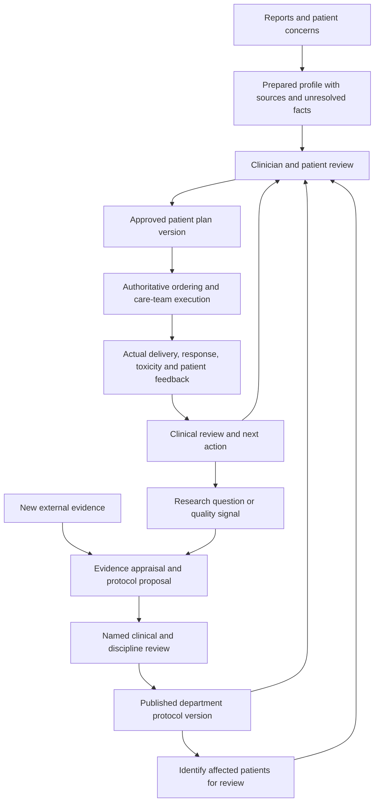

# Proposed next build and validation plan

11 October 2026. Product recommendation, not an adopted hospital protocol or clinical validation. Read with the accompanying research report and source notes.

## Product promise to test

For each patient, make it easy for the team to know the current reviewed clinical picture, the next decision, the approved plan, who owns the next action, and what actually happened. Reuse reviewed evidence and department-approved pathways, with explicit patient-specific decisions and exceptions.

## Two connected loops

A changed protocol creates an impact-review queue. It never silently replaces active patient plans. A reported session remains distinguishable from an authenticated administration record. A published study result remains distinguishable from an individual patient's response.

## Next three reviewable slices

### 1. Prove the everyday care loop

Keep the current six-dimensional profile, source review, applicability snapshots and patient-plan approval. Add a compact patient summary above the detail: decision due; change since last review; missing input; responsible person; next action/date; current plan and protocol version. Every item opens its supporting record.

Demonstrate a routine follow-up, an incomplete case, and a case requiring specialist review. Avoid making every routine visit start a literature-review exercise. Scope review to changed material while preserving access to the entire clinical record. The current code uses a broad case revision and requires research applicability for patient-plan changes; distinguish operational edits, routine continuation, patient-specific exceptions and research-triggered changes before expanding this workflow. A new task should not by itself imply a new clinical decision. Which changes need renewed approval must be defined with the service.

Exit criterion: representative clinicians and coordinators can complete a realistic fictional case without the builder explaining the intended clicks, and can identify current decisions, unresolved items and responsibility correctly. This establishes usability evidence only.

### 2. Add departmental protocol governance

Create a real shared protocol object separate from the existing patient-specific draft:

- Identity, disease/setting, intended use and explicit exclusion or exception conditions.
- Version, effective date, review date, owner and institution/service.
- Supporting evidence versions, appraisal, limitations and applicable local resources.
- Required facts, review points, monitoring responsibilities and escalation rules authored by the service.
- Named reviewer assignments, scope, disagreement and resolution.
- Draft → in review → approved/published → superseded or withdrawn states.
- A change comparison and the set of patient plans using the prior version.

The lifecycle above is a proposed software model; exact reviewers and approval policy are institution-specific. Approval of a library source does not itself publish a protocol. Publication does not approve its application to a patient. A justified deviation from a pathway is recorded and can trigger review without being treated automatically as an error.

Exit criterion: one service can propose, review, publish and supersede a fictional protocol; a reviewer can reconstruct why it changed; affected case plans remain unchanged until individually reviewed.

### 3. Make one service pilot possible

Replace simulated actors and browser-only records with real authentication, permissions, shared persistence, version concurrency checks and an attributable audit trail. Put source documents in controlled durable storage. Establish which hospital system owns identity, orders, administration and results; agree one import and one approved export/reconciliation route. Test the failure path as well as success. Add patient/caregiver next-step communication only when the service has a defined approval and staffed response process; the present main app is an oncologist workspace, not a working patient portal.

Do not start with all oncology specialties. Pick one service and one recurring workflow with the partner. The existing AML fictional cases are useful discovery material; their presence is not evidence that AML is the best first commercial market.

Exit criterion: an institution approves the intended pilot use and information flows, users do not need to maintain conflicting records, and the agreed workflow can be measured against its current baseline.

## Component ownership

| Component | Owns | Must not decide alone |
|---|---|---|
| Patient workspace | Source-linked facts, review changes, timeline, decisions and tasks | Diagnosis, therapy or delivery clearance |
| Evidence workspace | Search/import, study extraction, evidence versions, appraisals, research requests | Whether a paper becomes departmental practice |
| Protocol service | Reviewed templates, lifecycle, change comparison, applicability constraints, impact queue | Automatic migration of active patient plans |
| Clinical decision record | Chosen approach, alternatives, rationale, patient discussion, deviations, signer | Whether a generated recommendation is clinically correct |
| Task and event service | Assignment, acceptance, completion evidence, due date, observations | Inferring treatment occurred from a scheduled event |
| Integration service | Identity/source mapping, import, reconciliation, approved write-back | Silently changing the authoritative record |
| AI workers | Draft extraction, cited summary, retrieval, comparison and candidate change proposals | Publishing protocols, signing plans or creating executable orders |
| Evaluation and audit | Error review, version history, access trail, task metrics and model regressions | Claiming clinical benefit from UI tests |

Suggested implementation, not a technology mandate: a typed application service, relational database, document object store and durable background job queue. Use explicit state transitions for approvals and tasks. Keep model outputs as drafts until the appropriate verification/clinical review. Do not begin with multiple autonomous agents that can mutate patient plans.

Minimum linked objects: Patient, Episode, SourceDocumentVersion, Specimen, Observation, ProfileReview, EvidenceSourceVersion, EvidenceAppraisal, ProtocolTemplateVersion, ApplicabilityReview, PatientPlanVersion, CareEvent, Task, ClinicalDecision, ResearchQuestion. Observations need patient/specimen/date/method/source linkage; arbitrary note text is insufficient for dependable cohort analysis.

## Research expansion order

1. **Evidence-to-practice work:** answer a focused clinical question, retrieve reliable sources, appraise population/endpoints/limitations, compare to current pathway, and propose a reviewed change. This is the closest next extension of the existing lab.
2. **Service quality and observational research:** define cohort, denominator, endpoint, time zero, follow-up, missingness and analysis plan; collect comparable data through routine workflow; review quality and confounding. A descriptive dashboard cannot establish treatment superiority.
3. **Prospective clinical research:** add study-specific eligibility, screening/consent, approvals, safety reporting and study data processes under the institution's research team. This is a separate operational capability, not just another tab in the literature tool.

## Validate that the problem is real

Recruit a small discovery group such as 2–3 oncologists plus a coordinator, oncology nurse/pharmacist and pathway owner in one service. This is a proposed discovery sample, not a powered clinical study.

Observe consecutive new and follow-up cases using the existing process, with institution-authorized access. Start with fictional or appropriately prepared cases for prototype sessions. For each case, record where the team reconstructs history, duplicates entry, waits for a report, loses a handoff, or repeats an evidence review. Ask for recent concrete examples rather than agreement with the vision.

Use the same task definitions to compare baseline and prototype:

| Question | Measure |
|---|---|
| Does preparation actually take less work? | Total active staff time across roles, including verification/correction and duplicate entry |
| Are decisions supported by the right information? | Important omissions, wrong/stale/source-mismatched facts and residual errors after review |
| Do tasks get completed? | Unacknowledged/overdue actions, completion evidence and attributable delay reasons |
| Is shared knowledge reused? | Repeated appraisal avoided, turnaround to a reviewed answer, stale-source/plan incidents |
| Can patients follow the plan? | Understanding of next steps, ownership of concern response, access barriers captured and acted upon |
| Will the service adopt it? | Return use, named owner, agreed integration route, concrete willingness to pilot/pay |

Have the service define acceptable safety and operational thresholds before testing. Record failures, dissent and cases where the tool adds work. A small discovery exercise can reject an awkward workflow; it cannot certify clinical accuracy or demonstrate survival benefit.

## Decision gates

- **Continue:** a frequent costly problem is observed, a team owns it, a comparison demonstrates lower total burden with acceptable reviewed information quality, and a feasible integration path exists.
- **Revise:** the main pain is elsewhere, evidence review is occasional, or another role absorbs the saved clinician time. Reorder the product around the measured bottleneck.
- **Stop or pivot:** users must duplicate a complete chart, no one owns the queue, the current hospital system already solves the problem adequately, or safe adoption requires a scope far beyond the team's capacity.

The strongest next demonstration is an end-to-end case and a governed protocol change, not a larger dashboard or a general oncology chatbot.
