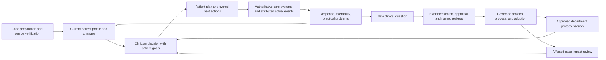

# Local prototype audit: fit to the oncology department vision

Inspected 11 October 2026. Scope: read-only inspection of the confirmed `healthcare/product` app, its guide, blueprints and relevant tests. No web research in this strand. These are current implementation findings, not an assessment of clinical accuracy or clinical suitability. The workspace was confirmed untracked by Gortex, so local source reads were used. No application or test files were changed.

## Main conclusion

The existing app is already a useful demonstration of the intended **patient care → evidence applicability → approved patient plan → attributed session feedback → next decision** loop. It should be evolved, not discarded in favor of copying another product's website. The strongest implemented foundation is source provenance and version-bound review. The largest gaps are a shared department protocol/SOP library, actual team workflow and integrations, structured research/outcome data, and clinical/workflow validation. Calling this an AI treatment engine or department operating system today would overstate it.

The current UI is an **oncologist-only local prototype with two fictional AML cases**. Some documentation and legacy demo routes still describe role switching. Current code explicitly fixes `role='oncologist'`; care-team acknowledgement can be transcribed by the oncologist, and session observations retain the reported source instead of impersonating a care-team signature.

Evidence: [current role and storage](/Users/anukkrit/Documents/ChatGPT/healthcare/product/intake-app.js:2), [fictional case definitions](/Users/anukkrit/Documents/ChatGPT/healthcare/product/intake-model.js:5), [reported acknowledgement](/Users/anukkrit/Documents/ChatGPT/healthcare/product/protocol-model.js:24), [session attribution](/Users/anukkrit/Documents/ChatGPT/healthcare/product/session-model.js:13).

## Capability inventory

| User goal | Implemented in current prototype | What remains missing or simulated |
|---|---|---|
| Manage a caseload | Two-patient worklist, pending source findings, open/accepted tasks, next owner/action, pending session reviews; case-specific tabs | Dynamic patient enrollment, real identities/episodes, clinical-team assignment, due times/overdue queues, scheduling, operational capacity and service-specific prioritization |
| Understand each patient | Real PDF/PNG/JPEG import; retained originals, SHA-256 hashes, PDF text coordinates; reviewed facts grouped into six dimensions; prior encounter comparison | General clinical extraction, OCR, complete specimen/assay relationships, terminology normalization, diagnostic inference, real longitudinal feeds |
| Decide patient-specific next steps | Scoped profile review; encounter continue/reassess/modify; clinician-authored research-linked plan draft, explicit approval and retained earlier versions | Validated option generation/ranking, executable institutional pathways, structured orders/doses, specialty-specific clearance and administration |
| Help oncologists research | Independent research questions; upload papers; keyword candidate passages; original-page review; appraisal/limitations; scoped library review | Live literature search, comprehensive extraction, study-design/evidence-grading workflows, reviewer assignments, disagreement resolution, evidence surveillance/retraction feeds |
| Relate research to a patient | Clinician compares source criteria with verified actual profile facts; Matches/Differs/Unknown/Not applicable plus reasoning; patient and source snapshots | Validated semantic eligibility reasoning, trial recruitment integration, availability and local formulary checks; no efficacy prediction |
| Make research affect care | A signed applicability review links into the same patient's protocol tab; exact draft approval creates a patient plan version; named team/task and local handoff | Department adoption of a shared template, distribution to multiple oncologists, real team inbox/acknowledgement, integration with authoritative orders |
| Learn after treatment | Attributed session reports distinguish completed/partial/not given/uncertain; response and side effects; clinician continue/reassess/change; history linked to a protocol packet | Verified administration records, structured outcomes/denominators, standardized assessments, follow-up completeness, cohort analysis, causal inference or prospective research operations |
| Department SOPs | Strong blueprint separates institutional protocol template, patient plan, care event and approval scopes | No implemented shared institutional protocol registry, multi-discipline adoption process, effective/review dates, SOP branching, exception workflow or impact queue |
| Patient/family manageability | Some earlier demo companion content and planned responsibilities | Current main app has no selectable family account, patient portal, authenticated caregiver permissions, confirmed appointment/instruction delivery or staffed concern-response service |

## Implementation evidence and reusable strengths

### 1. Patient profile and provenance are real interactions

`IntakeModel.extract` recognizes a finite list of labelled fields and creates candidates with original value, exact quotation, page, start/end offsets and boxes. It is a regular-expression parser, not a general model. `identity`, `inspect` and `reviewFact` separate report association, source inspection and verification/correction. A corrected or excluded value requires a reason, and original wording survives. Missing, pending, not detected and contradictory values are not all collapsed into the same state.

- [Field list, extraction and receipt](/Users/anukkrit/Documents/ChatGPT/healthcare/product/intake-model.js:6)
- [Identity and verification gates](/Users/anukkrit/Documents/ChatGPT/healthcare/product/intake-model.js:15)
- [Missing/conflict checks and scoped review](/Users/anukkrit/Documents/ChatGPT/healthcare/product/intake-model.js:20)
- [PDF extraction, geometry and original persistence](/Users/anukkrit/Documents/ChatGPT/healthcare/product/pdf-reader.js:14)

The six-dimensional profile is a good product primitive: biology, extent, fitness, history, current condition, priorities/access. Its snapshots retain missing facts and review status. Its comparison distinguishes added/corrected/reviewed findings; a new result is not automatically interpreted as improvement. Current/history dimensions now include attributed session feedback.

- [Dimension definitions](/Users/anukkrit/Documents/ChatGPT/healthcare/product/profile-dimensions.js:4)
- [Snapshots, session feedback and diff](/Users/anukkrit/Documents/ChatGPT/healthcare/product/profile-dimensions.js:16)

**Reuse:** the underlying provenance schema, original viewer, candidate-versus-reviewed state, missingness rules, patient/episode scoping concept, immutable snapshot pattern, accessible source-region marking. Preserve these when adding a model or database; do not replace them with a narrative chat transcript.

### 2. The independent research library already connects to real saved patient profiles

The current research lab reads the clinical local store rather than using the older demo's hard-coded clinical characteristics. A research question begins without a patient. After library review, the clinician explicitly selects a patient and compares criteria against verified facts. Every Matches/Differs assessment must link a verified, resolved fact. Unknown stays explicit. The signed application captures evidence and patient versions; the link to the patient's protocol tab is real.

- [Research persistence and clinical profile loading](/Users/anukkrit/Documents/ChatGPT/healthcare/product/research-lab.js:2)
- [Independent question and reviewed-paper screens](/Users/anukkrit/Documents/ChatGPT/healthcare/product/research-lab.js:11)
- [Applicability screen and patient-plan link](/Users/anukkrit/Documents/ChatGPT/healthcare/product/research-lab.js:14)
- [Version checks and signed application creation](/Users/anukkrit/Documents/ChatGPT/healthcare/product/research-lab.js:18)

The paper extractor is keyword matching over sentences/paragraphs with an 80-passage cap. It does not comprehensively understand research, grade evidence, or infer treatment benefit. The current lab's source approval is one demo reviewer with a free-text appraisal. There is no study registry, methods workspace, statistical analysis or cohort query UI.

- [Keyword extraction and cap](/Users/anukkrit/Documents/ChatGPT/healthcare/product/pdf-evidence.js:4)
- [Original inspection, source review and approval](/Users/anukkrit/Documents/ChatGPT/healthcare/product/research-lab.js:15)

**Reuse:** independent question ownership, reuse of library review, clear separation of source review from patient applicability, explicit Unknown, and reconstructable patient/source snapshots. Expand the research schema before expanding the number of papers.

### 3. Patient plan approval and handoff are connected, but are local text workflows

`ProtocolModel.draft` requires the current signed applicability review, keeps the existing plan unchanged, and stores protocol text, rationale, uncertainty, monitoring, review timing, receiving team and requested task. `approve` requires current scoped profile review plus acknowledgement of the exact draft; it preserves prior approved packets. Handoff is a separate state. Current code also supports recording an externally received acknowledgement with reported author and oncologist attribution.

- [Applicability currency and approval status](/Users/anukkrit/Documents/ChatGPT/healthcare/product/protocol-model.js:11)
- [Draft and versioned approval](/Users/anukkrit/Documents/ChatGPT/healthcare/product/protocol-model.js:16)
- [Local handoff, acknowledgement and reported receipt](/Users/anukkrit/Documents/ChatGPT/healthcare/product/protocol-model.js:22)

This is a **patient-specific prose plan and review packet**, not a shared departmental SOP/template or drug-order engine. Code comments and UI explicitly say there is no prescribing/delivery/external messaging. Main data is local JSON and in-browser snapshots, not authoritative server transactions.

**Reuse:** draft-versus-approved distinction, exact version binding, prior-plan retention, named handoff object and separate receipt. Extend with a shared `ProtocolTemplate` object rather than treating every patient's free-text plan as the template.

### 4. The treatment feedback loop is more complete than the current guide suggests

`SessionModel.record` requires an acknowledged patient packet, captures date, session identifier, reported delivery status, response observations, side effects, actions, reported author/source and optional documents. It opens an oncologist review task. `review` records continue/reassess/change with separate response/toxicity assessment, reasoning and next step. It retains the patient plan unchanged; protocol changes must use the separate proposal/approval flow. Pending session reports prevent a new approval. A reviewed continuation can remain current while its evidence/plan remain consistent.

- [Packet selection and report creation](/Users/anukkrit/Documents/ChatGPT/healthcare/product/session-model.js:8)
- [Clinical review and continuation](/Users/anukkrit/Documents/ChatGPT/healthcare/product/session-model.js:16)
- [Pending feedback gate](/Users/anukkrit/Documents/ChatGPT/healthcare/product/protocol-model.js:13)
- [Session UI and explicit reported/assessed distinction](/Users/anukkrit/Documents/ChatGPT/healthcare/product/session-view.js:5)

**Reuse:** explicit planned-versus-reported-delivery distinction, source attribution, no-change decision, linkage to historical packet, feedback-to-review queue. This helps demonstrate the user's manageability objective. A free-text report is not sufficient for institutional research: research-grade endpoints require definitions, collection rules, missingness/follow-up and governance.

## Biggest remaining product gaps

1. **Department knowledge governance.** Implement shared protocol versions with defined intended population/setting, supporting and conflicting evidence, named clinical owners, discipline-specific requested reviews, disagreement resolution, adoption/effective/review dates, supersession and patient-impact review. These are explicitly proposed in [the blueprint's template distinction](/Users/anukkrit/Documents/ChatGPT/healthcare/product/oncologist-workspace-blueprint.md:47) and [knowledge workspace](/Users/anukkrit/Documents/ChatGPT/healthcare/product/oncologist-workspace-blueprint.md:75); they are not implemented by a single patient's plan approval.
2. **Actual team workflow.** Current main app hard-codes the oncologist. Coordinator/care-team methods and older role demos do not provide real access control or independent work ownership. Define who prepares the case, who confirms source transcription, who interprets, who receives work and which system records actual care. Avoid requiring the oncologist to manually operate every preparation and follow-up step.
3. **Practical caseload management.** Current worklist exposes only two fixed cases and first open task. There are no actual appointments, due-date management, reassignment, dependency queues, service filters, escalation staffing or workload balancing. Those may matter more to everyday adoption than broad research automation.
4. **An authoritative record and integrations.** Need authenticated server-side users/permissions, patient/episode linkage, transactional persistence, authorized audit/event history, backup/retention and original-file access. Integrate with the service's existing patient records, lab/pathology feeds, scheduling and orders rather than maintaining two conflicting charts. Current loopback Python server serves static files only [server](/Users/anukkrit/Documents/ChatGPT/healthcare/product/serve-demo.py:1); local storage is [here](/Users/anukkrit/Documents/ChatGPT/healthcare/product/intake-app.js:3).
5. **Evidence production, not only evidence reading.** Literature assistance and clinical research are different products. The lab supports reading/appraisal/applicability. Producing research requires governed cohort definitions, eligibility/data dictionaries, consent/ethics handling where appropriate, structured endpoints, analysis plans, missing data/follow-up tracking and research exports. None is demonstrated. The blueprint itself separates observational learning from protocol adoption [two loops](/Users/anukkrit/Documents/ChatGPT/healthcare/product/oncologist-workspace-blueprint.md:95).
6. **Generalization and accuracy.** The label parser, identity cross-check against two demo names, synthetic PDFs, free-text plan and UI signatures cannot establish clinical performance. The guide accurately calls for representative authorized documents, independent reference annotations and measurement of errors remaining after review [validation](/Users/anukkrit/Documents/ChatGPT/healthcare/product/intake-review-guide.md:58). Current tests establish software behavior only.

## Workflow mismatch to resolve before adding more features

The current code links **every research-backed patient plan change to a freshly signed research applicability review**. This is useful for an evidence-driven change demo, but may be too burdensome for routine care, a clinically justified exception, a patient-preference change or a toxicity-related adjustment within an already approved departmental pathway. `IntakeModel.change` increases one broad patient revision even for task/concern additions, while `ProtocolModel.applicable/status` tests revision equality. This can trigger more review than the underlying clinical change warrants.

Evidence: [broad revision change](/Users/anukkrit/Documents/ChatGPT/healthcare/product/intake-model.js:11), [task/concern application](/Users/anukkrit/Documents/ChatGPT/healthcare/product/intake-model.js:23), [currency checks](/Users/anukkrit/Documents/ChatGPT/healthcare/product/protocol-model.js:11), [session change instruction](/Users/anukkrit/Documents/ChatGPT/healthcare/product/session-view.js:5).

Proposed product correction, to test with clinicians: keep version-bound evidence, but distinguish a research-triggered change, routine pathway continuation, operational update and patient-specific exception. Re-review affected clinical facts and authority scope, with institution-defined escalation, instead of forcing every update through the entire paper-review chain. Do not interpret a software stale-state flag as an automatic clinical instruction to stop therapy.

## Proposed connected product model



Currently implemented as local interactions: much of A–D, attributed portions of F/B, R's PDF review/applicability portion. Missing: real E integration, reusable T/G, and an operational Q/R/I assignment-and-follow-up layer. Formal cohort research is an additional governed branch from structured data; it should not silently modify T.

## Recommended build and validation order

1. **Freeze one coherent demo flow and reconcile documentation/tests.** Keep the current patient and research routes, clearly label the older route, and document the new oncologist-only receipt/session workflow. Demonstrate one ordinary review, one missing-information case, one justified no-change decision and one exception.
2. **Observe and validate one service's daily work.** Measure active preparation/review time, repeated entry, time reconstructing a case, unresolved owner/due date, acknowledgement delay and errors remaining after review. Test whether the product reduces effort before expanding its scope. Existing blueprint metrics already align [metrics](/Users/anukkrit/Documents/ChatGPT/healthcare/product/oncologist-workspace-blueprint.md:144).
3. **Build the first real care coordination slice.** One disease pathway, real role assignments and due dates, authenticated shared records, original-file provenance and one agreed upstream/downstream integration. Retain approval and actual administration in their authoritative systems until expanded integration is validated.
4. **Add one governed department protocol.** Create a reusable approved template and patient-specific applications/exceptions; reuse approved evidence without re-appraising unchanged sources; create targeted review tasks when material facts or evidence change.
5. **Expand literature and research productivity.** Start with curated evidence questions and review requests. Add source discovery/extraction only with measured retrieval/omission/citation performance. Add structured outcome capture needed for the chosen service, then governed research datasets and analyses once data completeness and research purpose are established.

## Verification status and live-review instructions

Read-only targeted execution: `node --test product/tests/protocol-model.test.cjs` produced **10 passing tests and 1 failure**. The failing test is [protocol-model.test.cjs:11](/Users/anukkrit/Documents/ChatGPT/healthcare/product/tests/protocol-model.test.cjs:11). Its setup directly changes an already approved plan through the chat proposal API, but [IntakeModel.apply](/Users/anukkrit/Documents/ChatGPT/healthcare/product/intake-model.js:23) now rejects that operation and requires the approval workflow. This is a stale test setup versus a newer protective gate, not evidence that the unsafe mutation is permitted. The old guide's all-passing counts were not accepted as current verification. No broad suite or browser tests were run by this subagent. No dedicated SessionModel model test existed in the observed test inventory.

The user may be actively building this prototype elsewhere; this audit describes the observed files, not a frozen commit. It should not claim the current guide fully matches the UI.

Run from `/Users/anukkrit/Documents/ChatGPT/healthcare`:

```sh
python3 product/serve-demo.py
```

- Current clinical app: `http://127.0.0.1:8765/product/aml-screen-walkthrough.html`
- Current independent research lab: `http://127.0.0.1:8765/product/evidence-review.html`
- Earlier separate demonstration: `http://127.0.0.1:8765/product/patient-evidence-review.html`

The old route has a different case model and local store; do not use its synthetic automatic matching or role selector as evidence that the current clinical app has those capabilities. The guide records that separation [legacy boundary](/Users/anukkrit/Documents/ChatGPT/healthcare/product/intake-review-guide.md:102).

Audit: web searches 0; local source files/documents/tests inspected; targeted test command 1; application mutations 0; owned output only this file. Source tier: direct local implementation for code behavior; local design documents for intended functionality; guide's historical test claims treated as unverified historical statements.
