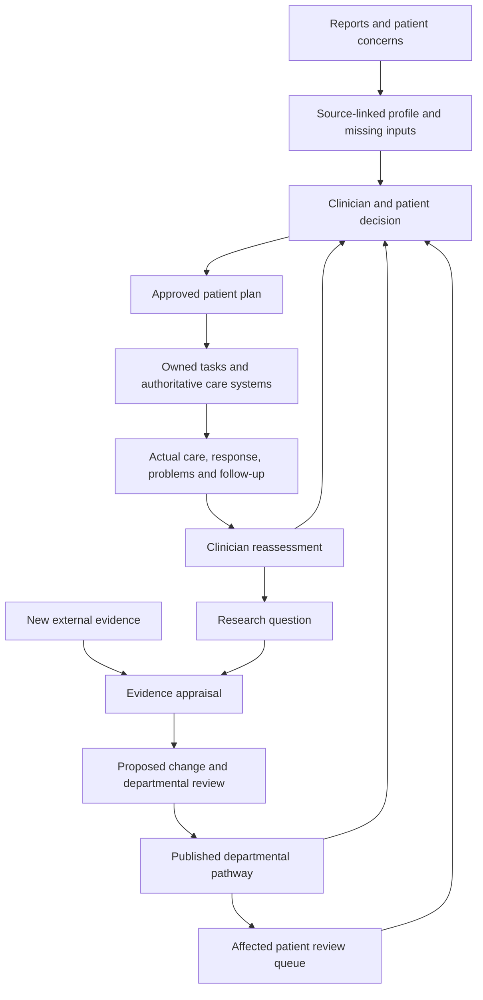

# Does Oncologic match our oncology department vision?

11 October 2026 · Research router → deep-research, with web-research delegation · Current prototype confirmed by the user: `healthcare/product`.

## Decision

**Yes: Oncologic is a strong conceptual reference, and the current prototype is already moving in a compatible direction.** It is not evidence that this product is clinically effective or that a specific hospital will adopt it. The best near-term opportunity to test is a connected workflow that prepares a reliable patient picture, supports an accountable clinician decision, and makes the next action happen.

The broader vision is a department that learns: reviewed evidence informs approved pathways; clinicians apply them to individual patients; actual care and outcomes generate new questions. Preserve that ambition, but revise the idea that the best oncologist will work *only* on research. Senior experts can lead evidence and protocol development while retaining responsibility for difficult cases, escalation and mentorship.

This report combines current public sources, direct inspection of the local app, and proposed product design. Recommendations and sample pilot designs are not established clinical protocols or demonstrated product benefits.

## 1. What Oncologic actually overlaps with

Oncologic publicly describes three connected functions: ResearchORB organizes oncology evidence; ReasonARC supports patient-specific pathway reasoning; PracticePAL coordinates administrative and care tasks. Its stated market is community oncology, with existing electronic-record integration and faster movement toward therapy. This is closely aligned with the user's research, patient decisions and manageability goals. Its public page does not establish a complete departmental protocol-publishing workflow or a research cohort-analysis product. Those capabilities may exist; they were not verified. [Oncologic platform](https://www.oncologic.ai/)

| User's objective | Relevant inspiration | Product decision for our app |
|---|---|---|
| Keep current with research | A reusable evidence function | Extend the current independent research lab with retrieval, appraisal and named review |
| Decide an individual plan | Evidence and patient context together | Keep source-linked applicability, uncertainty, alternatives and clinician-owned approval |
| Manage many patients | Connected operational follow-through | Prioritize decision queues, missing inputs, owners, due dates and accepted/completed work |
| Establish departmental protocols | Practice-aligned decisions | Add an explicit shared protocol lifecycle; public marketing does not demonstrate this detail |
| Produce departmental research | A longitudinal learning loop | Build reliable structured data and study workflows as a separate expansion |

The useful inspiration is the separation of knowledge, clinical decisions and operations, and their connection within existing clinical work. Copying branding, a general chatbot, or an autonomous therapy selector would not establish the underlying value.

Oncologic advertises 94% guideline alignment, 85% faster ordering and 38% lower per-claim costs, with a linked ASCO abstract. That abstract was inaccessible during this review; the study population, methods and scope of those metrics were not verified. Treat them as vendor claims, not targets or proof of platform-wide effectiveness. Its ordering-time claim is also not direct evidence of shorter patient time to therapy. [Vendor claims](https://www.oncologic.ai/)

## 2. How the actual Claude-built app matches

The app was inspected in the browser and in source. It contains considerably more than a design mockup, but remains a browser-local, fictional-case prototype.

| Capability | Observed implementation | Gap to the vision |
|---|---|---|
| Patient understanding | Six dimensions: biology, extent, fitness, history, current condition, priorities/access; source links, candidate/reviewed facts, changes over time | General extraction, full specimen/context linkage and real clinical feeds |
| Research support | Independent questions, PDF evidence review, appraisal, scoped library approval and patient applicability | Live search/AI, richer methods appraisal, assigned reviewers and evidence updates |
| Patient decisions | Research-linked proposal, exact draft review, approved plan versions and retained history | Shared protocol templates and validated clinical decision support |
| Follow-through | Local handoff packets, recorded receipt, attributed session feedback and next clinical review | Actual team accounts, owned inboxes, due-date workflows and authoritative delivery integration |
| Department learning | Useful provenance and event foundations | Structured cohorts, outcome definitions, missingness, analytical methods and research authorization |
| Patient/family manageability | Patient preferences/access represented in the profile | A current authenticated patient/caregiver companion and a staffed response process |

The current main interface fixes the acting role to the oncologist. Care-team reports and acknowledgements can be transcribed with attribution; this is not independent multiuser participation. PDF extraction is real, while clinical field parsing and paper passage discovery are limited rules/keywords. No general diagnostic AI or live literature agent is connected. Local storage and simulated signatures are not a clinical record system.

Most relevant implementation references: [current app/role](/Users/anukkrit/Documents/ChatGPT/healthcare/product/intake-app.js:2), [source/fact model](/Users/anukkrit/Documents/ChatGPT/healthcare/product/intake-model.js:6), [research lab](/Users/anukkrit/Documents/ChatGPT/healthcare/product/research-lab.js:14), [patient-plan approval](/Users/anukkrit/Documents/ChatGPT/healthcare/product/protocol-model.js:16), [session feedback](/Users/anukkrit/Documents/ChatGPT/healthcare/product/session-model.js:13).

**Keep this foundation.** Its strongest property is that facts, evidence, patient applicability, approval and delivered/reported care are distinguishable. These are more valuable to preserve than any particular screen layout. The detailed [prototype audit](findings_prototype.md) records implemented, simulated and missing behavior with line references.

One workflow needs correction before expansion: broad record revisions can stale approvals, and patient-plan changes currently depend on fresh research applicability. Separate routine continuation, operational edits, individual exceptions and research-triggered changes. Clinical review should cover what changed; unchanged source appraisal should be reusable. Validate the rules with the service rather than treating every software revision as a new clinical risk.

## 3. Are we solving the right problem?

**There is a credible problem category; the local product opportunity remains unvalidated.** Oncology care needs patient-specific planning, team communication, follow-up and support, rather than a list of patients with attached papers. The 2025 ASCO–COA standards provide professional support for that service shape, though only official indexed excerpts were accessible here. [ASCO–COA standards](https://ascopubs.org/doi/10.1200/OP-25-00498)

An actionable problem statement is:

> The team spends too much effort reconstructing each patient's situation, deciding what requires attention, and ensuring an agreed plan is followed through. The department also repeats evidence work without a clear route from reviewed knowledge to approved practice.

This is a hypothesis to investigate through observed cases. The dominant bottleneck may instead be diagnostic capacity, staffing, access, affordability or poor interoperability. Software can expose and coordinate a delay without being able to remove its underlying cause. Measure the whole team's burden, including verification and duplicate entry, rather than only the oncologist's screen time.

Patient follow-up is a real intervention with operational consequences. In the PRO-TECT randomized trial, symptom monitoring with care-team alerts improved several patient-centred outcomes and reduced emergency visits, but did not improve overall survival. The response team was part of the intervention. This supports testing accountable follow-up, not promising that our application improves survival. [Original PRO-TECT trial](https://pmc.ncbi.nlm.nih.gov/articles/PMC12184200/)

## 4. Refine the senior-oncologist model

The useful idea is to make expert knowledge reusable, giving senior clinicians protected time for research and pathway improvement. The part to reject as an assumption is that other oncologists should execute one expert's SOPs without independent patient assessment.

NHS guidance offers a useful operational reference: appropriate cases can use agreed standards to focus multidisciplinary discussion on complexity, while preserving oversight, complete case information and clinician/patient decisions. Uncertainty and patient preferences can trigger discussion. This is an English service reference, not a binding Indian workflow or proof of the proposed staffing model. [NHS multidisciplinary-team guidance, pp. 9–13](https://www.england.nhs.uk/wp-content/uploads/2020/01/multi-disciplinary-team-streamlining-guidance.pdf)

Proposed responsibilities:

- **Senior evidence/pathway lead and relevant specialists:** appraise evidence, maintain protocols, review exceptions, teach and lead research.
- **Treating oncologist:** assess the patient, discuss goals/options, choose and own the individual plan, document deviations and seek review when necessary.
- **Nurses, pharmacy and coordinators:** prepare information, progress assigned work, document their actions and observations, and escalate concerns.
- **Patient and authorized caregiver:** communicate preferences, barriers and symptoms; understand the agreed next step.
- **Software:** assemble, compare, remind, track, explain sources and preserve decisions. AI outputs remain proposals with a defined review owner.

Which disciplines participate depends on the disease, service and decision. A named deputy and backup response route matter as much as identifying a senior lead.

## 5. Separate four meanings of “protocol”

| Object | Purpose | Example of a software action |
|---|---|---|
| Clinical pathway/protocol | Approved reference for a defined patient population and setting | Publish version 2 after designated review |
| Individual patient plan | Application or justified deviation for a particular patient | Approve the patient's chosen approach with rationale and source versions |
| Department operating procedure | Who prepares, reviews, hands off, responds and audits | Define who handles a missing report or unacknowledged action |
| Research protocol | A study's question, methods, population, data and approvals | Open a study with named investigator and authorized data scope |

This distinction is a proposed data and workflow model. It is supported by the broader evidence/practice distinction: NCI explicitly treats its evidence summaries as different from clinical practice guidelines or treatment recommendations. A reviewed article must not silently become a departmental treatment rule. [NCI PDQ summaries](https://www.cancer.gov/publications/pdq/information-summaries)

## 6. The end-to-end workflow to build

There are two connected loops: patient care and departmental learning. Routine care should be able to use an already reviewed pathway. New evidence and recurring problems can start research. A published update identifies affected cases for review; it does not overwrite active plans. Clinical escalation should not wait for a literature-review task to finish.

NCI's evidence process uses expert review and consensus updates. Its discussion of study designs also explains why observational outcome patterns alone are insufficient to establish treatment superiority. Use local outcomes to investigate quality and generate well-designed studies; do not automatically promote them into new protocols. [NCI evidence methods](https://www.cancer.gov/publications/pdq/levels-evidence/treatment)

## 7. Help oncologists do research in stages

**First, help them use evidence:** focused questions, reliable retrieval, study populations/endpoints/limitations, comparison with current practice, peer comments and a proposed protocol amendment. This extends what the current lab already demonstrates.

**Then, help the service learn from its own care:** consistent data capture, explicit cohorts, denominators, follow-up, missingness and reproducible analysis. NCI's current real-world-data program highlights data quality and harmonization as foundational needs. A dashboard built over inconsistent notes does not solve them. [NCI real-world-data program](https://www.cancer.gov/about-nci/organization/cbiit/projects/real-world-data)

**Later, support formal studies:** study-specific workflows, investigators, data access, consent and appropriate institutional approvals. ICMR's research-integrity policy supports qualified research conduct, review and preservation of data. The institution must determine which approvals apply to a proposed audit or study; the app should record that determination. [ICMR research-integrity policy](https://www.icmr.gov.in/icmrobject/uploads/Guidelines/1724844182_icmr_pripe2019.pdf)

## 8. Recommended next build

1. **Make the everyday workflow easier to review.** Put decision due, changes, missing facts, owner and next action above the detailed profile. Demonstrate an ordinary review, an incomplete case and a justified exception. Preserve source access. Correct broad stale-review behavior and reconcile guide/test drift.
2. **Add one shared departmental protocol lifecycle.** Evidence → proposal → named reviews → approval → published version → exception/impact review. Keep it separate from patient-specific plans and the source library.
3. **Make one real service pilot possible.** Authenticated team users, shared database, controlled document storage, attributable history, due-date/task ownership and one agreed hospital integration. Avoid duplicate authoritative charts.
4. **Add evaluated AI and research automation where time is actually lost.** Begin with extraction and cited preparation, then evidence retrieval/appraisal assistance. Keep approvals and workflow transitions explicit. Add cohort research after usable longitudinal data exists.

These are reviewable product slices, not fixed calendar estimates. Choose one partner service and workflow. The existing AML cases help demonstrate behavior, but do not establish the best first market or pathway. Component ownership, minimum linked data objects and acceptance criteria are in the [build and validation plan](build-and-validation-plan.md).

## 9. Test whether to invest further

Observe one service's existing work before adding broad functionality. A small discovery group could include 2–3 oncologists, a coordinator, a nurse/pharmacy representative and the pathway owner. Use consecutive new and follow-up cases under institution-approved access; start prototype sessions with fictional or appropriately prepared material. This is discovery, not a powered clinical validation study.

Compare total staff preparation/review time, duplicate entry, clinically important omissions, errors remaining after review, delayed/unowned tasks, repeated evidence appraisal, and reasons care did not progress. Have the service define acceptable thresholds before testing. Ask for a named pilot owner and feasible integration route, not just positive feedback about the concept.

Continue if it measurably reduces a frequent problem without unacceptable extra work or information errors. Revise if another role absorbs the workload or the pain lies elsewhere. Pivot if the hospital's existing tools already solve it adequately or the real constraint is outside the product's reach. Public research cannot settle these local questions.

## Hypothesis verdicts and adversarial review

| Hypothesis | Current verdict |
|---|---|
| Oncologic overlaps with our care/research vision | Supported as observed public positioning; independent performance remains unverified |
| A reliable case and follow-through workspace addresses a real category of need | Plausible, supported by service guidance and adjacent clinical evidence; local demand/ROI unproven |
| The prototype already represents the core loop | Supported by code and browser inspection; production governance/integration absent |
| Senior knowledge can scale through protocols without senior case oversight | Reusable expertise is plausible; complete withdrawal from complex decisions is unsupported |

Four challenges were applied: Are we confusing marketing with performance? Are we solving the observed bottleneck? Could the workflow add more verification work? What would disprove the staffing and automatic-learning assumptions? The report retains uncertainty on all four. No thesis about local effectiveness, commercial differentiation or staffing outcomes met three-independent-source-type triangulation. Do not present those as validated. The separate [adversarial note](adversarial-review.md) records what could reverse the recommendation.

## Verification and audit

- Browser inspection: current patient home/worklist, six-dimensional profile, session feedback and research landing. Existing fictional records were viewed without record edits/reset.
- Source inspection: direct implementation audit, including local persistence, role, extraction, research applicability, plan approvals and session models. Application files were not changed.
- Targeted test: `node --test product/tests/protocol-model.test.cjs` returned 10 pass / 1 fail. The failure is a stale test setup attempting a direct plan mutation that the current protective gate rejects. No full-suite pass or clinical accuracy is claimed.
- Discovery queries: 18 attempts total: 10 substantive indexed searches, 8 browser search attempts. Returned discovery entries: 84 across strands, including irrelevant and duplicate variants; these are not 84 reviewed sources.
- Public evidence: 8 fully read primary pages/documents plus 2 cited sources available only as indexed excerpts across the strand reports. This synthesis uses 8 supporting public sources. Vendor vision and ASCO assistant are additional sources in the strand notes; the inaccessible linked ASCO study is not supporting evidence.
- Access limitations: main strand 3 blocked/failed search or fetch attempts; clinical strand 9 browser/fetch failures; governance strand 7 blocked/timeout/crash attempts. Three additional browser searches returned unhelpful results. One local browser-directory setup error was corrected. Counts describe attempts, not independent unavailable sources.
- Tool fallback: gstack browse was used for website/UI reading. Browser-search blocks required indexed discovery; NHS and PRO-TECT required read-only retrieval fallback. ASCO standards/assistant were not full-text verified. Gortex did not track this workspace, so local source inspection used read-only filesystem tools.
- Source reliability: primary vendor material for product claims; primary professional/institutional guidance for workflow; one original randomized trial for adjacent follow-up evidence; direct local code/browser evidence for implementation. NCI's discussion of another study is a secondary synthesis, not a direct review of that study.

The [source index](sources.csv), individual source notes, [clinical findings](findings_clinical.md), [governance findings](findings_governance.md), [prototype audit](findings_prototype.md), and [refresh targets](refresh_targets.md) preserve the evidence trail. No patient treatment was recommended, no company was contacted, and no clinical system was connected.
