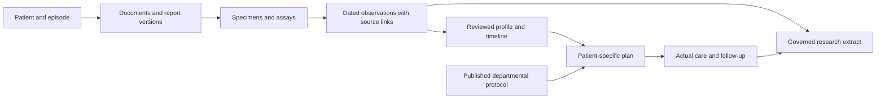

# Which oncology data to use, and how it changes the app

11 October 2026 · Research and planning only. No app code or fixtures changed.

## Recommendation

Start with **BeatAML2.0 for real AML research fields**, **a small GDC pathology sample for authentic report structure**, and **mCODE/FHIR plus ABDM for representation and exchange**. Build the complete operational journey with separately labelled, clinician-reviewed synthetic records. The public sources inspected do not supply the whole journey from referral through departmental approval and follow-up.

Two small public samples have already been downloaded and inspected:

- [BeatAML2.0 clinical workbook](samples/BeatAML2_research-specimen-clinical.xlsx): real specimen-level AML research data, including a dictionary and metadata. This inspected file contains **942 specimen rows, 95 fields and 805 distinct subject IDs**. It is the best starting point found for understanding AML data relationships.
- [Authentic GDC pathology report](samples/solid-tumor_TCGA-44-6147_pathology.pdf): a two-page, redacted **lung cancer** report with five labelled specimens. It shows genuine report structure but does not establish an AML reporting standard.

Their exact sources, versions, checksums, attribution and terms are in the [sample manifest](samples/README.md). They concern unrelated people and must never be joined into a single patient chart. [Beat AML source workbook](https://github.com/biodev/beataml2.0_data/blob/main/beataml_wv1to4_clinical.xlsx), [GDC source metadata](https://api.gdc.cancer.gov/files/709e6425-3cfe-4f28-b97b-edaaa6aa257a?expand=cases.project&pretty=true)

## Your concern about the reports is correct

The app's current fictional documents bundle marrow/molecular findings, clinical history and fitness into a small summary. A separate context document bundles preferences and logistics. That is sufficient for an interface demonstration, but it hides the origin and timing of information. A patient profile should summarize many sources; it should not dictate the shape of every source document. The [local workflow audit](../plans/oncology-department-journey/workflow-review.md) records the fixture and model evidence.

The real PDF makes the distinction tangible: its diagnoses and uncertainty apply to particular specimen parts, alongside different report sections. Beat AML adds a second lesson: several specimen records can belong to one person, with different collection offsets and findings. Neither should become a single timeless patient record.

The structure to implement is:

Keep negative, untested, pending, indeterminate, unreported and unavailable distinct. A gene label alone is not a complete molecular result: retain the reported finding, specimen, assay, date, value where present, interpretation and limitations. Keep lab-issued report status separate from our team's review status. These are representation requirements; they do not authorize the app to diagnose or select therapy. [FHIR DiagnosticReport](https://hl7.org/fhir/R4/diagnosticreport.html), [Observation](https://hl7.org/fhir/R4/observation.html), [mCODE genomics examples](https://hl7.org/fhir/us/mcode/examples_genomics.html)

## Dataset and reference comparison

| Resource | What it actually contains | Access and reuse | Fit for this app / principal gap |
|---|---|---|---|
| **BeatAML2.0** | Real AML research spreadsheet; subject and specimen IDs, collection offsets, phenotype, molecular/pathology fields and care/outcome summaries | Public repository, inspected licence CC BY 4.0; retain attribution and changes | **Use now for AML schema and missingness.** No complete EHR or serial report PDFs; summary treatment lists are not administrations |
| **GDC pathology reports** | Authentic released pathology PDFs linked to cancer cases; one lung example inspected | Inspected file is open; GDC/NIH policy applies, no per-file CC licence displayed | **Use now for source viewer/extraction design.** This sample is not AML and is not a complete clinical timeline |
| **TCGA-LAML in GDC** | AML case, diagnosis, biospecimen and some treatment/follow-up metadata; genomic datasets have varying access | Public metadata and open files; some molecular/clinical data controlled | Useful for case/specimen hierarchy and unknowns. Inspected clinical content sparse; scoped LAML + Pathology Report query returned zero on this date |
| **TCIA CMB-AML** | AML imaging, pathology slides and metadata, with registration-relative time alignment | Some images/metadata open under CC BY 4.0; complete clinical data and certain images controlled | Promising **later multimodal** dataset. Full clinical content not inspected; no narrative radiology-report corpus verified |
| **mCODE + FHIR** | Oncology representation profiles and authored examples | Public standards; terminology and package rights require their own checks | **Use now for representation.** A standard and examples, not a patient dataset or mandatory AML workup |
| **ABDM laboratory guide/examples** | Indian FHIR exchange structure linking report, observations, specimen, author and document | Public specification/examples; no blanket sample redistribution assessment made | Useful for India-facing interoperability. Example dates are not a coherent clinical journey |
| **Synthea** | Synthetic longitudinal encounters, results, conditions and care records | Generator Apache 2.0; official synthetic-data page permits broad secondary use and asks citation | Optional timeline/import scaffold. Advertised oncology example is breast cancer; not validated AML ground truth |
| **MIMIC-IV Demo / Note** | Demo: real deidentified structured hospital/ICU tables for 100 patients. Note: separate discharge/radiology corpus | Demo public ODbL 1.0; Note credentialed access, training and DUA | Optional later benchmarks. **Demo excludes clinical notes**; neither establishes a complete outpatient AML workflow |

Primary sources: [Beat AML and licence](https://github.com/biodev/beataml2.0_data), [GDC access](https://gdc.cancer.gov/access-data/data-access-processes-and-tools), [GDC policy](https://gdc.cancer.gov/access-data/data-access-policies), [TCGA-LAML](https://portal.gdc.cancer.gov/projects/TCGA-LAML), [CMB-AML](https://www.cancerimagingarchive.net/collection/cmb-aml/), [mCODE](https://hl7.org/fhir/us/mcode/), [ABDM laboratory profile](https://www.nrces.in/ndhm/fhir/r4/StructureDefinition-DiagnosticReportLab.html), [Synthea downloads](https://synthetichealth.github.io/downloads.html), [MIMIC Demo](https://physionet.org/content/mimic-iv-demo/2.2/), [MIMIC Note documentation](https://mimic.mit.edu/docs/iv/modules/note/).

CAP's current myeloid reporting template is a useful additional **clinical reference for discussion with a hematopathologist**, not a patient dataset. Public reading does not grant unrestricted electronic, commercial or AI incorporation. Do not copy its field dictionary into the product without the necessary rights. [CAP protocols and terms](https://www.cap.org/protocols-and-guidelines/cancer-protocols/current-cancer-protocols/)

## What to inspect first

### 1. Read the Beat AML dictionary before its patient rows

The downloaded workbook has `summary`, `dataDictionary` and `metaData` sheets. The inspected first two records share a subject ID but have different specimen IDs and collection offsets. Across the file, 108 subject IDs occur on multiple rows. This supports a subject-to-many-specimens relationship, not a claim that all intervening care is captured.

| Source concept observed | Proposed destination | Meaning to preserve |
|---|---|---|
| Subject identifier | Research subject identity, namespaced to dataset | No matching across studies based on resemblance |
| DNA/RNA sample identifiers and specimen type | Specimen and assay references | Several assay identifiers may relate to one collection; mapping must follow the dictionary |
| Collection-day offset | Relative clinical time with named anchor | Do not manufacture calendar dates |
| Disease context at collection | Dated source assertion / classification | Preserve historical framework and reported context |
| Blood counts, morphology and molecular fields | Source observations with specimen/window and units | Dictionary windows and sentinel values travel with the data |
| Cumulative regimen and most recent regimen | Attributed treatment-summary assertions | Do not infer orders, sequence, doses or administrations |
| Response and survival summaries | Defined research outcome variables | Preserve definitions, missingness and follow-up limits |

The workbook explicitly treats the cumulative regimen list as unordered. That is the clearest example of why importing a spreadsheet straight into a care timeline would create false information. Its historical classification fields must also retain their edition/context. These mappings are proposed product design, not a completed importer. [Workbook and dictionary](https://github.com/biodev/beataml2.0_data/blob/main/beataml_wv1to4_clinical.xlsx)

### 2. Compare the authentic report with our current fixture

Open the [saved PDF](samples/solid-tumor_TCGA-44-6147_pathology.pdf) and identify the specimen parts, report sections, source uncertainty and redactions. Ask whether every extracted finding could point back to the correct part and page. The current all-purpose summary cannot establish that coverage.

Use this sample to test preservation and review, not AML medical correctness. An image or slide from TCIA is a different source type from a signed narrative report; do not describe a generated image caption as an authentic clinical report. [GDC original](https://api.gdc.cancer.gov/data/709e6425-3cfe-4f28-b97b-edaaa6aa257a), [CMB-AML formats/access](https://www.cancerimagingarchive.net/collection/cmb-aml/)

### 3. Use standards to organize the records

The published mCODE guide inspected is **4.0.0 STU4**, based on **FHIR R4 4.0.1**. The actual genomics example references multiple specimens and observations; diagnostic and therapeutic implications remain distinct. mCODE represents supported concepts when shared; it is not a list of everything required for every patient. FHIR's report resource also does not represent the entire cumulative result history. [mCODE](https://hl7.org/fhir/us/mcode/), [genomics example](https://hl7.org/fhir/us/mcode/DiagnosticReport-gx-genomics-report-adam-anyperson.html), [DiagnosticReport](https://hl7.org/fhir/R4/diagnosticreport.html)

The ABDM published laboratory guide displayed version 6.5.0, based on R4. Its example provides useful links between resources but contains inconsistent illustrative dates. Copy its relationships for study, not its chronology as a gold-standard case. No conformance is claimed for the current app. [ABDM example](https://www.nrces.in/ndhm/fhir/r4/Bundle-DiagnosticReport-Lab-example-03.html)

### 4. Author the complete fictional episode separately

The [data specification](../plans/oncology-department-journey/report-and-data-specification.md) defines a 13-part source pack: referral, repeated blood results, marrow, flow, cytogenetics, molecular report, amendment, clinical assessment, patient discussion, plan/handoff, actual care, follow-up and concern/response. This is a demonstration pack for clinical review, not a prescribed workup.

Keep original inputs, expected extracted facts and expected workflow transitions in separate files. Include delayed and amended results, ambiguous specimen linkage, missing values, a patient-specific exception, partial care and missed follow-up. Use independently authored fictional people; never supplement a real Beat AML subject with invented encounters and label the combined chart real.

### 5. Validate with authorized local documents later

Public examples establish structural plausibility. Clinical coverage needs a permitted sample of actual hospital document families and staff workflows, with independent annotations and adjudication. Measure patient/specimen association, exact values/units/status/dates, source attribution, amendments, omissions and errors remaining after review. Report this separately from whether the software journey works.

Record dataset/version, file checksum, source, access basis, licence/policy, allowed purpose, identifiers, date anchors, transformations and retained uncertainty. Dataset availability does not establish permission for every redistribution or model-training use. A future research cohort also needs a defined question, inclusion criteria, variable definitions, lineage and reproducible extract; an exploratory association is not a causal treatment conclusion.

## What the research supports—and what it does not

| Hypothesis | Assessment | Remaining uncertainty |
|---|---|---|
| One public dataset can supply the complete proposed workflow | Not established in this bounded search; inspected sources cover different layers | Other datasets or institution partnerships may offer more |
| The report model must be separate from the patient summary | Strongly supported by inspected real report, workbook and standards | Exact fields and clinical completeness require the local laboratory/service |
| The current app can be extended without discarding provenance work | Supported by the local architecture audit; implementation proposed in master plan | Shared access, migration and integration need actual engineering validation |
| Synthetic cases can establish clinical extraction accuracy | Rejected | They establish expected behavior; real held-out documents need qualified annotation |

Adversarial check: Beat AML is research-curated and incomplete as an operational record; one lung PDF cannot establish AML layout diversity; standards examples can contain implausible chronology; a successful fictional journey does not prove staff adoption or clinical benefit. These limitations are why the plan separates structure, workflow demonstration and clinical evaluation.

## Evidence trail and refresh points

The dataset strand made five substantive searches, the standards strand five, and the parent one: **11 discovery queries**. Dataset search returned 59 entries, the first standards response 37, and the parent response 16; the second standards response was truncated, so an overall result count is not asserted. This guide cites **19 distinct external source URLs**, all primary dataset, policy, standard or official example pages; the source index groups the evidence into 15 entries. Discovery entries are not sources read. Primary-source inspection, query strings, access failures and limited downloads are recorded in the two findings reports and individual notes.

- [Dataset investigation and audit](findings_datasets.md)
- [Standards/document investigation and audit](findings_structure.md)
- [Source index](sources.csv)
- [Sample provenance and checksums](samples/README.md)
- [Refresh targets](refresh_targets.md)
- [Complete implementation plan](../plans/oncology-department-journey/implementation-plan.md)

All findings are as of 11 October 2026. Recheck dataset releases, availability and intended-use terms before acquisition beyond these samples; recheck standards/profile versions before implementation. No controlled data access was requested, no large cohort was downloaded and no patient data was uploaded to a model in this task.
